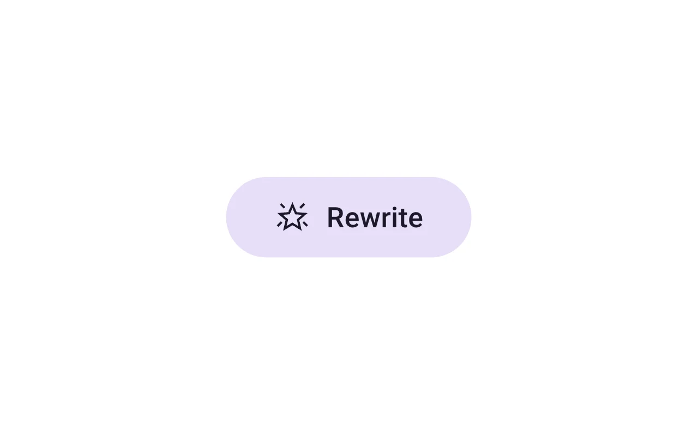
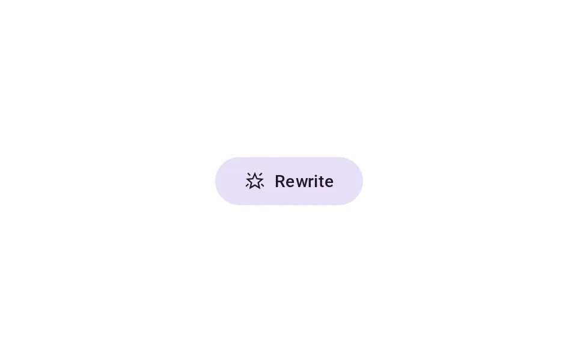
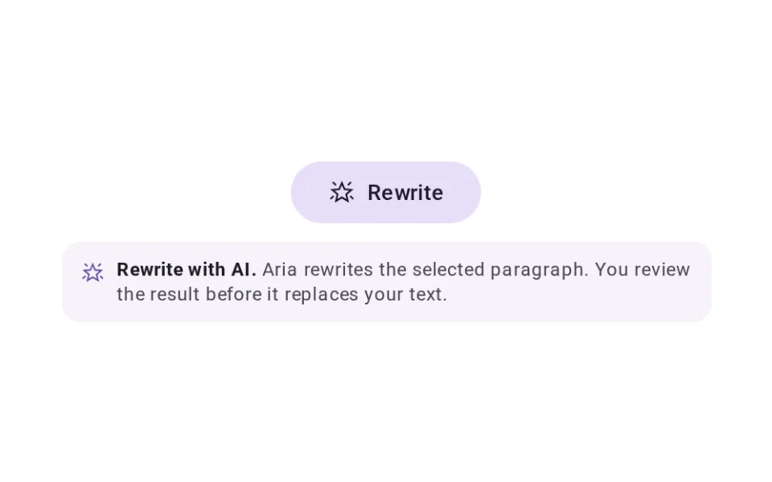
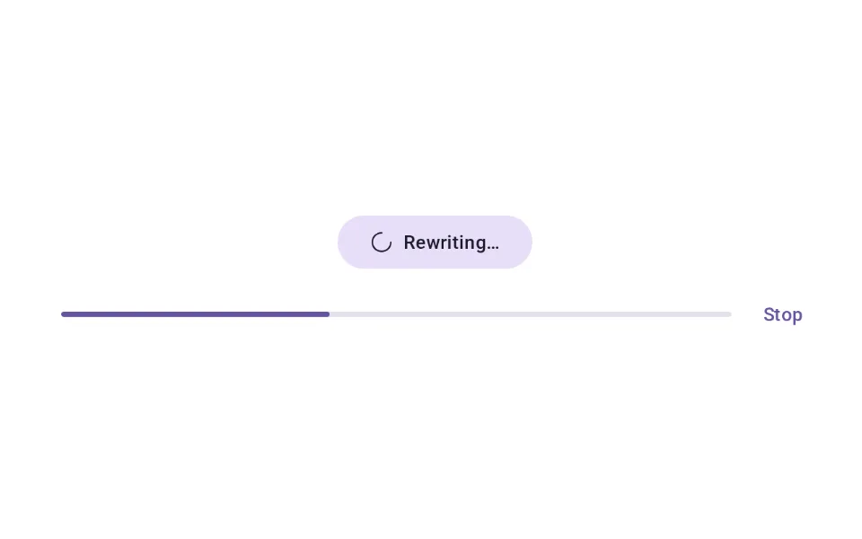
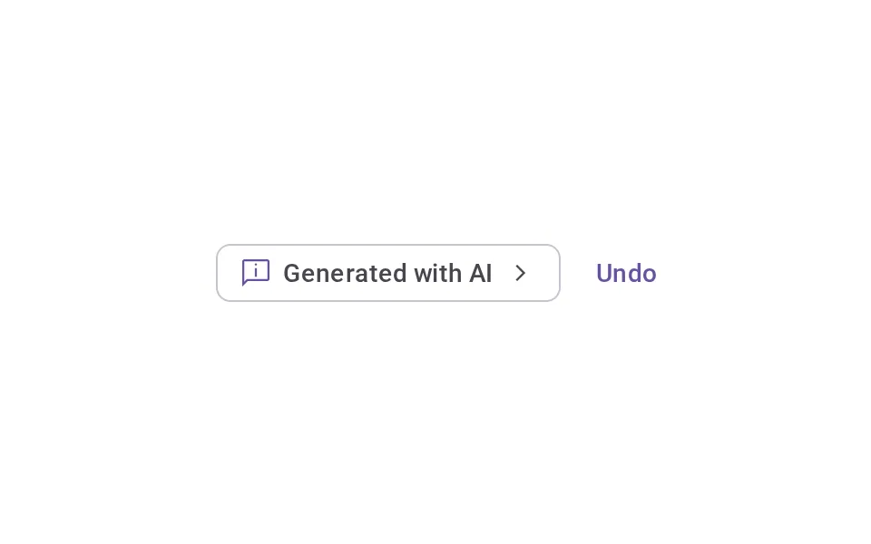
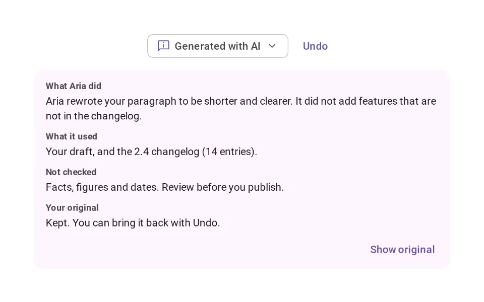

# Disclosure

**Onboarding › Trust & Disclosure** · id `disclosure` · API `AiDisclosure`

> Makes it clear where AI is involved — an AI action, an agent at work, or content AI produced — at the point it matters.

Open it: [material-pattern.html?id=disclosure](../../../../material-pattern.html?id=disclosure)

## Intent

Answers “where is AI involved here?” at the moment it matters: the action that will use AI says so before it runs, the agent’s work is visibly in progress, and what it produced is labelled where it sits — so people can judge it.

## When to use

**Use when:** Wherever AI acts on something a person owns or will rely on: a rewrite in an editor, a drafted reply, a generated summary, a filled field. Mark the action before it runs, the work while it runs, and the result for as long as it is on the page — including for the colleague who opens it later.

## Where the code lives

| Part | Location |
|---|---|
| Live Preview (states, customizer, code tab) | [`material-preview.js` L4624–4910](../../../../material-preview.js#L4624-L4910) |
| Simulator | [`material-sim.js` L1000–1162](../../../../material-sim.js#L1000-L1162) |
| Docs (intent, anatomy, usage) | [`material-patterns.js` L25–205](../../../../material-patterns.js#L25-L205) |
| Category CSS block | [`material-pattern.html` TDX-START (L7696)](../../../../material-pattern.html#L7696) |
| Sidebar entry | [`material-nav.js`](../../../../material-nav.js) |
| Tests | [`disc.js`](../../../../_tests/suites/disc.js), [`onb.js`](../../../../_tests/suites/onb.js) |

## Nucleux packages

- `@nucleux/ai-disclosure`
- `@nucleux/md3-button`
- `@nucleux/md3-card`
- `@nucleux/md3-chip`
- `@nucleux/md3-icon-button`
- `@nucleux/md3-progress`
- `@nucleux/tokens`

## States (5)

### 01 · Resting _(initial)_

| | |
|---|---|
| Key | `resting` |
| Trigger | Nothing has been chosen for AI to act on yet. |
| Behaviour | The AI action control: the AI action mark and its verb. Nothing is labelled — AI has not done anything yet. |
| Meaning | Nothing here came from AI. The one control that would use it is recognisable. |
| Action | Press Rewrite to choose what it applies to. |
| Next | AI action available |

### 02 · AI action available

| | |
|---|---|
| Key | `action` |
| Trigger | Something is selected, so Rewrite now applies to it. |
| Behaviour | Rewrite becomes available and says, in words, what it will do and that nothing is replaced until they review it. |
| Meaning | Pressing Rewrite asks AI to change the selection — before anything has happened. |
| Action | Press Rewrite, or keep editing by hand. |
| Next | AI working |

### 03 · AI working

| | |
|---|---|
| Key | `working` |
| Trigger | Rewrite was pressed. |
| Behaviour | The action mark becomes the working mark and the button reads “Rewriting…”. Progress and Stop sit with it, and a screen reader hears “Agent working”. Nothing changes until the result arrives. |
| Meaning | The agent is doing it now. This is not the result yet. |
| Action | Wait, or Stop. |
| Next | AI-generated content |

### 04 · AI-generated content

| | |
|---|---|
| Key | `generated` |
| Trigger | The rewrite came back. |
| Behaviour | The “Generated with AI” label, attached to the content it describes, with Undo. |
| Meaning | This content was written by AI — and it has not been checked. |
| Action | Open the label for details, keep editing, or Undo. |
| Next | Additional details |

### 05 · Additional details

| | |
|---|---|
| Key | `details` |
| Trigger | The label was pressed. |
| Behaviour | The label opens a panel in place: what Aria did, what it used, what it did not check, and that the original is kept. No model names or pipeline detail. |
| Meaning | What the agent did, in terms they can judge without technical knowledge. |
| Action | Show the original, close the details, or Undo. |
| Next | AI-generated content |

## Simulator

A release note three people wrote. Ask Aria to rewrite your paragraph and watch the three meanings stay apart: the action says what it will do, the working state says it is doing it, and the result says it came from AI — then open the document as the reviewer and check the label is still there.

---

_Generated by `_build/catalog/make.js` — do not edit by hand; change the pattern and re-run._
