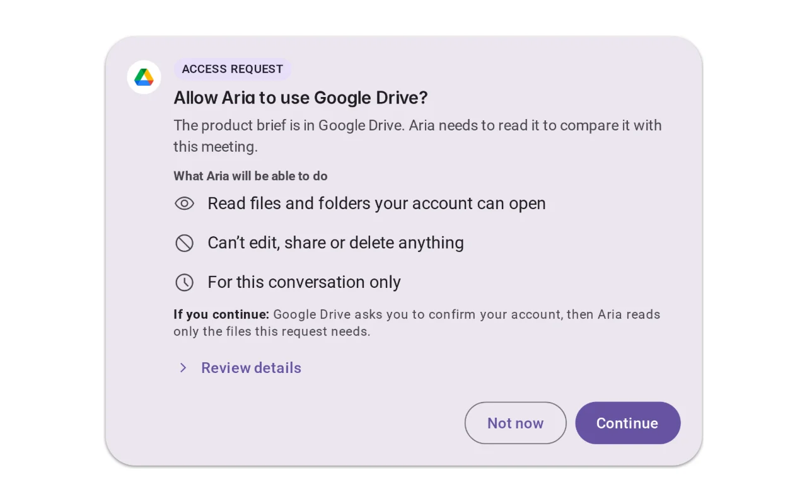
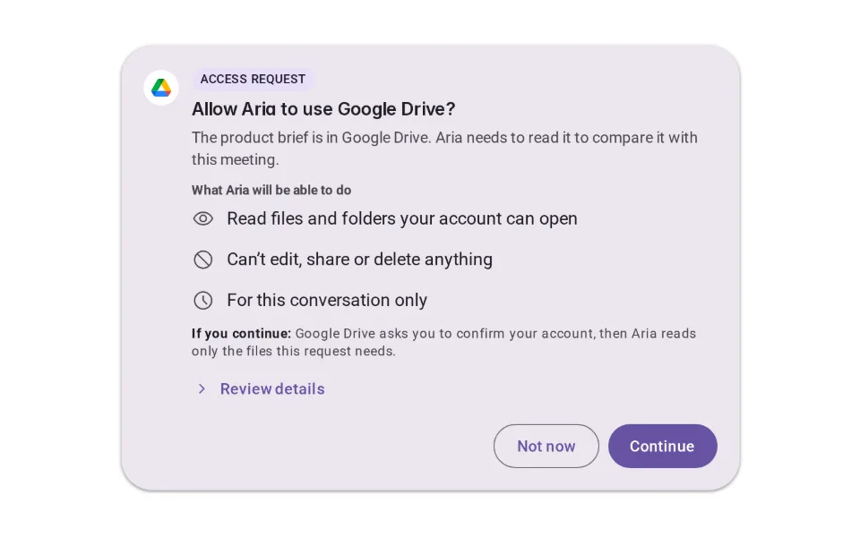
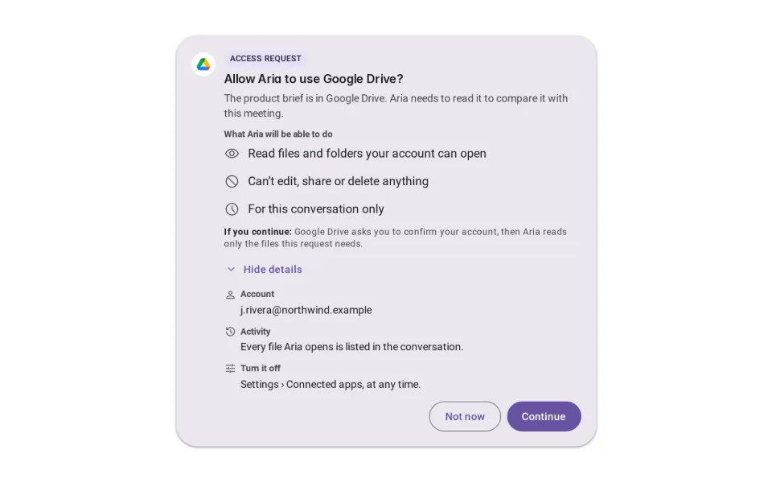
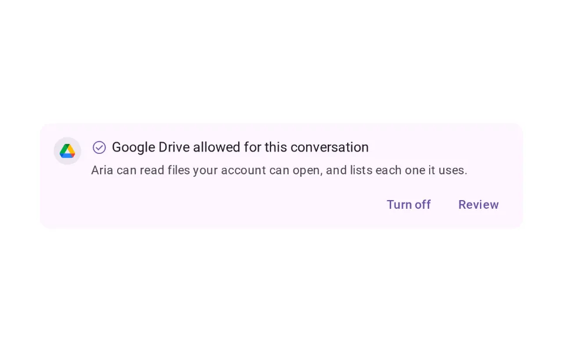
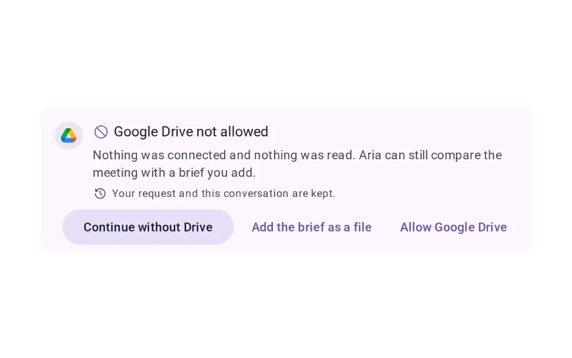
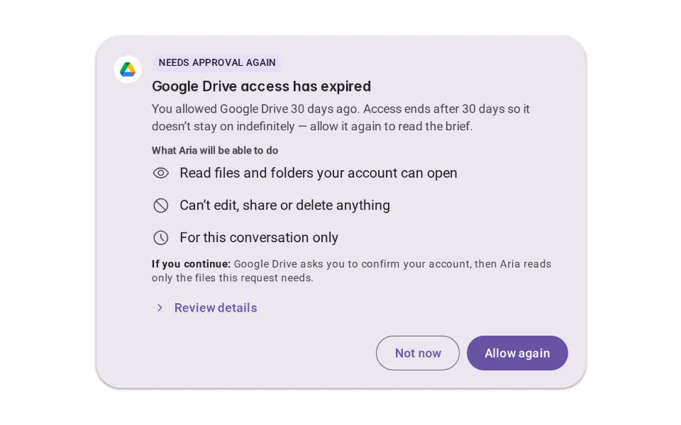
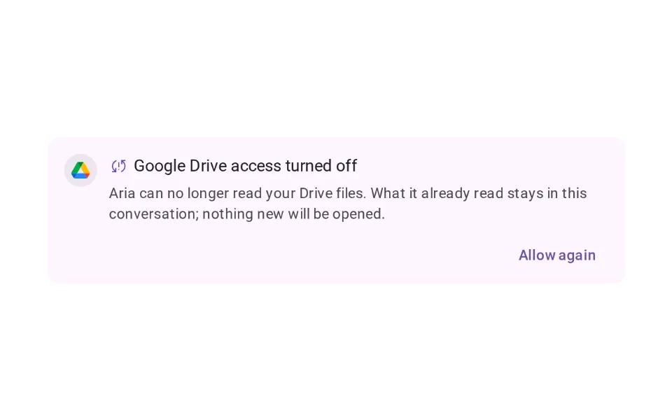

# Consent

**Onboarding › Trust & Disclosure** · id `consent` · API `Md3ActionConfirmation`

> Asks before the agent accesses something sensitive or takes an important action — what, why, the scope, and two real choices.

Open it: [material-pattern.html?id=consent](../../../../material-pattern.html?id=consent)

## Intent

Answers “do I want to allow the agent to do this?” at the moment access or an action is needed — with what is asked, why this task needs it, exactly what it covers, and two real choices. Nothing happens before the answer, and no answer costs the person their work.

## When to use

**Use when:** Before the agent reads data it was not given, before an action others will see or that is hard to undo, and before a permission outlives the conversation. Ask again only when something changed — it expired, or the thing being approved is different — and say why.

## Where the code lives

| Part | Location |
|---|---|
| Live Preview (states, customizer, code tab) | [`material-preview.js` L4928–5202](../../../../material-preview.js#L4928-L5202) |
| Simulator | [`material-sim.js` L585–798](../../../../material-sim.js#L585-L798) |
| Docs (intent, anatomy, usage) | [`material-patterns.js` L210–312](../../../../material-patterns.js#L210-L312) |
| Category CSS block | [`material-pattern.html` TDX-START (L7696)](../../../../material-pattern.html#L7696) |
| Sidebar entry | [`material-nav.js`](../../../../material-nav.js) |
| Tests | [`onb.js`](../../../../_tests/suites/onb.js) |

## Nucleux packages

- `@nucleux/md3-action-confirmation`
- `@nucleux/md3-button`
- `@nucleux/md3-card`
- `@nucleux/md3-checkbox`
- `@nucleux/md3-list`
- `@nucleux/tokens`

## States (6)

### 01 · Consent required _(initial)_

| | |
|---|---|
| Key | `required` |
| Trigger | The agent reached something it may not do without permission. |
| Behaviour | Work pauses at that step. The request names what is asked, why this task needs it, the scope, and what happens next — with two choices of equal size. Nothing is preselected. |
| Meaning | Nothing has been accessed or done. It is waiting for them. |
| Action | Continue, Not now, or review the details first. |
| Next | Approved, Denied, or Reviewing access |

### 02 · Reviewing access

| | |
|---|---|
| Key | `reviewing` |
| Trigger | Review details was pressed. |
| Behaviour | The request opens in place: the account, where activity is shown, and how to turn it off later. The choices stay where they were. |
| Meaning | Exactly what they are agreeing to, before they agree. |
| Action | Decide. |
| Next | Approved or Denied |

### 03 · Approved

| | |
|---|---|
| Key | `approved` |
| Trigger | They chose to allow it. |
| Behaviour | A short confirmation replaces the request: what was allowed, for how long, and where to take it back. The task continues. |
| Meaning | Permission was given — only what was shown. |
| Action | Carry on, review it, or turn it off. |
| Next | The task continues · Revoked · Expired |

### 04 · Denied

| | |
|---|---|
| Key | `denied` |
| Trigger | They chose Not now. |
| Behaviour | Nothing is accessed or done. Their request and the conversation are kept, and the product offers another way to continue. |
| Meaning | No was a real answer, and the rest of the product still works. |
| Action | Continue without it, use another source, or allow it after all. |
| Next | The task continues without it |

### 05 · Expired

| | |
|---|---|
| Key | `expired` |
| Trigger | Permission given earlier no longer applies. |
| Behaviour | The request comes back with the reason it is being asked again — time, or what changed — rather than as if it were the first time. |
| Meaning | Why they are being asked again, so the repeat is not noise. |
| Action | Allow again, or not. |
| Next | Approved or Denied |

### 06 · Revoked

| | |
|---|---|
| Key | `revoked` |
| Trigger | They turned the permission off. |
| Behaviour | Access stops at once. What was already read or done is stated plainly; nothing new happens until they allow it again. |
| Meaning | They are back in control, and they can see where things stand. |
| Action | Allow again later, if they want to. |
| Next | Consent required, the next time it is needed |

## Simulator

The request is ordinary; the permission is a consequence of it. Send it, and the agent stops at the one step it is not allowed to take. Continue and Not now both lead somewhere useful.

---

_Generated by `_build/catalog/make.js` — do not edit by hand; change the pattern and re-run._
