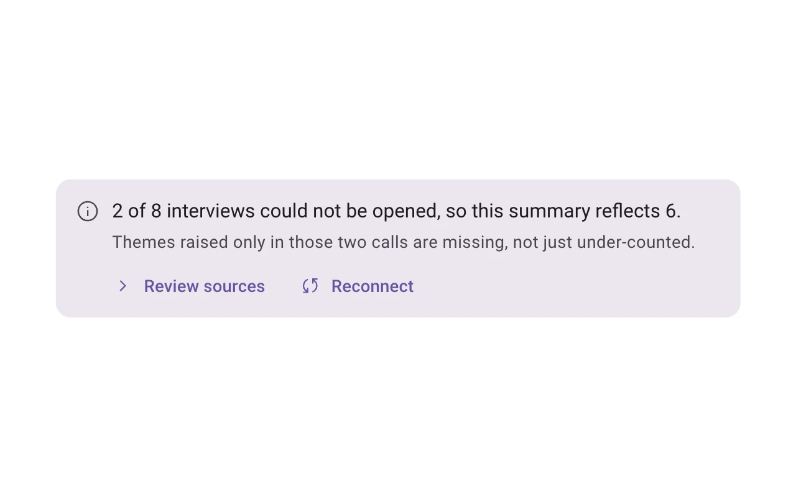
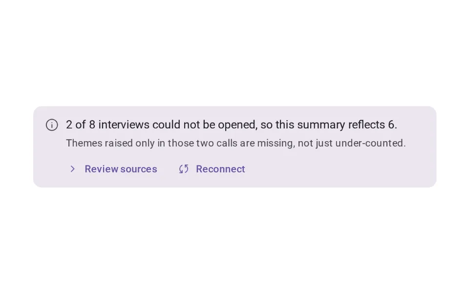
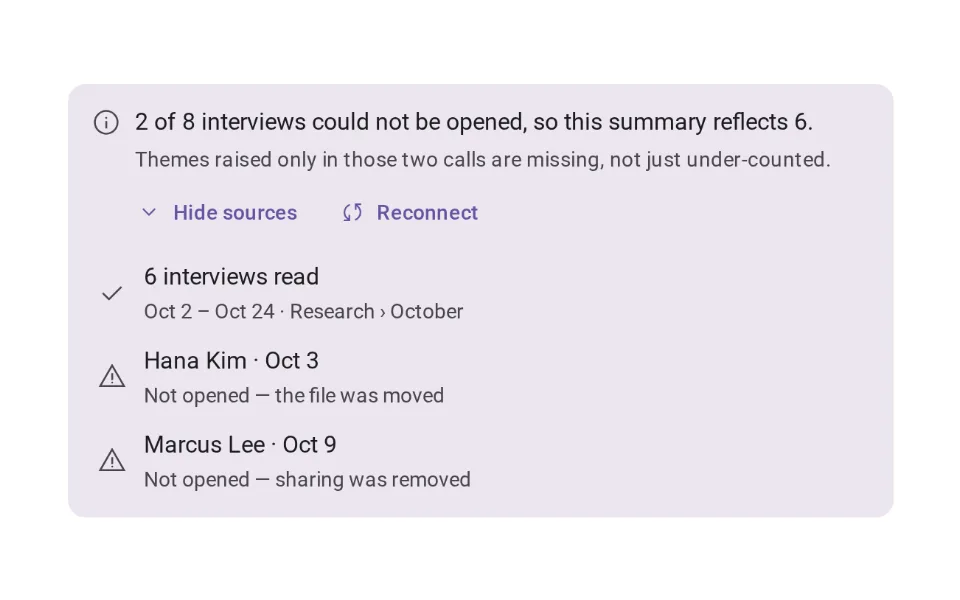
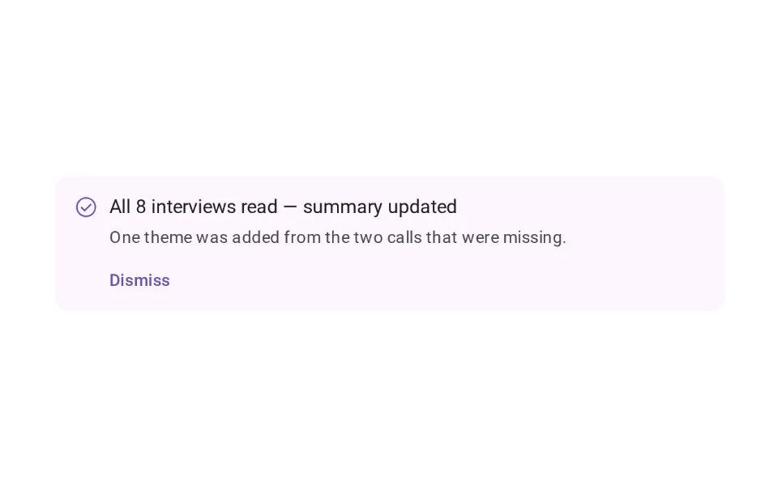
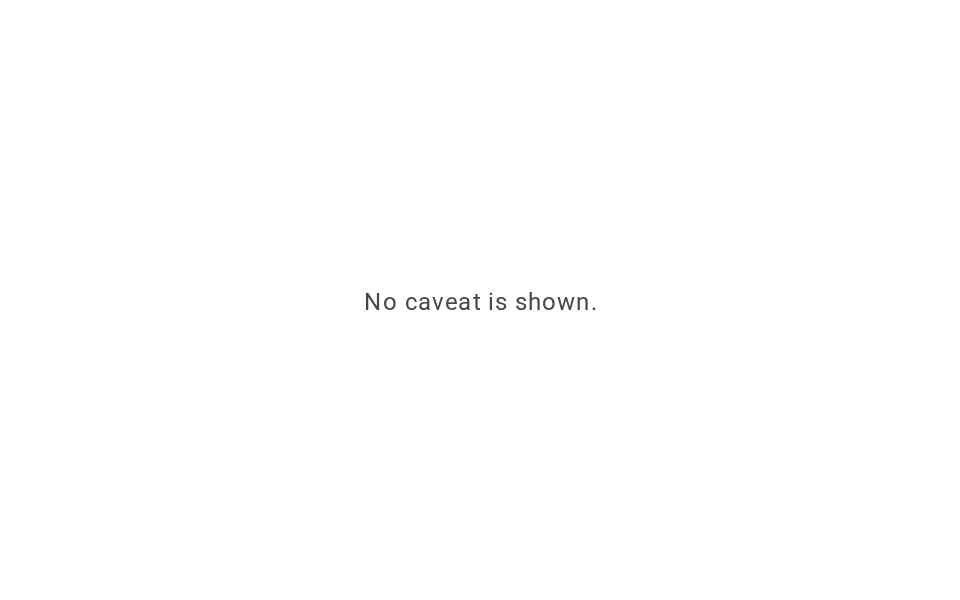

# Caveat

**Onboarding › Trust & Disclosure** · id `caveat` · API `AiCaveat`

> Says what is incomplete, uncertain or out of date about this result — attached to it, with a next step.

Open it: [material-pattern.html?id=caveat](../../../../material-pattern.html?id=caveat)

## Intent

Answers “what should I be careful about with this result?” — specifically, attached to the result it qualifies, with why it matters and what to do next. It appears only when there is a real limitation and leaves when the reason for it is gone.

## When to use

**Use when:** When something about this result is meaningfully incomplete, uncertain, out of date or limited, and that changes how far it can be relied on. Not on results the product can stand behind, and never as a standing disclaimer.

## Where the code lives

| Part | Location |
|---|---|
| Live Preview (states, customizer, code tab) | [`material-preview.js` L5217–5459](../../../../material-preview.js#L5217-L5459) |
| Simulator | [`material-sim.js` L1176–1350](../../../../material-sim.js#L1176-L1350) |
| Docs (intent, anatomy, usage) | [`material-patterns.js` L317–393](../../../../material-patterns.js#L317-L393) |
| Category CSS block | [`material-pattern.html` TDX-START (L7696)](../../../../material-pattern.html#L7696) |
| Sidebar entry | [`material-nav.js`](../../../../material-nav.js) |
| Tests | [`onb.js`](../../../../_tests/suites/onb.js) |

## Nucleux packages

- `@nucleux/ai-disclosure`
- `@nucleux/md3-button`
- `@nucleux/md3-card`
- `@nucleux/md3-list`
- `@nucleux/md3-progress`
- `@nucleux/tokens`

## States (5)

### 01 · No caveat needed

| | |
|---|---|
| Key | `none` |
| Trigger | Every source was read and nothing about the result is in doubt. |
| Behaviour | The result on its own. No empty notice, no standing “AI can make mistakes” line. |
| Meaning | There is nothing specific to be careful about. |
| Action | Use the result. |
| Next | — |

### 02 · Caveat visible _(initial)_

| | |
|---|---|
| Key | `visible` |
| Trigger | Two of the eight interviews could not be opened. |
| Behaviour | One note at the foot of the summary it qualifies: what is missing, why it matters, and what to do. Calm tokens, not the error colour. The summary stays — nothing was removed because it is incomplete. |
| Meaning | This summary reflects 6 of 8 interviews and may miss something. |
| Action | Review sources, or reconnect the missing ones. |
| Next | Details expanded, or Resolved |

### 03 · Details expanded

| | |
|---|---|
| Key | `expanded` |
| Trigger | Review sources was pressed. |
| Behaviour | The note opens in place to list what was read and what was not, each with its reason. |
| Meaning | Exactly which inputs are behind the result, and which are not. |
| Action | Reconnect, or close. |
| Next | Resolved |

### 04 · User resolves the issue

| | |
|---|---|
| Key | `resolved` |
| Trigger | They reconnected the folder and Aria re-read the missing interviews. |
| Behaviour | The note becomes a short confirmation of what changed — all 8 read, one theme added — and the new line is marked in the summary. |
| Meaning | The gap is closed, and they can see what it changed. |
| Action | Read the update, then dismiss it. |
| Next | No longer relevant |

### 05 · Caveat no longer relevant

| | |
|---|---|
| Key | `gone` |
| Trigger | The reason for the caveat is gone. |
| Behaviour | The caveat leaves with its reason. The summary stands on its own, now from all eight. |
| Meaning | Nothing about this result needs special care any more. |
| Action | Use the result. |
| Next | — |

## Simulator

Limitation → explanation → recovery → resolution. Ask for the summary; two interviews will not open, and the caveat says exactly that — then reconnect them and watch it go. Compare it with the generic line.

---

_Generated by `_build/catalog/make.js` — do not edit by hand; change the pattern and re-run._
