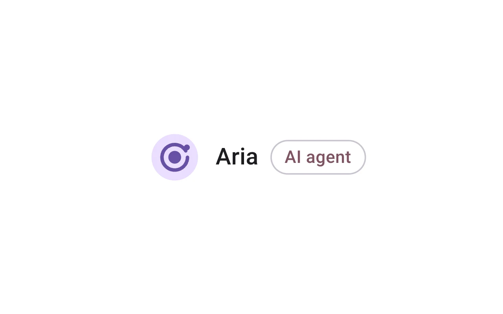
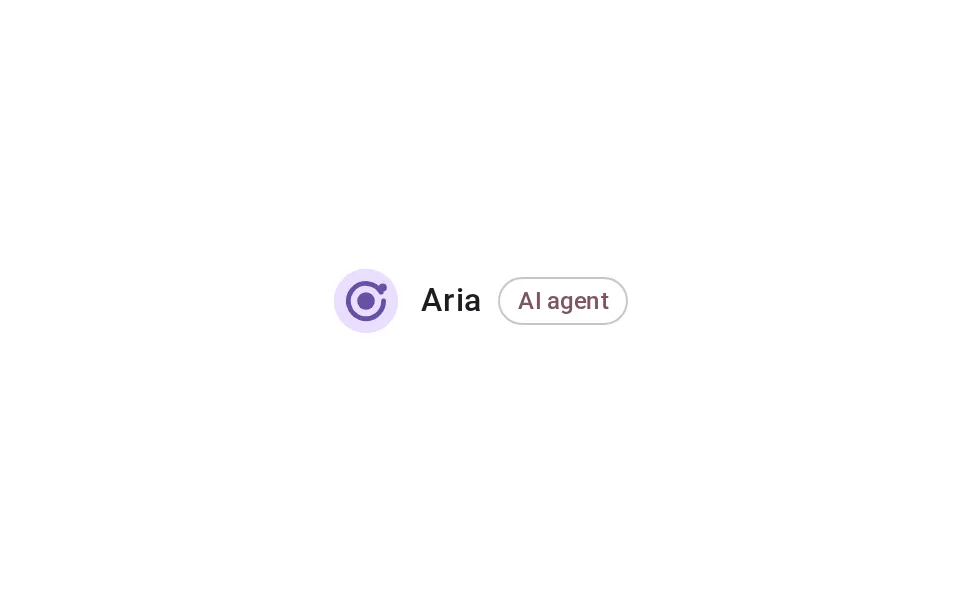
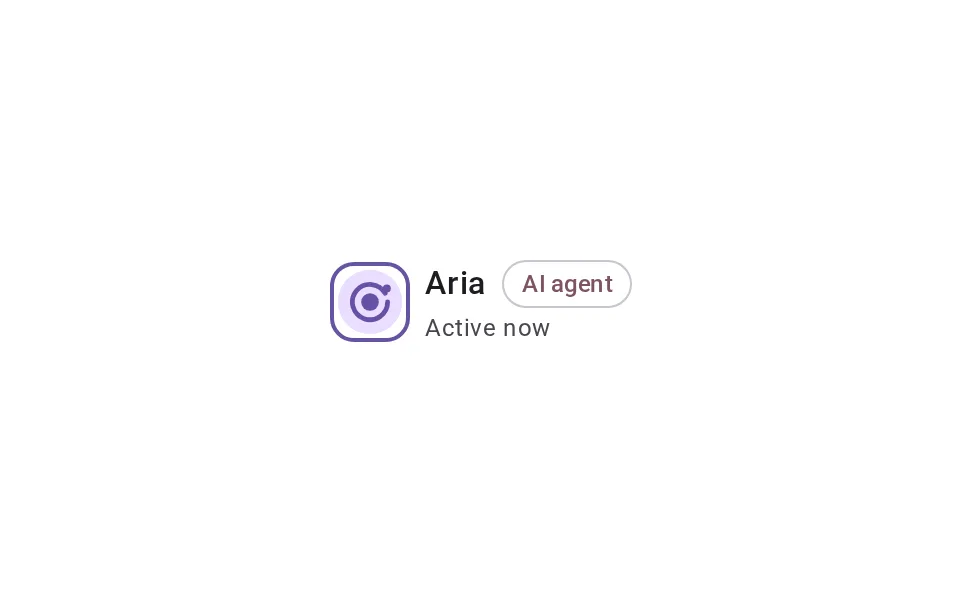
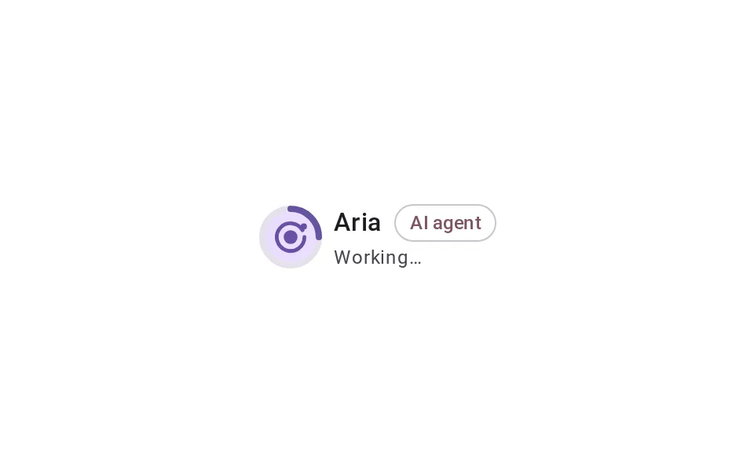
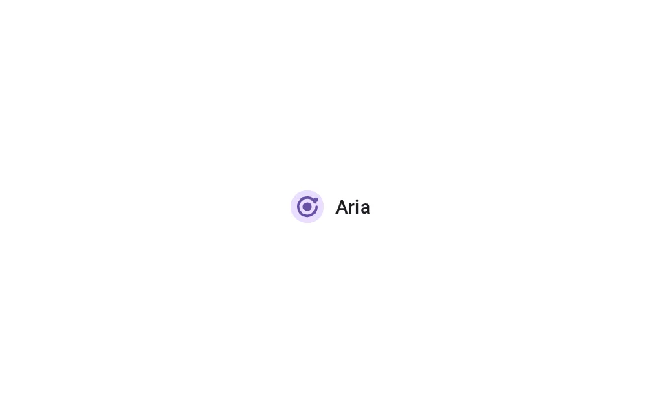
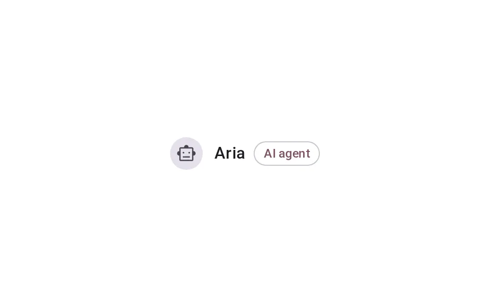

# Avatar

**Onboarding › Identity** · id `avatar` · API `Avatar`

> One mark for the agent on every surface — never mistakable for a person, with its working state on the mark itself.

Open it: [material-pattern.html?id=avatar](../../../../material-pattern.html?id=avatar)

## Intent

Answers “is that the agent, and is it doing something?” at a glance — in a meeting, a message, a list or a chip — without relying on colour, motion or a face.

## When to use

**Use when:** Anywhere the agent appears or acts next to people: meeting participants, messages, notifications, activity, mentions and the composer chip that addresses it.

## Where the code lives

| Part | Location |
|---|---|
| Live Preview (states, customizer, code tab) | [`material-preview.js` L5462–5629](../../../../material-preview.js#L5462-L5629) |
| Simulator | [`material-sim.js` L1363–1449](../../../../material-sim.js#L1363-L1449) |
| Docs (intent, anatomy, usage) | [`material-patterns.js` L397–537](../../../../material-patterns.js#L397-L537) |
| Category CSS block | [`material-pattern.html` IDV-START (L7939)](../../../../material-pattern.html#L7939) |
| Sidebar entry | [`material-nav.js`](../../../../material-nav.js) |
| Tests | [`onb.js`](../../../../_tests/suites/onb.js) |

## Nucleux packages

- `@nucleux/ai-disclosure`
- `@nucleux/avatar`
- `@nucleux/md3-button`
- `@nucleux/md3-list`
- `@nucleux/md3-message`
- `@nucleux/md3-progress`
- `@nucleux/md3-theme`
- `@nucleux/tokens`

## States (5)

### 01 · Resting _(initial)_

| | |
|---|---|
| Key | `resting` |
| Trigger | The agent is present and idle. |
| Behaviour | The agent avatar (rounded square, agent role), its name and “AI agent”. No ring, no motion. |
| Meaning | The agent is here and available. |
| Action | — |
| Next | Active, or Working |

### 02 · Active

| | |
|---|---|
| Key | `active` |
| Trigger | The agent is engaged — listening, or assigned. |
| Behaviour | A still outline ring in md-primary around the same avatar, and the words “Active now”. |
| Meaning | The agent is engaged right now. |
| Action | — |
| Next | Working |

### 03 · Working

| | |
|---|---|
| Key | `working` |
| Trigger | The agent is doing something. |
| Behaviour | Md3CircularProgress turns around the same avatar, with “Working…” beside it. The mark itself does not change. |
| Meaning | The agent is working now. |
| Action | — |
| Next | Active |

### 04 · Compact

| | |
|---|---|
| Key | `compact` |
| Trigger | Space is tight: a list row, a chip, a notification. |
| Behaviour | The same mark at 24 — same shape, same container — with the name beside it. |
| Meaning | The same agent, in less space. |
| Action | — |
| Next | — |

### 05 · Fallback

| | |
|---|---|
| Key | `fallback` |
| Trigger | The approved image did not load. |
| Behaviour | The package fallback: the agent glyph on muted (or initials on brand). Shape and accessible label stay. |
| Meaning | Still the agent — only the picture is missing. |
| Action | — |
| Next | — |

## Simulator

A meeting with two people and an agent. Ask Aria for a summary and watch its mark: it rings while it works, and it never looks like Maya or Jordan. Then break the image, or draw Aria like a person, and compare.

---

_Generated by `_build/catalog/make.js` — do not edit by hand; change the pattern and re-run._
