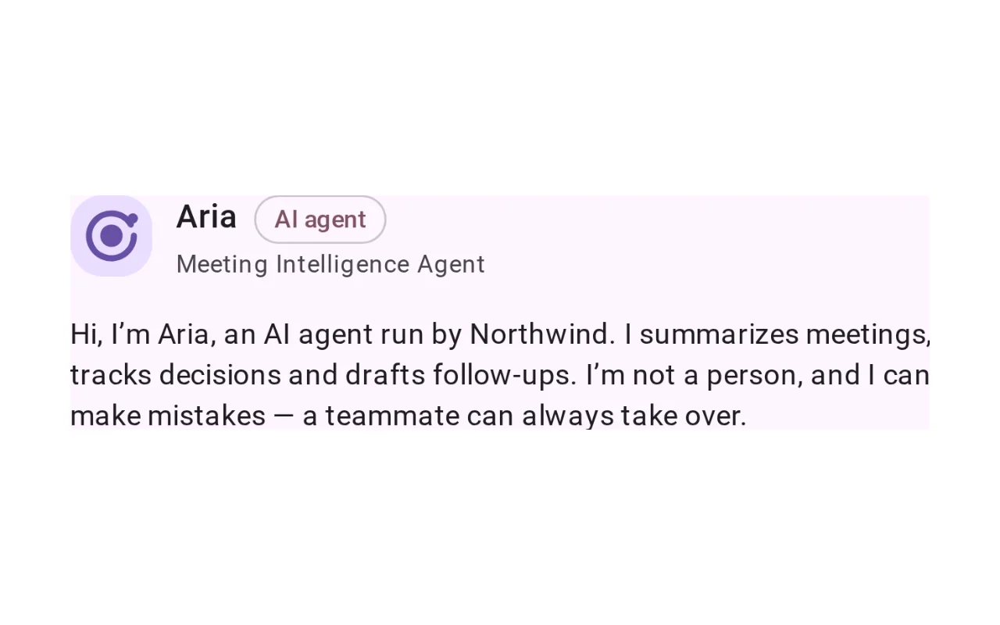
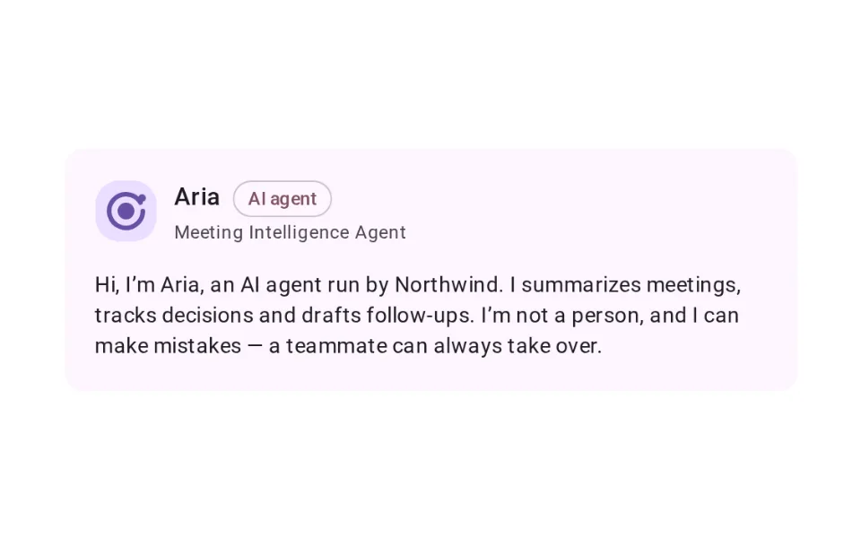
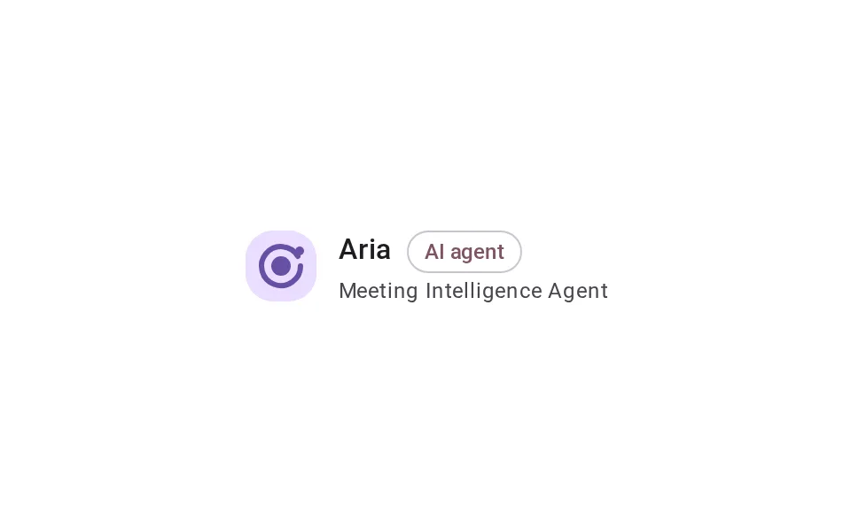
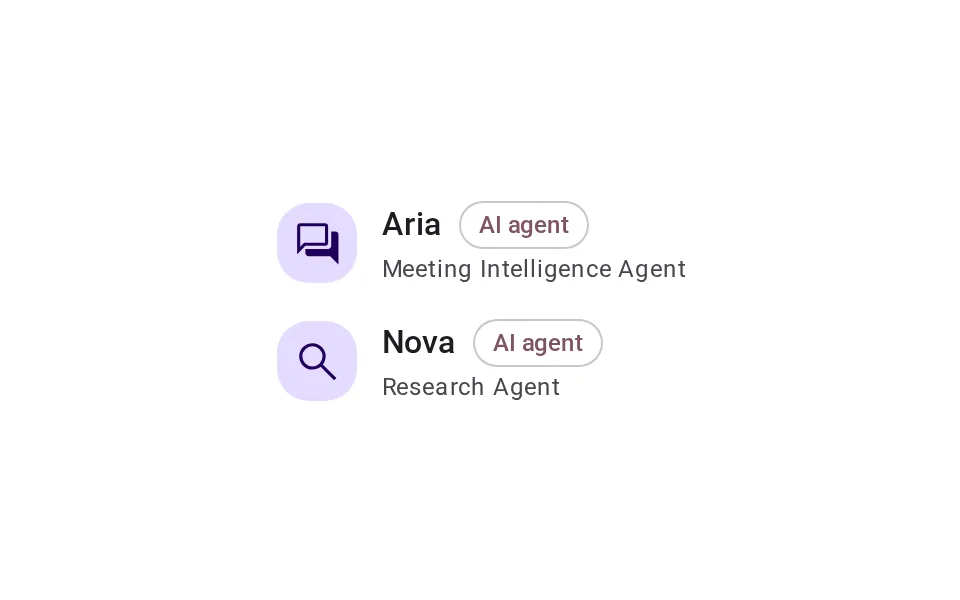
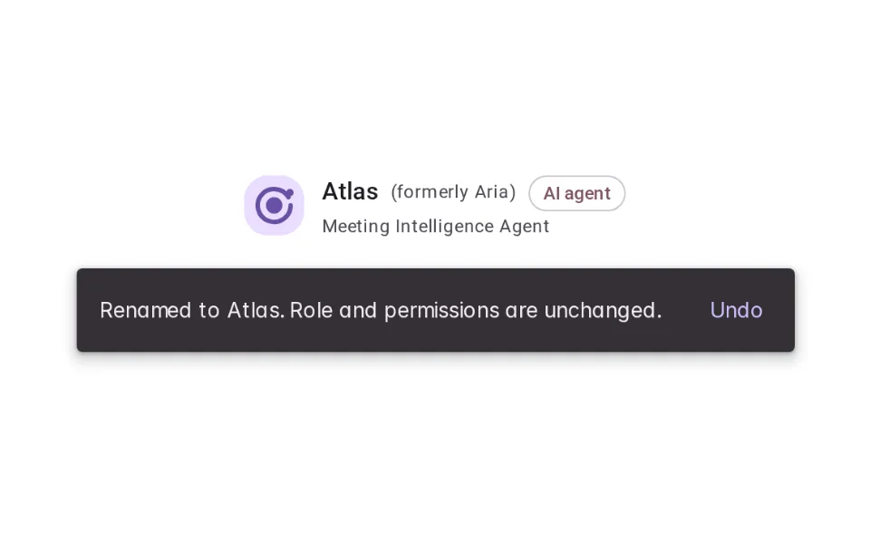

# Name

**Onboarding › Identity** · id `name` · API `AgentIdentity`

> A short, consistent name and role for the agent — the same on every surface, never a real person’s name.

Open it: [material-pattern.html?id=name](../../../../material-pattern.html?id=name)

## Intent

Answers “who am I talking to, and what is it for?” — with a name people can say and refer to, a role that says what it does, and an introduction that says it is AI and who runs it.

## When to use

**Use when:** Whenever the agent is a participant people address or refer to — not for a single feature button.

## Where the code lives

| Part | Location |
|---|---|
| Live Preview (states, customizer, code tab) | [`material-preview.js` L5632–5825](../../../../material-preview.js#L5632-L5825) |
| Simulator | [`material-sim.js` L1463–1534](../../../../material-sim.js#L1463-L1534) |
| Docs (intent, anatomy, usage) | [`material-patterns.js` L542–629](../../../../material-patterns.js#L542-L629) |
| Category CSS block | [`material-pattern.html` IDV-START (L7939)](../../../../material-pattern.html#L7939) |
| Sidebar entry | [`material-nav.js`](../../../../material-nav.js) |
| Tests | [`onb.js`](../../../../_tests/suites/onb.js) |

## Nucleux packages

- `@nucleux/ai-disclosure`
- `@nucleux/avatar`
- `@nucleux/md3-button`
- `@nucleux/md3-card`
- `@nucleux/md3-list`
- `@nucleux/md3-message`
- `@nucleux/md3-snackbar`
- `@nucleux/md3-text-field`
- `@nucleux/tokens`

## States (5)

### 01 · Introduced _(initial)_

| | |
|---|---|
| Key | `introduced` |
| Trigger | The agent appears for the first time. |
| Behaviour | Avatar, name, role and “AI agent”, then one sentence: who runs it, what it does, and that it is not a person. |
| Meaning | This is Aria, an AI agent, and this is what it is for. |
| Action | — |
| Next | Standard |

### 02 · Standard

| | |
|---|---|
| Key | `standard` |
| Trigger | Anywhere the agent is named with room to spare. |
| Behaviour | The avatar with the name and the role beside it, in the same words as the introduction. |
| Meaning | This is Aria. |
| Action | — |
| Next | Compact, or Name updated |

### 03 · Compact

| | |
|---|---|
| Key | `compact` |
| Trigger | A chip, a notification, an activity line. |
| Behaviour | The name alone (or name · role) at 24 with the mark. The accessible name still includes the role. |
| Meaning | The same agent, briefly. |
| Action | — |
| Next | — |

### 04 · Multiple agents

| | |
|---|---|
| Key | `multiple` |
| Trigger | More than one agent in the same product. |
| Behaviour | Each has its own name, role and glyph, so they are told apart by more than colour. |
| Meaning | Which agent is which. |
| Action | — |
| Next | — |

### 05 · Name updated

| | |
|---|---|
| Key | `updated` |
| Trigger | An admin renamed the agent. |
| Behaviour | The new name with “formerly Aria” beside it, and an Md3Snackbar saying the role and permissions did not change — with Undo. |
| Meaning | Same agent, new name. Nothing else changed. |
| Action | Keep it, or undo. |
| Next | Standard |

## Simulator

The same agent in the chat, the activity log and the email it sends. Ask a question, then rename it as an admin — or switch on inconsistent naming and see three products where there is one agent.

---

_Generated by `_build/catalog/make.js` — do not edit by hand; change the pattern and re-run._
