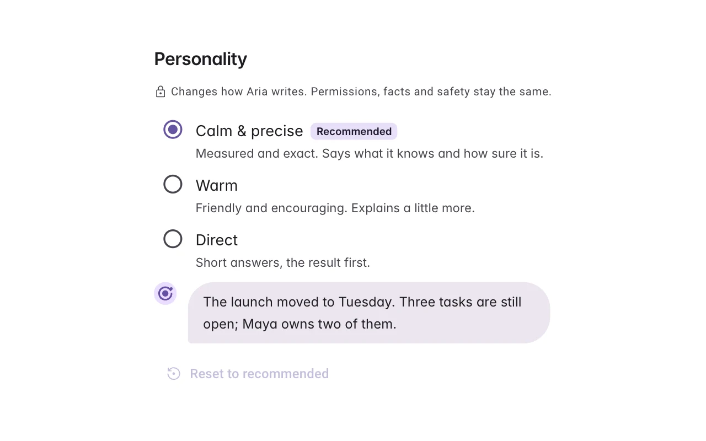
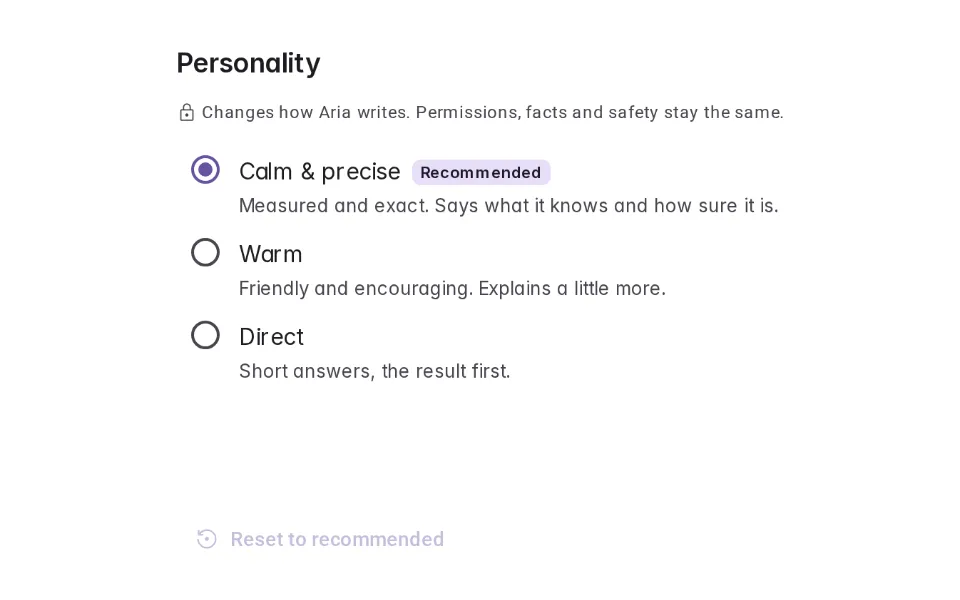
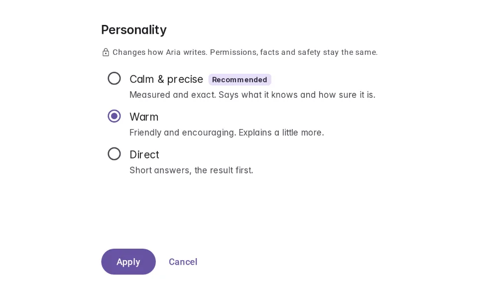
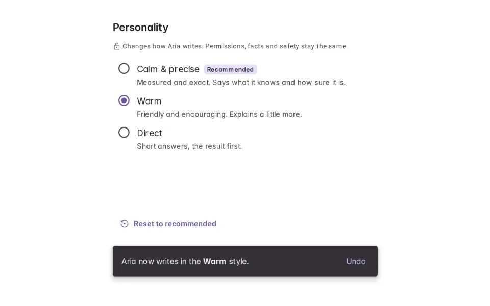
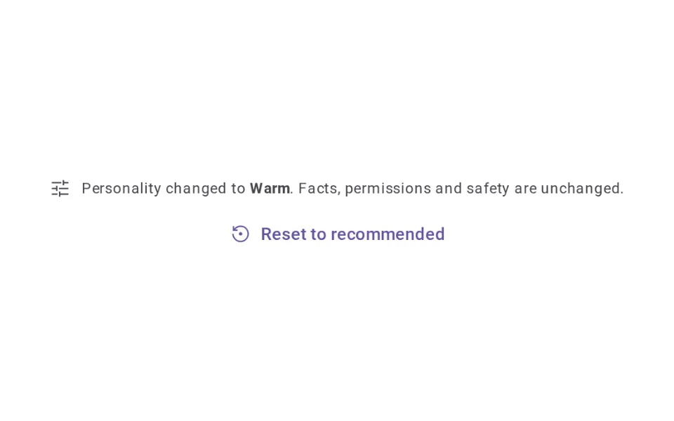
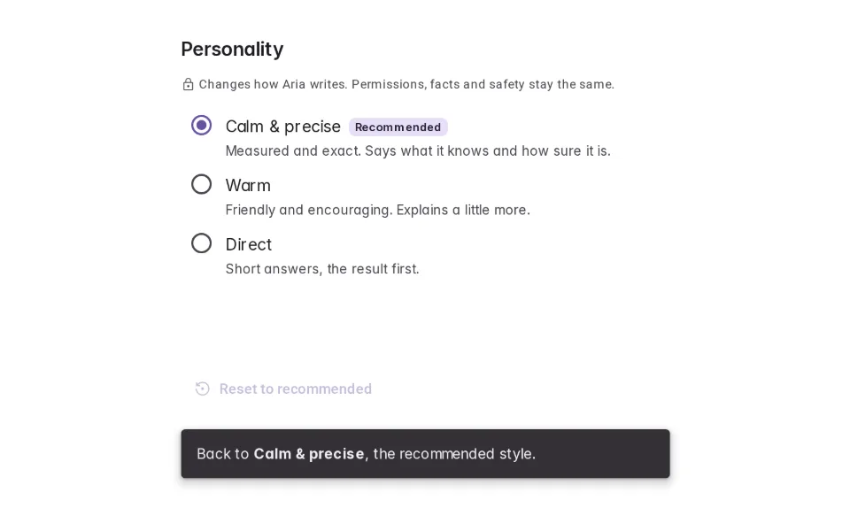

# Personality

**Onboarding › Identity** · id `personality` · API `PersonalitySetting`

> Lets people choose how the agent writes — with a preview — while permissions, facts and safety language stay exactly the same.

Open it: [material-pattern.html?id=personality](../../../../material-pattern.html?id=personality)

## Intent

Answers “how will this sound, and what will it not change?” — a small set of writing styles, previewed on the same messages before applying, with the trust language fixed in every one.

## When to use

**Use when:** When people spend long stretches with the agent and its default voice may not suit them. Not as a persona or a character that claims to be a person, and not in regulated output where tone reads as opinion.

## Where the code lives

| Part | Location |
|---|---|
| Live Preview (states, customizer, code tab) | [`material-preview.js` L5828–6030](../../../../material-preview.js#L5828-L6030) |
| Simulator | [`material-sim.js` L1548–1598](../../../../material-sim.js#L1548-L1598) |
| Docs (intent, anatomy, usage) | [`material-patterns.js` L634–728](../../../../material-patterns.js#L634-L728) |
| Category CSS block | [`material-pattern.html` IDV-START (L7939)](../../../../material-pattern.html#L7939) |
| Sidebar entry | [`material-nav.js`](../../../../material-nav.js) |
| Tests | [`onb.js`](../../../../_tests/suites/onb.js) |

## Nucleux packages

- `@nucleux/ai-disclosure`
- `@nucleux/md3-action-confirmation`
- `@nucleux/md3-button`
- `@nucleux/md3-list`
- `@nucleux/md3-message`
- `@nucleux/md3-radio`
- `@nucleux/md3-segmented-button`
- `@nucleux/md3-snackbar`
- `@nucleux/tokens`

## States (5)

### 01 · Default _(initial)_

| | |
|---|---|
| Key | `default` |
| Trigger | The personality setting, first visit. |
| Behaviour | The recommended option, Calm & precise, selected. Each option says how it writes; one line says permissions, facts and safety stay the same. |
| Meaning | This changes how the agent writes — nothing else. |
| Action | Choose another option. |
| Next | Preview |

### 02 · Preview

| | |
|---|---|
| Key | `preview` |
| Trigger | They chose Warm. |
| Behaviour | A sample reply in Warm. Nothing is applied until Apply. |
| Meaning | This is what Warm would sound like. |
| Action | Apply, or cancel. |
| Next | Applied |

### 03 · Applied

| | |
|---|---|
| Key | `applied` |
| Trigger | They pressed Apply. |
| Behaviour | Warm is selected and an Md3Snackbar confirms it, with Undo. |
| Meaning | The agent writes warmly from now on. |
| Action | Keep it, or undo. |
| Next | Changed |

### 04 · Changed

| | |
|---|---|
| Key | `changed` |
| Trigger | They are back in the conversation. |
| Behaviour | One quiet notice — “Personality changed to Warm. Facts, permissions and safety are unchanged.” — with Reset. |
| Meaning | The style changed; the rules did not. |
| Action | Carry on, or reset. |
| Next | Reset |

### 05 · Reset

| | |
|---|---|
| Key | `reset` |
| Trigger | They chose Reset to recommended. |
| Behaviour | Calm & precise is selected again, with a snackbar that says so. |
| Meaning | Back to the recommended style. |
| Action | — |
| Next | — |

## Simulator

Switch Aria between three personalities and read the same conversation each time. The reply changes; the permission request and the caveat do not. Then let a playful personality override them, and see what breaks.

---

_Generated by `_build/catalog/make.js` — do not edit by hand; change the pattern and re-run._
