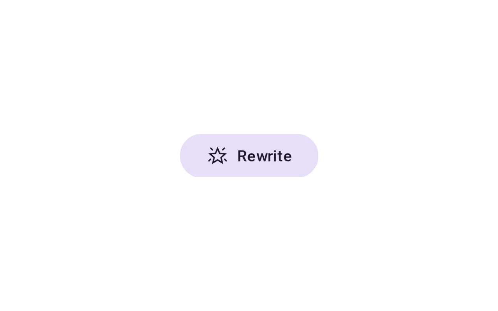
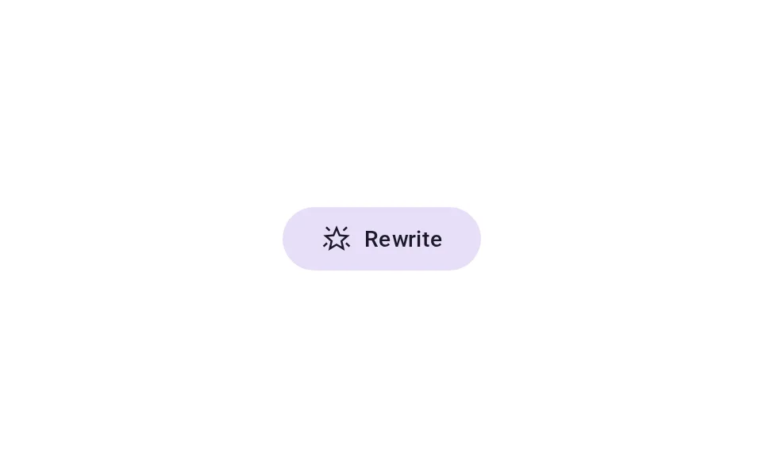
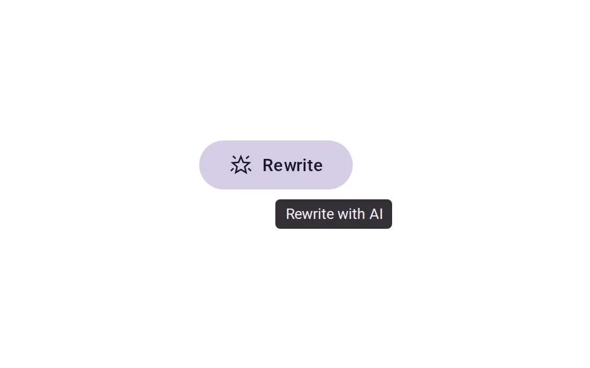
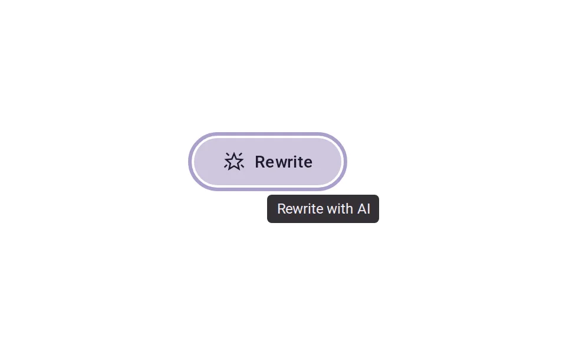
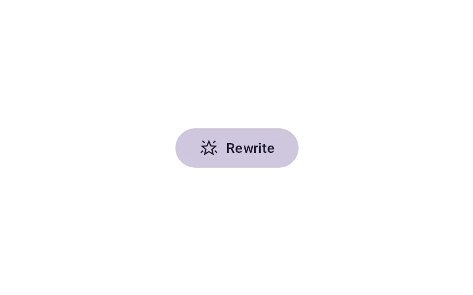
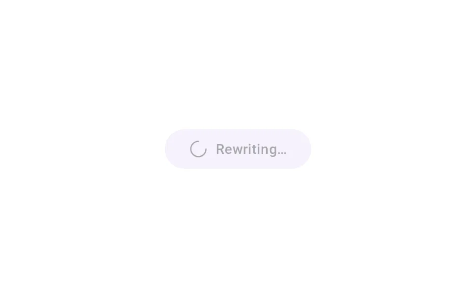
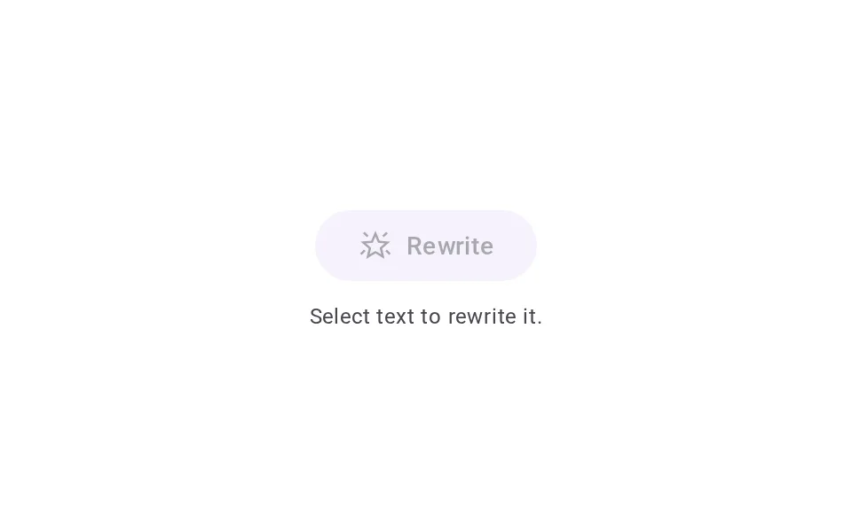

# Iconography

**Onboarding › Identity** · id `iconography` · API `Md3Button`

> One Material Symbol per AI meaning — action, working, tool use, generated — always with words, never one sparkle for everything.

Open it: [material-pattern.html?id=iconography](../../../../material-pattern.html?id=iconography)

## Intent

Answers “what does this AI mark mean here?” — will run AI, is running, used a tool, or was written by AI — consistently across the product, with a label or tooltip so the icon is never the only explanation.

## When to use

**Use when:** On controls that run AI, on the working state, on tool-use steps and on AI-generated content. Not on features without AI, and not as decoration, branding or “premium”.

## Where the code lives

| Part | Location |
|---|---|
| Live Preview (states, customizer, code tab) | [`material-preview.js` L6033–6235](../../../../material-preview.js#L6033-L6235) |
| Simulator | [`material-sim.js` L1612–1688](../../../../material-sim.js#L1612-L1688) |
| Docs (intent, anatomy, usage) | [`material-patterns.js` L733–826](../../../../material-patterns.js#L733-L826) |
| Category CSS block | [`material-pattern.html` IDV-START (L7939)](../../../../material-pattern.html#L7939) |
| Sidebar entry | [`material-nav.js`](../../../../material-nav.js) |
| Tests | [`onb.js`](../../../../_tests/suites/onb.js) |

## Nucleux packages

- `@nucleux/md3-button`
- `@nucleux/md3-chip`
- `@nucleux/md3-icon-button`
- `@nucleux/md3-list`
- `@nucleux/md3-tooltip`
- `@nucleux/tokens`

## States (6)

### 01 · Resting _(initial)_

| | |
|---|---|
| Key | `resting` |
| Trigger | The control is available. |
| Behaviour | The role glyph and its verb. Nothing glows or moves. |
| Meaning | Pressing this runs AI on something specific. |
| Action | Hover, focus or press it. |
| Next | Hover |

### 02 · Hover

| | |
|---|---|
| Key | `hover` |
| Trigger | The pointer is over it. |
| Behaviour | The Md3 state layer at 8% and the Md3Tooltip: what will happen, in words. |
| Meaning | What the control will do. |
| Action | Press it. |
| Next | Pressed |

### 03 · Focus

| | |
|---|---|
| Key | `focus` |
| Trigger | Keyboard focus reached it. |
| Behaviour | The focus ring (md-primary) and the same tooltip. |
| Meaning | The same, without a pointer. |
| Action | Enter or Space. |
| Next | Pressed |

### 04 · Pressed

| | |
|---|---|
| Key | `pressed` |
| Trigger | It is being pressed. |
| Behaviour | The 12% state layer. The glyph does not change yet. |
| Meaning | Your press was received. |
| Action | Release. |
| Next | Working |

### 05 · Working

| | |
|---|---|
| Key | `working` |
| Trigger | The AI action is running. |
| Behaviour | The action glyph becomes the working glyph (progress_activity) and the label becomes “Rewriting…”. |
| Meaning | The agent is doing it now. |
| Action | — |
| Next | Resting |

### 06 · Disabled

| | |
|---|---|
| Key | `disabled` |
| Trigger | There is nothing to act on. |
| Behaviour | The control at 38% with its reason as supporting text — never an unexplained grey icon. |
| Meaning | Why it is unavailable, and what to do. |
| Action | Do what the reason says. |
| Next | Resting |

## Simulator

A support reply. Press Rewrite and watch four different marks appear for four different meanings — action, working, tool use, generated. Then switch on “one sparkle for everything” and try to tell them apart.

---

_Generated by `_build/catalog/make.js` — do not edit by hand; change the pattern and re-run._
