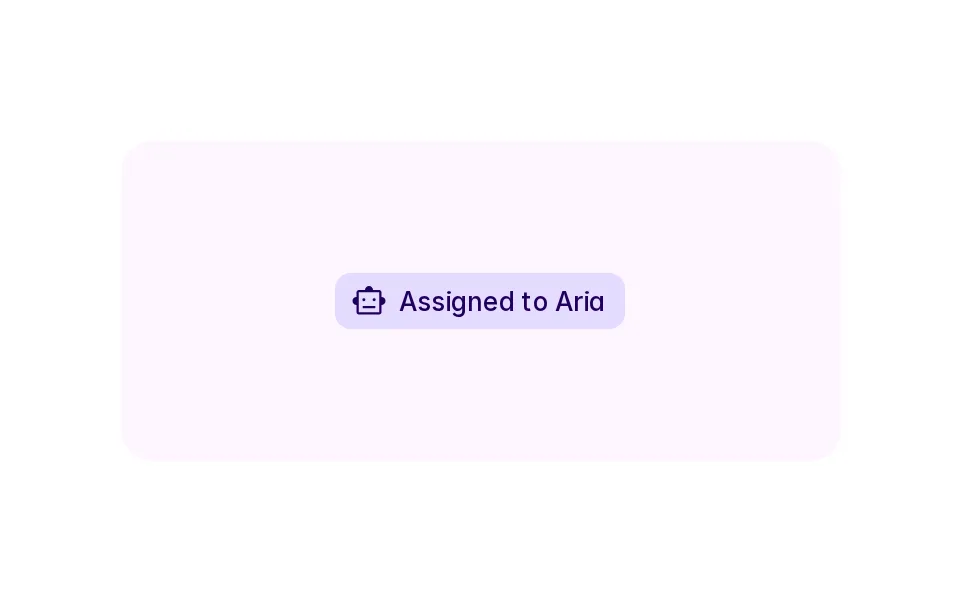
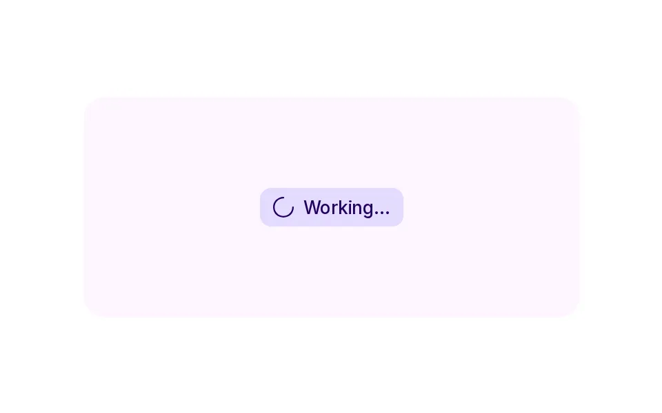
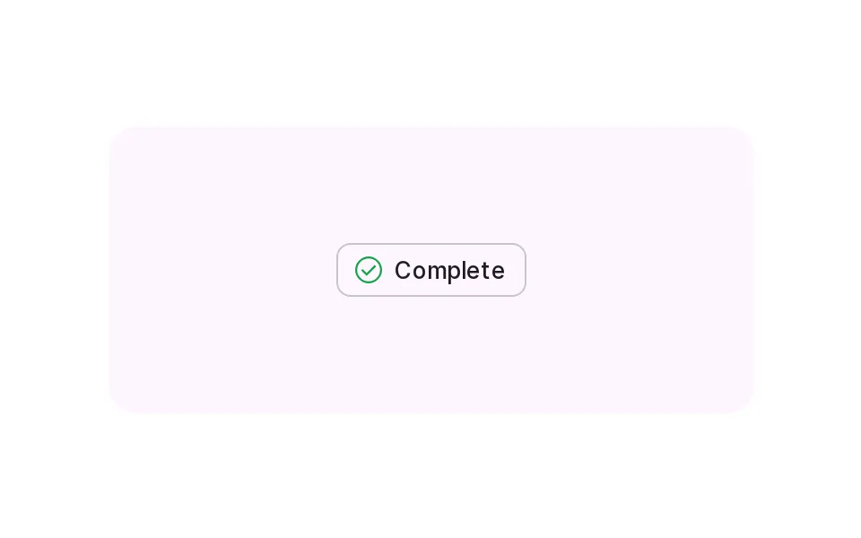
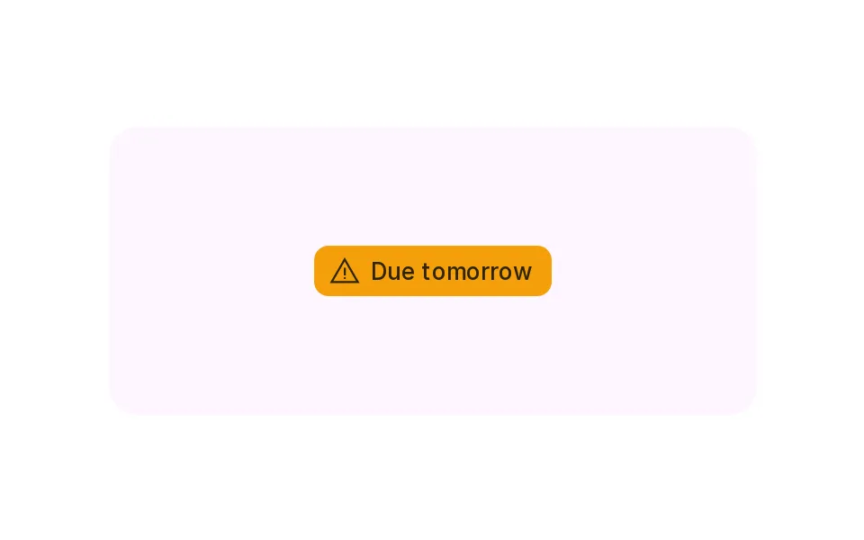
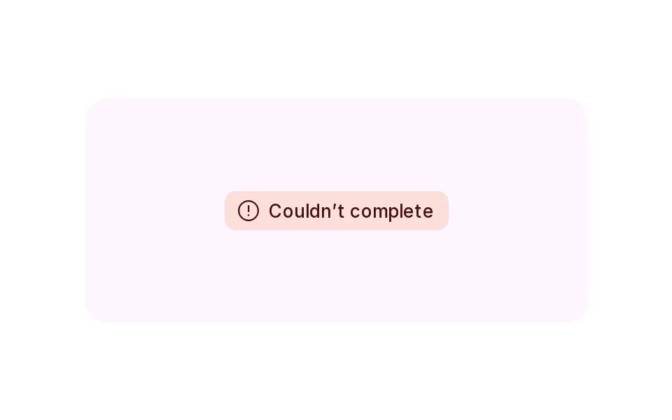

# Color

**Onboarding › Identity** · id `color` · API `AgentStatus`

> Semantic colour roles from Nucleux tokens for the agent, attention, evidence and status — always paired with an icon and words.

Open it: [material-pattern.html?id=color](../../../../material-pattern.html?id=color)

## Intent

Answers “what needs me, what is the agent doing, and what went wrong?” with colour that means something — agent, attention, evidence, success, warning, error — and that still reads in greyscale, dark theme and to a screen reader.

## When to use

**Use when:** For the agent’s presence and work, for states that need a decision, for sources it used, and for outcomes. Not for decoration, gradients or glows, and never by remapping error or warning to brand colours.

## Where the code lives

| Part | Location |
|---|---|
| Live Preview (states, customizer, code tab) | [`material-preview.js` L6238–6389](../../../../material-preview.js#L6238-L6389) |
| Simulator | [`material-sim.js` L901–985](../../../../material-sim.js#L901-L985) |
| Docs (intent, anatomy, usage) | [`material-patterns.js` L831–908](../../../../material-patterns.js#L831-L908) |
| Category CSS block | [`material-pattern.html` IDV-START (L7939)](../../../../material-pattern.html#L7939) |
| Sidebar entry | [`material-nav.js`](../../../../material-nav.js) |
| Tests | [`onb.js`](../../../../_tests/suites/onb.js) |

## Nucleux packages

- `@nucleux/avatar`
- `@nucleux/md3-button`
- `@nucleux/md3-card`
- `@nucleux/md3-list`
- `@nucleux/md3-progress`
- `@nucleux/md3-theme`
- `@nucleux/tokens`

## States (7)

### 01 · Default _(initial)_

| | |
|---|---|
| Key | `default` |
| Trigger | The agent is available. |
| Behaviour | A neutral surface with an outline, the agent glyph and “Available”. |
| Meaning | Nothing needs attention. |
| Action | — |
| Next | Active, or Working |

### 02 · Active

| | |
|---|---|
| Key | `active` |
| Trigger | The task is assigned to the agent. |
| Behaviour | The agent role (md-primary-container), the agent glyph and “Assigned to Aria”. |
| Meaning | The agent owns this. |
| Action | — |
| Next | Working |

### 03 · Working

| | |
|---|---|
| Key | `working` |
| Trigger | The agent is doing it. |
| Behaviour | The agent role, the working glyph and what it is doing. |
| Meaning | The agent is working now. |
| Action | — |
| Next | Attention, Success, Warning or Error |

### 04 · Attention

| | |
|---|---|
| Key | `attention` |
| Trigger | The agent needs a decision. |
| Behaviour | The attention role (md-tertiary-container), a help glyph and “Needs your approval”. |
| Meaning | You need to decide something. |
| Action | — |
| Next | Success |

### 05 · Success

| | |
|---|---|
| Key | `success` |
| Trigger | It finished and passed. |
| Behaviour | A check glyph in the success colour on a neutral surface, so the text keeps its contrast, and “Complete”. |
| Meaning | Done. |
| Action | — |
| Next | — |

### 06 · Warning

| | |
|---|---|
| Key | `warning` |
| Trigger | Something may go wrong soon. |
| Behaviour | The warning role with its foreground, a warning glyph and the specific reason. |
| Meaning | Look at this soon. |
| Action | — |
| Next | — |

### 07 · Error

| | |
|---|---|
| Key | `error` |
| Trigger | It failed. |
| Behaviour | The error role (md-error-container), an error glyph and what failed. Never used for anything else. |
| Meaning | It failed. |
| Action | — |
| Next | Working |

## Simulator

A launch board. Assign the checklist to Aria and follow it from available to working, approval, source used and done — every state a token role with its own glyph and words. Turn on greyscale: nothing is lost. Turn on colour only: everything is.

---

_Generated by `_build/catalog/make.js` — do not edit by hand; change the pattern and re-run._
