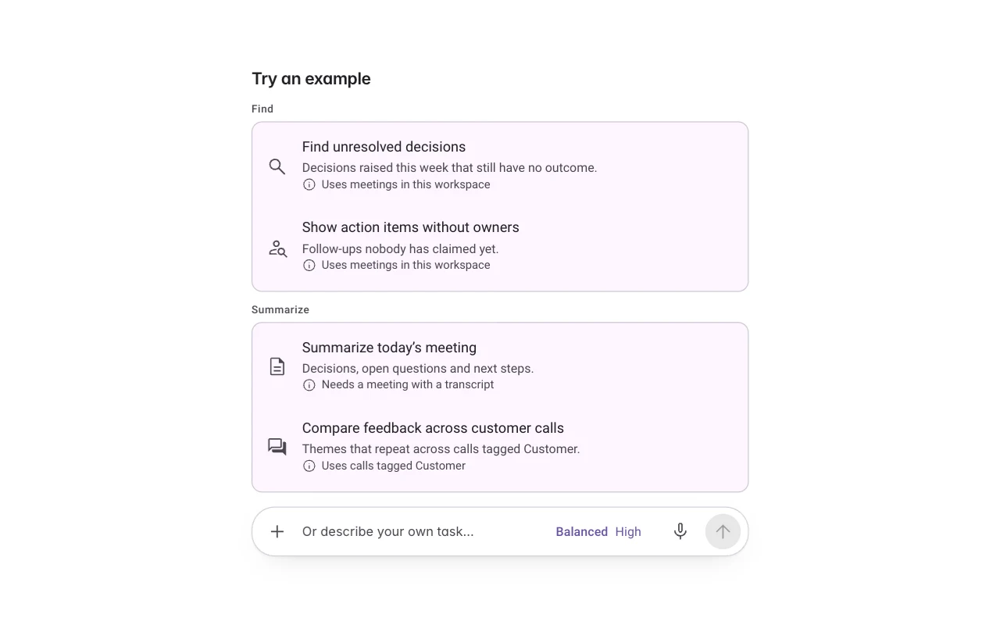
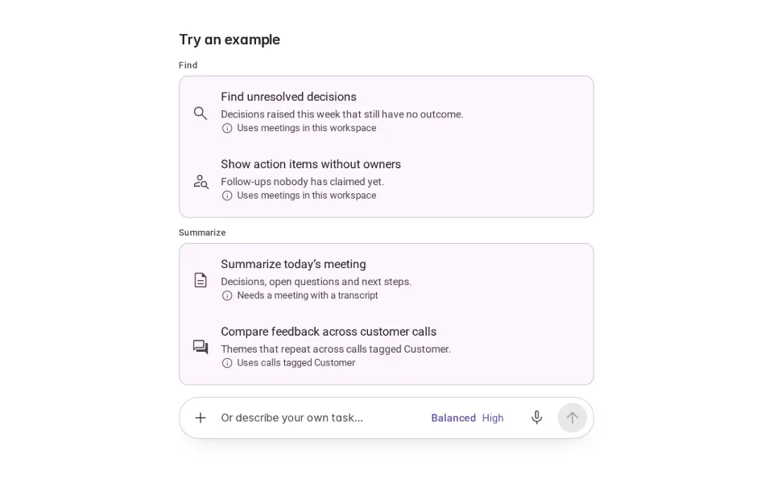
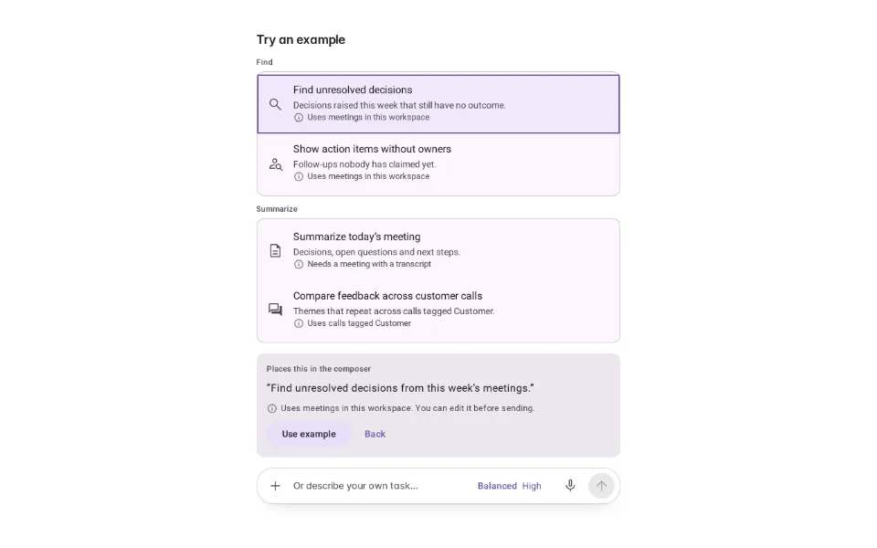
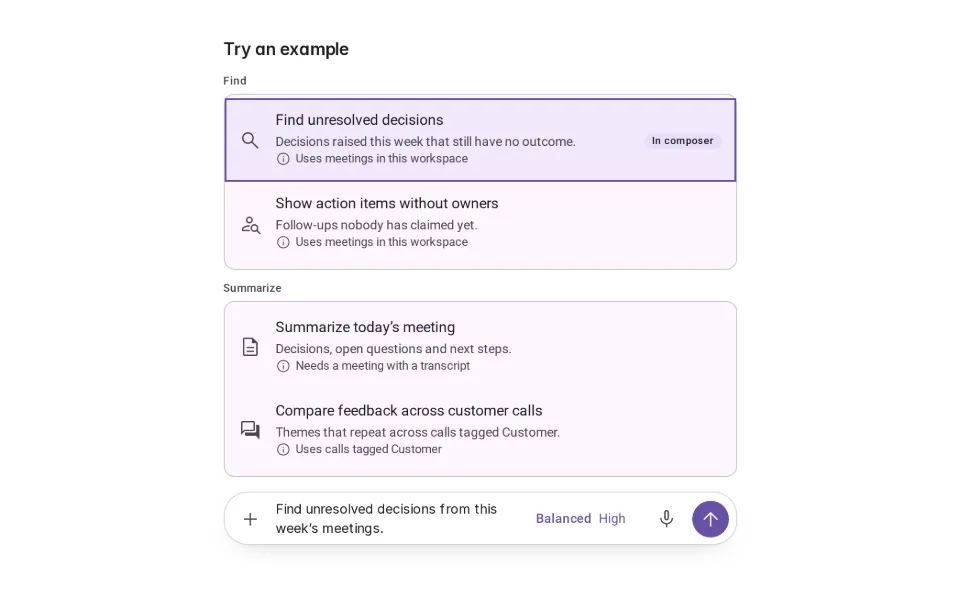
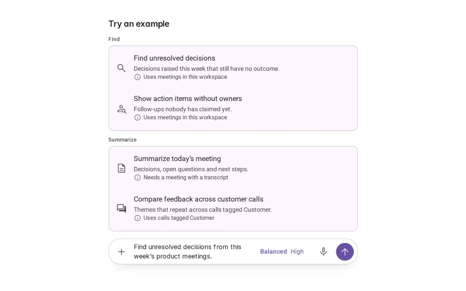
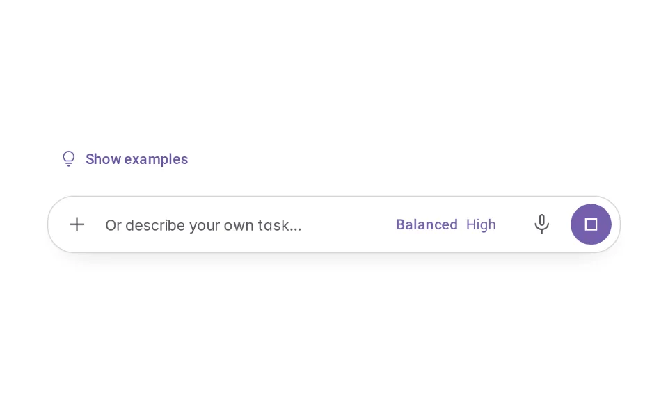

# Example Gallery

**Onboarding › Capability Discovery** · id `example-gallery` · API `ExampleGallery`

> A small set of real, product-specific tasks the agent does well — choosing one places an editable request in the composer.

Open it: [material-pattern.html?id=example-gallery](../../../../material-pattern.html?id=example-gallery)

## Intent

Answers “what can I do with this agent?” with a few real tasks from this product — grouped, each saying what it uses — so people start from something that works instead of guessing what to ask.

## When to use

**Use when:** On an empty or new conversation, and on demand afterwards. Not as a standing panel that competes with the work once it has started.

## Where the code lives

| Part | Location |
|---|---|
| Live Preview (states, customizer, code tab) | [`material-preview.js` L3667–3931](../../../../material-preview.js#L3667-L3931) |
| Simulator | [`material-sim.js` L2345–2430](../../../../material-sim.js#L2345-L2430) |
| Docs (intent, anatomy, usage) | [`material-patterns.js` L913–994](../../../../material-patterns.js#L913-L994) |
| Category CSS block | [`material-pattern.html` CDX-START (L8082)](../../../../material-pattern.html#L8082) |
| Sidebar entry | [`material-nav.js`](../../../../material-nav.js) |
| Tests | [`onb.js`](../../../../_tests/suites/onb.js) |

## Nucleux packages

- `@nucleux/md3-agent-composer`
- `@nucleux/md3-button`
- `@nucleux/md3-card`
- `@nucleux/md3-chip`
- `@nucleux/md3-list`
- `@nucleux/tokens`

## States (5)

### 01 · Examples available _(initial)_

| | |
|---|---|
| Key | `available` |
| Trigger | The person has not started yet. |
| Behaviour | A few real tasks, grouped by kind, each with one line on what it does and what it needs. The composer is right below for their own words. |
| Meaning | This is the kind of thing the agent is good at. |
| Action | Choose an example, or type. |
| Next | Example selected |

### 02 · Example selected

| | |
|---|---|
| Key | `selected` |
| Trigger | They chose an example. |
| Behaviour | The example opens to show the exact request it will place, and what it uses. Nothing is filled yet. |
| Meaning | What choosing this would do. |
| Action | Use it, or go back. |
| Next | Placed into workflow |

### 03 · Placed into workflow

| | |
|---|---|
| Key | `placed` |
| Trigger | They pressed Use example. |
| Behaviour | The request is in the composer, editable and unsent. The example is marked “In composer”. |
| Meaning | It is their request now. |
| Action | Edit it, send it, or clear it. |
| Next | Edited, or Active |

### 04 · Example edited

| | |
|---|---|
| Key | `edited` |
| Trigger | They changed the words. |
| Behaviour | Their version is what will be sent. The example no longer claims it. |
| Meaning | The example was a starting point. |
| Action | Send, or clear. |
| Next | Active interaction |

### 05 · Active interaction

| | |
|---|---|
| Key | `active` |
| Trigger | They sent a request. |
| Behaviour | The agent is working. The gallery steps back to a “Show examples” button (or a row of chips), so the work is the focus. |
| Meaning | Normal work has started. |
| Action | Wait, stop, or show examples again. |
| Next | Examples available |

## Simulator

A new conversation in a meeting workspace. Pick an example — it lands in the composer, unsent. Edit it (type, or use “Edit the request”), send it, and watch the gallery step back.

---

_Generated by `_build/catalog/make.js` — do not edit by hand; change the pattern and re-run._
