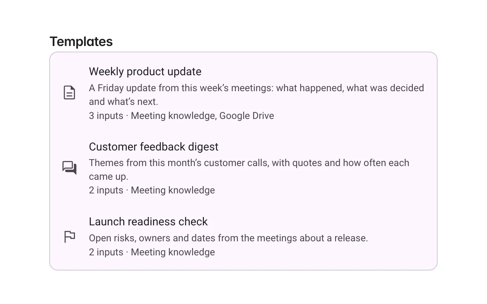
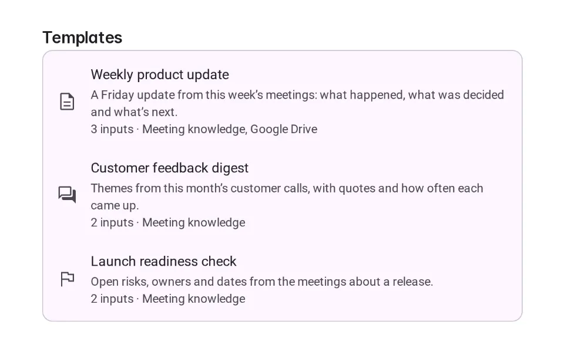
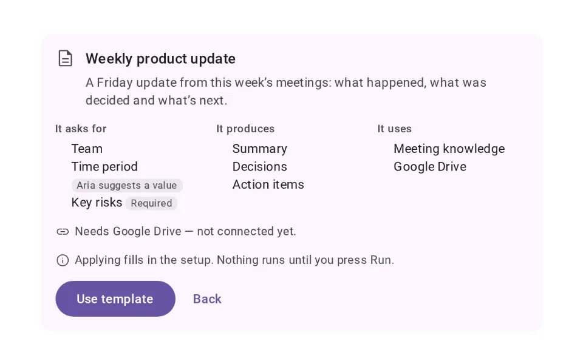
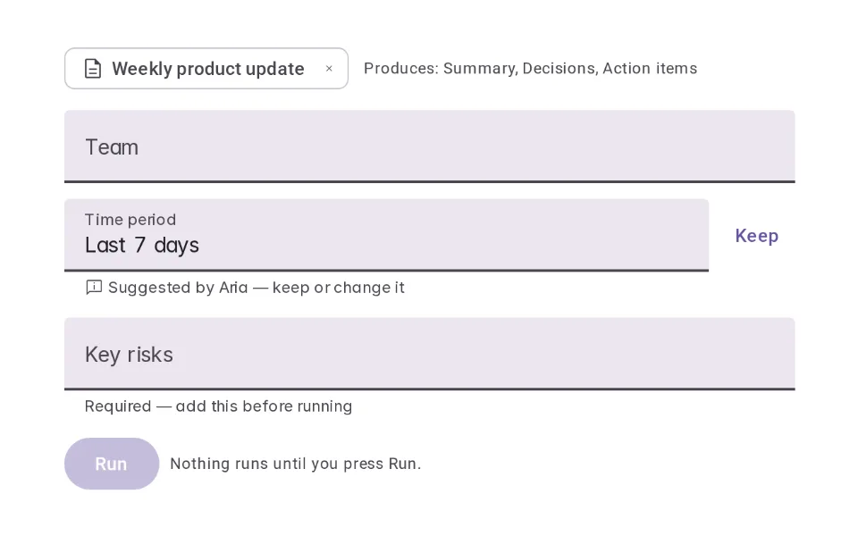
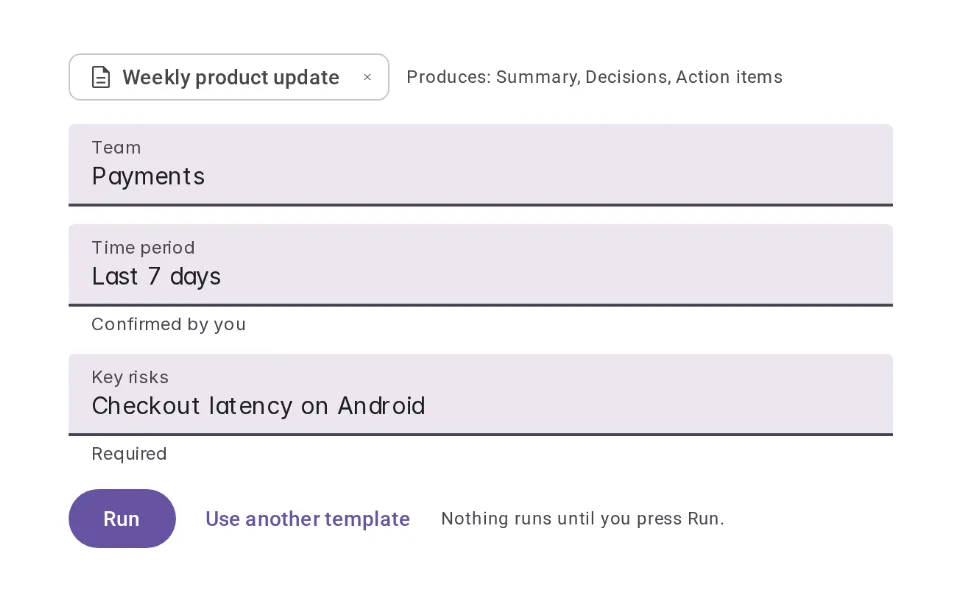
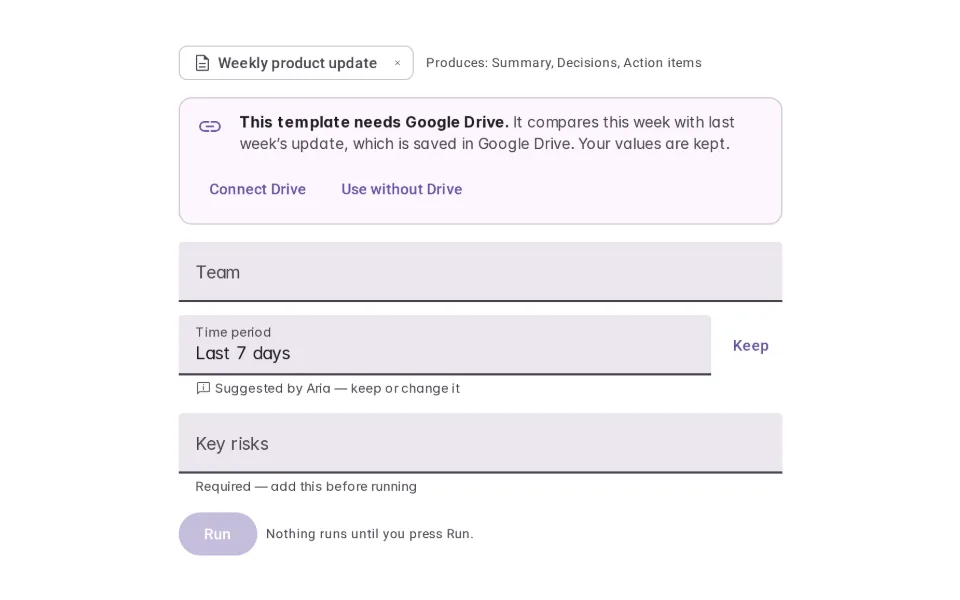
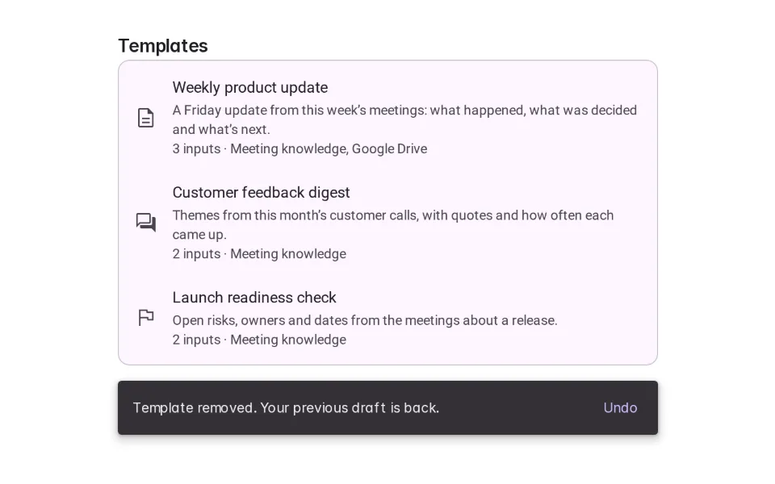

# Templates

**Onboarding › Capability Discovery** · id `templates` · API `WorkflowTemplate`

> A reusable setup for a repeatable workflow — previewed first, applied as editable fields, never run on its own.

Open it: [material-pattern.html?id=templates](../../../../material-pattern.html?id=templates)

## Intent

Answers “how do I start this workflow I do every week?” with a structure they can see before applying: what it asks for, what it produces, what it uses — and what it needs that isn’t connected yet.

## When to use

**Use when:** For workflows people repeat with the same shape — weekly updates, analyses, reviews. Not for one-off prompts (use Suggested Prompts or Example Gallery).

## Where the code lives

| Part | Location |
|---|---|
| Live Preview (states, customizer, code tab) | [`material-preview.js` L3934–4221](../../../../material-preview.js#L3934-L4221) |
| Simulator | [`material-sim.js` L2444–2540](../../../../material-sim.js#L2444-L2540) |
| Docs (intent, anatomy, usage) | [`material-patterns.js` L999–1076](../../../../material-patterns.js#L999-L1076) |
| Category CSS block | [`material-pattern.html` CDX-START (L8082)](../../../../material-pattern.html#L8082) |
| Sidebar entry | [`material-nav.js`](../../../../material-nav.js) |
| Tests | [`onb.js`](../../../../_tests/suites/onb.js) |

## Nucleux packages

- `@nucleux/md3-action-confirmation`
- `@nucleux/md3-banner`
- `@nucleux/md3-button`
- `@nucleux/md3-card`
- `@nucleux/md3-chip`
- `@nucleux/md3-list`
- `@nucleux/md3-snackbar`
- `@nucleux/md3-text-field`
- `@nucleux/tokens`

## States (6)

### 01 · Template available _(initial)_

| | |
|---|---|
| Key | `available` |
| Trigger | The person is starting a recurring piece of work. |
| Behaviour | A short list of workflow templates, each saying what it produces and what it uses. |
| Meaning | There is a ready-made setup for this. |
| Action | Open a template. |
| Next | Preview |

### 02 · Preview

| | |
|---|---|
| Key | `preview` |
| Trigger | They opened a template. |
| Behaviour | What it asks for, what it produces, the tools it uses and anything it needs — before anything is applied. |
| Meaning | Exactly what this template will set up. |
| Action | Use template, or go back. |
| Next | Applied, or Missing requirement |

### 03 · Applied

| | |
|---|---|
| Key | `applied` |
| Trigger | They chose Use template. |
| Behaviour | The fields are in place and editable. A value Aria suggested is marked until they keep or change it. Nothing has run. |
| Meaning | The setup is ready; they decide what goes in it. |
| Action | Fill the fields, then Run. |
| Next | Edited |

### 04 · Edited

| | |
|---|---|
| Key | `edited` |
| Trigger | They changed a field. |
| Behaviour | Their values are confirmed; Run becomes available once required fields are filled. Replacing the template asks first. |
| Meaning | It is their request now. |
| Action | Run, replace, or remove. |
| Next | — |

### 05 · Missing requirement

| | |
|---|---|
| Key | `missing` |
| Trigger | The template needs Google Drive, and it isn’t connected. |
| Behaviour | What is missing, why it is needed and what they can do — Connect Drive or Use without Drive. Their values stay. |
| Meaning | One thing is needed before it can do all of this. |
| Action | Connect, or continue without it. |
| Next | Applied |

### 06 · Removed / reset

| | |
|---|---|
| Key | `removed` |
| Trigger | They removed the template. |
| Behaviour | The template is gone and what was there before is back, with Undo. |
| Meaning | Nothing was lost. |
| Action | Undo, or choose another. |
| Next | Template available |

## Simulator

A research workspace. Preview the Competitive analysis template, apply it, and hit the one thing it needs — web access. Turn it on and see your values still there. Nothing runs until you press Run.

---

_Generated by `_build/catalog/make.js` — do not edit by hand; change the pattern and re-run._
