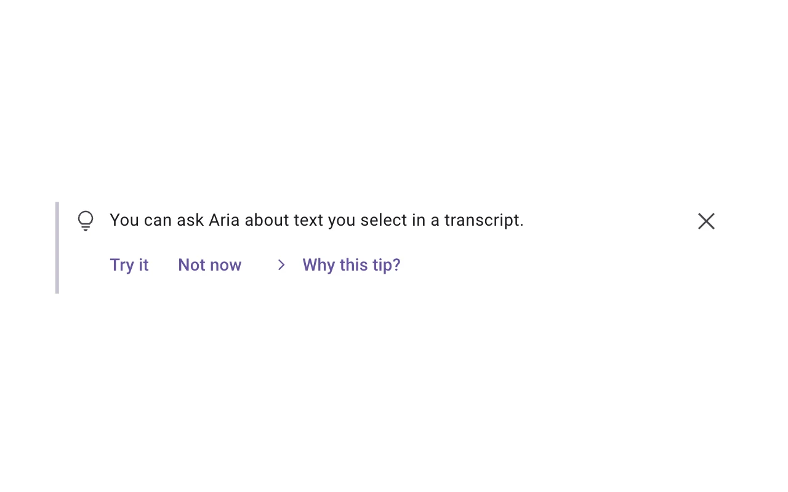
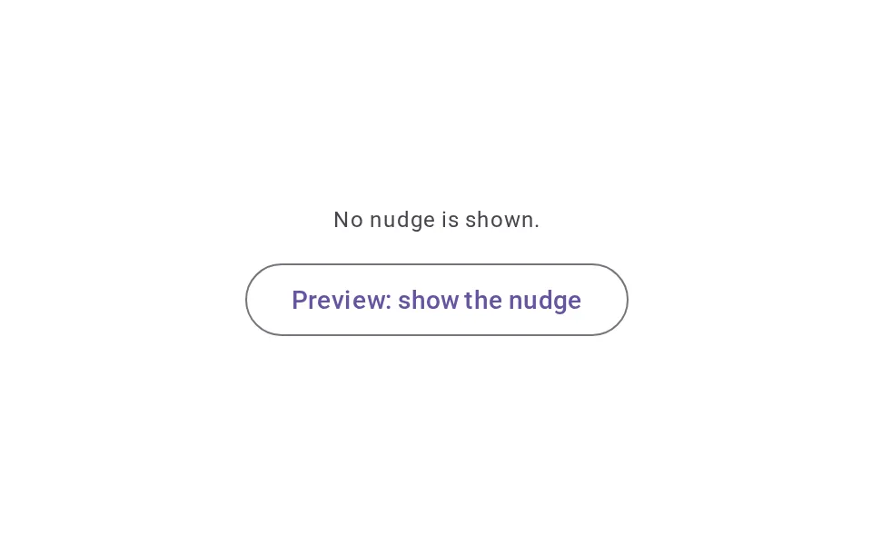
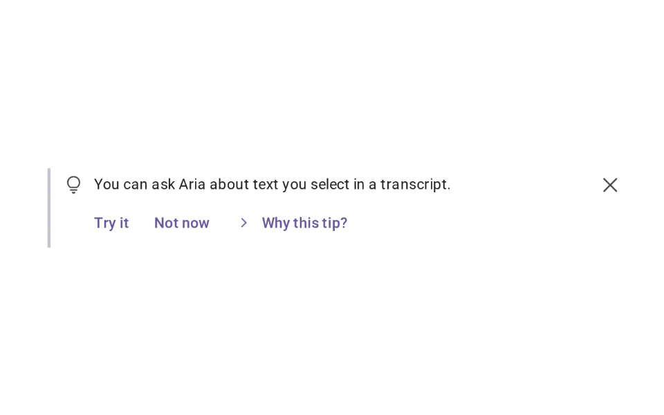
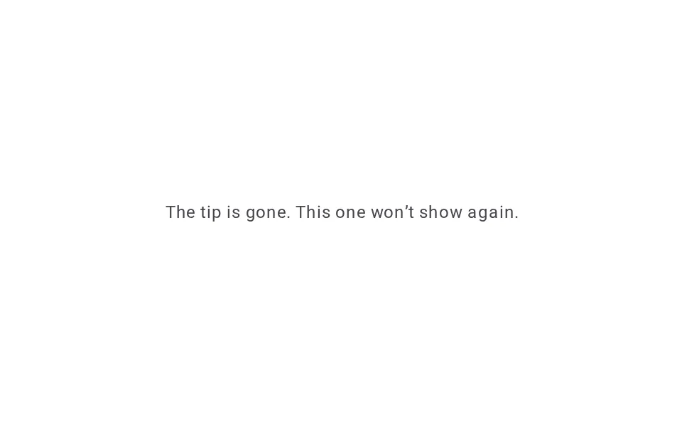
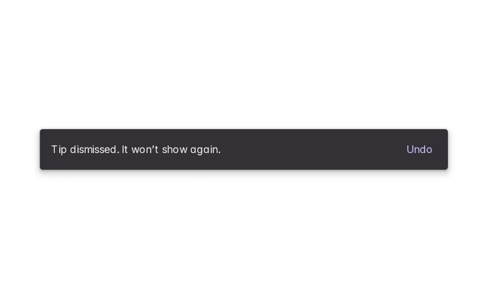
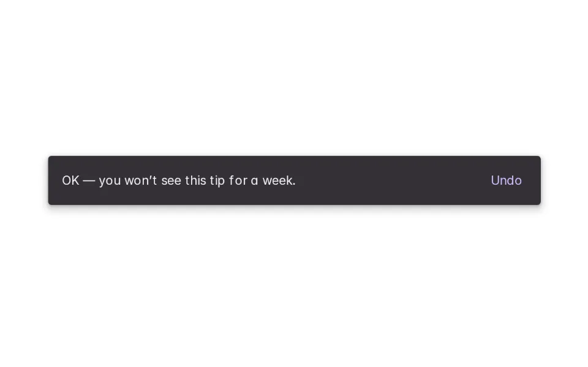
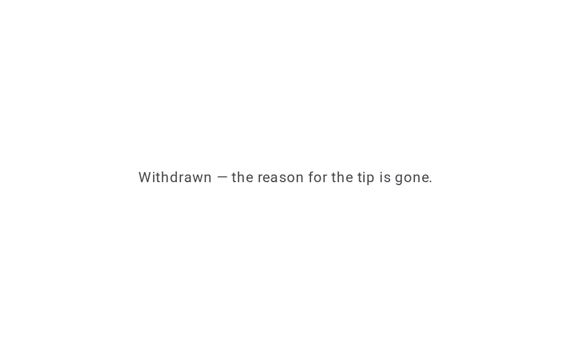

# Nudges

**Onboarding › Capability Discovery** · id `nudges` · API `Nudge`

> A quiet, dismissible tip about a capability that would help right now — with a reason, and it doesn’t come back once dismissed.

Open it: [material-pattern.html?id=nudges](../../../../material-pattern.html?id=nudges)

## Intent

Answers “is there something here I might have missed?” at the moment it is useful, without interrupting: one line in the flow, why it appeared, and an easy way to try it, snooze it or dismiss it.

## When to use

**Use when:** When the person is doing something a capability would make easier — and only once. Not on page load, not as an advert, and not again after it was used or dismissed.

## Where the code lives

| Part | Location |
|---|---|
| Live Preview (states, customizer, code tab) | [`material-preview.js` L4224–4413](../../../../material-preview.js#L4224-L4413) |
| Simulator | [`material-sim.js` L2554–2634](../../../../material-sim.js#L2554-L2634) |
| Docs (intent, anatomy, usage) | [`material-patterns.js` L1081–1132](../../../../material-patterns.js#L1081-L1132) |
| Category CSS block | [`material-pattern.html` CDX-START (L8082)](../../../../material-pattern.html#L8082) |
| Sidebar entry | [`material-nav.js`](../../../../material-nav.js) |
| Tests | [`onb.js`](../../../../_tests/suites/onb.js) |

## Nucleux packages

- `@nucleux/md3-button`
- `@nucleux/md3-card`
- `@nucleux/md3-icon-button`
- `@nucleux/md3-snackbar`
- `@nucleux/tokens`

## States (6)

### 01 · Dormant

| | |
|---|---|
| Key | `dormant` |
| Trigger | Nothing about what they are doing makes a capability useful right now. |
| Behaviour | Nothing is shown. |
| Meaning | — |
| Action | — |
| Next | Nudge shown |

### 02 · Nudge shown _(initial)_

| | |
|---|---|
| Key | `shown` |
| Trigger | They selected transcript text again — something Aria can work with. |
| Behaviour | One line in the flow: what they can do, why it appeared (on request), Try it, Not now and Dismiss. It never blocks the work. |
| Meaning | There is a capability that would help with what they are doing. |
| Action | Try it, not now, dismiss — or ignore it. |
| Next | Accepted, Dismissed, Snoozed or No longer relevant |

### 03 · Accepted

| | |
|---|---|
| Key | `accepted` |
| Trigger | They chose Try it. |
| Behaviour | The nudge leaves and the capability opens where they are working. It will not promote this again. |
| Meaning | They know about it now. |
| Action | — |
| Next | — |

### 04 · Dismissed

| | |
|---|---|
| Key | `dismissed` |
| Trigger | They chose Dismiss. |
| Behaviour | The nudge leaves, with an Undo. It does not come back for this capability. |
| Meaning | Their choice is remembered. |
| Action | Undo, or carry on. |
| Next | — |

### 05 · Snoozed

| | |
|---|---|
| Key | `snoozed` |
| Trigger | They chose Not now. |
| Behaviour | The nudge leaves for a week, with an Undo. |
| Meaning | It may come back later — not today. |
| Action | Undo, or carry on. |
| Next | — |

### 06 · No longer relevant

| | |
|---|---|
| Key | `irrelevant` |
| Trigger | They cleared the selection. |
| Behaviour | The nudge withdraws on its own, quietly — the reason for it is gone. |
| Meaning | — |
| Action | — |
| Next | Dormant |

## Simulator

Reviewing a transcript by hand. Select a second passage and a quiet tip appears — not a dialog. Try it and the selection goes into the composer as context; dismiss it and it stays gone.

---

_Generated by `_build/catalog/make.js` — do not edit by hand; change the pattern and re-run._
