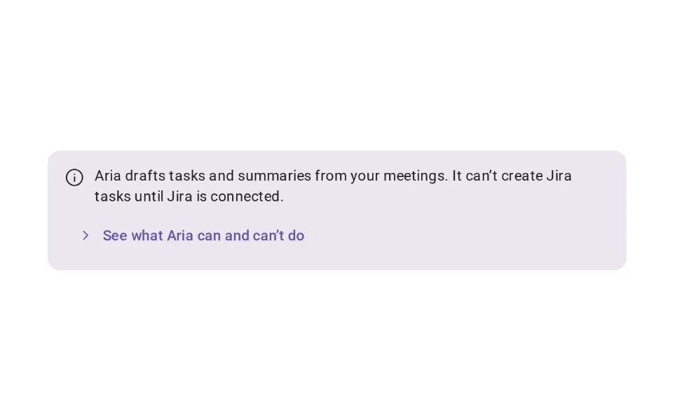
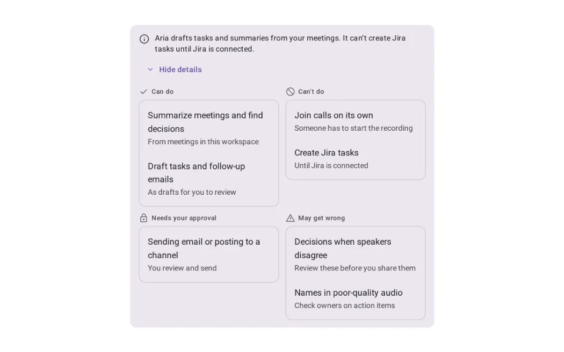
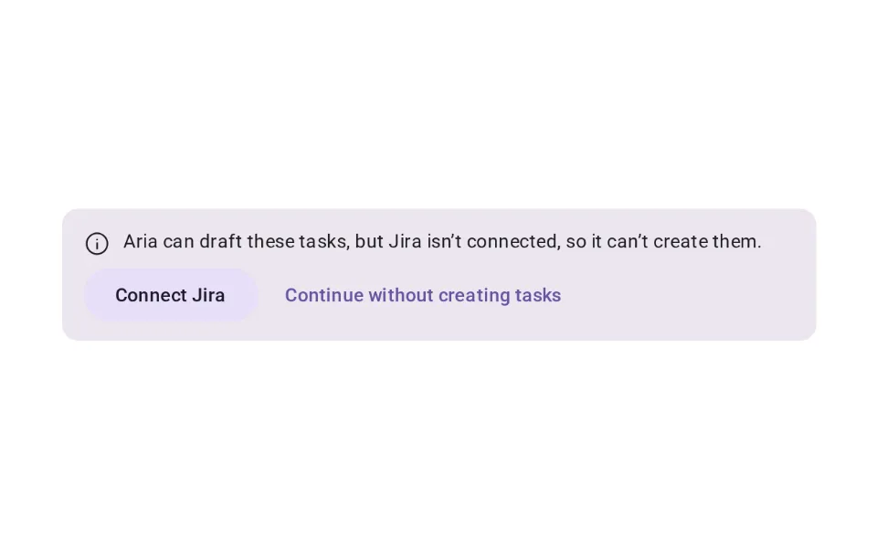
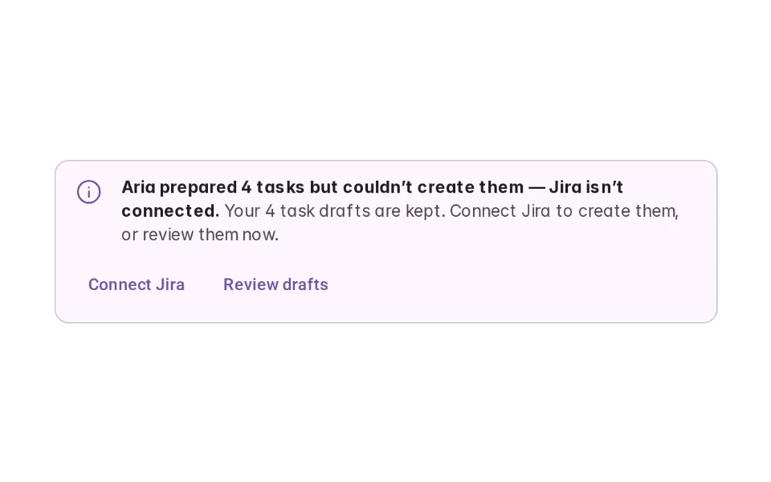
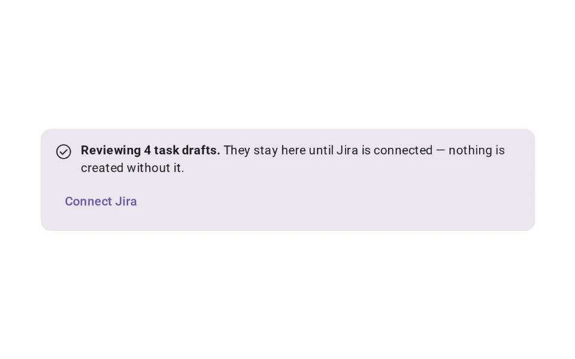

# Disclaimer / Agent Limits

**Onboarding › Capability Discovery** · id `disclaimer` · API `AgentLimits`

> States what the agent can’t reliably do — briefly in general, specifically where it matters, and with a way forward when it hits a limit.

Open it: [material-pattern.html?id=disclaimer](../../../../material-pattern.html?id=disclaimer)

## Intent

Answers “what can’t this agent do, and when should I check its work?” in plain words: a short general statement, the specific limit at the point it applies, and — when the agent reaches it — what happened, that the work is kept, and what to do next.

## When to use

**Use when:** Where the agent is introduced (general), before an action it can’t complete (contextual), and when it reaches a boundary during a task. Not as a standing warning on every message.

## Where the code lives

| Part | Location |
|---|---|
| Live Preview (states, customizer, code tab) | [`material-preview.js` L4416–4602](../../../../material-preview.js#L4416-L4602) |
| Simulator | [`material-sim.js` L811–887](../../../../material-sim.js#L811-L887) |
| Docs (intent, anatomy, usage) | [`material-patterns.js` L1137–1202](../../../../material-patterns.js#L1137-L1202) |
| Category CSS block | [`material-pattern.html` CDX-START (L8082)](../../../../material-pattern.html#L8082) |
| Sidebar entry | [`material-nav.js`](../../../../material-nav.js) |
| Tests | [`dline.js`](../../../../_tests/suites/dline.js), [`onb.js`](../../../../_tests/suites/onb.js) |

## Nucleux packages

- `@nucleux/md3-banner`
- `@nucleux/md3-button`
- `@nucleux/md3-card`
- `@nucleux/md3-list`
- `@nucleux/tokens`

## States (5)

### 01 · General limits available _(initial)_

| | |
|---|---|
| Key | `general` |
| Trigger | Where the agent is introduced, or from its menu. |
| Behaviour | One or two sentences on the limits that matter most, with “See what Aria can and can’t do”. |
| Meaning | The boundaries worth knowing before relying on it. |
| Action | Read more, or carry on. |
| Next | Details expanded |

### 02 · Details expanded

| | |
|---|---|
| Key | `expanded` |
| Trigger | They chose to see more. |
| Behaviour | Four short groups: what it can do, can’t do, needs approval for, and may get wrong — and where to review. |
| Meaning | When to rely on it, and when to check or take over. |
| Action | Close. |
| Next | General limits available |

### 03 · Contextual limit shown

| | |
|---|---|
| Key | `contextual` |
| Trigger | They are about to ask for something that needs Jira. |
| Behaviour | The relevant limit, at the point it matters, with what they can do instead. |
| Meaning | Before asking: this part needs Jira. |
| Action | Connect Jira, or continue without creating tasks. |
| Next | Recovery |

### 04 · Limit encountered

| | |
|---|---|
| Key | `encountered` |
| Trigger | Aria reached the boundary during the task. |
| Behaviour | An Md3Banner says what happened, that their work is kept, and the next steps. Not the error colour. |
| Meaning | It stopped at a limit — nothing was lost. |
| Action | Connect Jira, or review the drafts. |
| Next | Recovery / next step |

### 05 · Recovery / next step

| | |
|---|---|
| Key | `recovery` |
| Trigger | They chose Review drafts. |
| Behaviour | They continue with the drafts. The limit stays one line away, with Connect Jira when they are ready. |
| Meaning | The work carries on without the missing part. |
| Action | Review the drafts. |
| Next | — |

## Simulator

Ask Aria to create Jira tasks from a meeting. The general limits are one line at the top; the specific one appears when the request needs it, and again when Aria reaches it — with your drafts kept and two ways on.

---

_Generated by `_build/catalog/make.js` — do not edit by hand; change the pattern and re-run._
