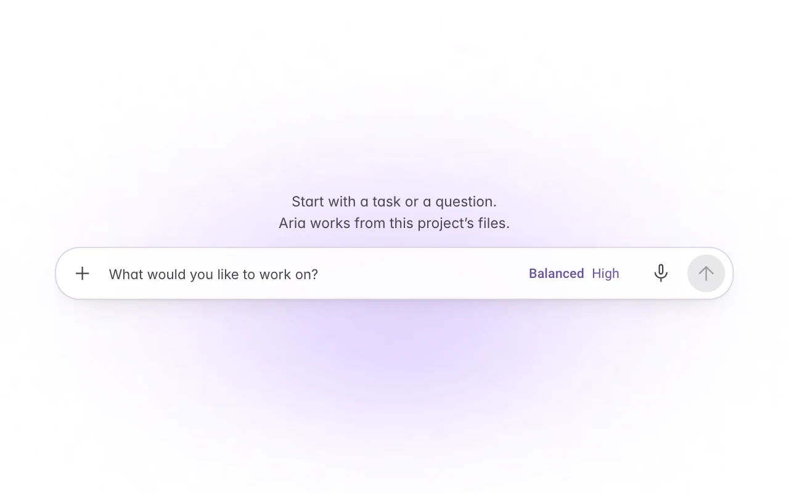
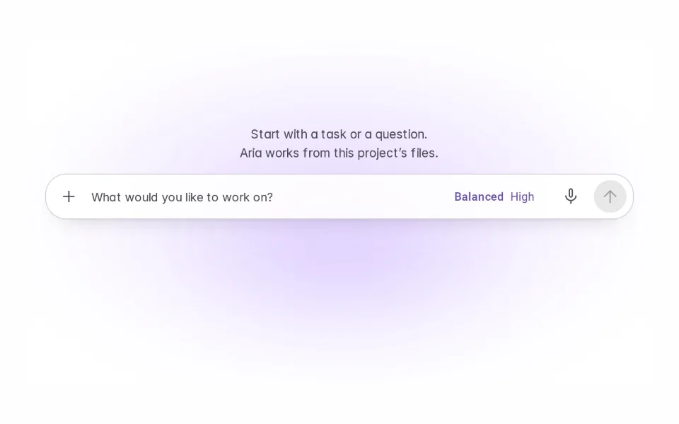
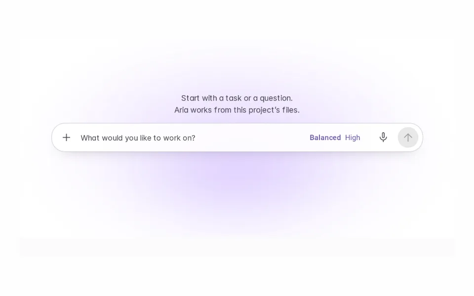
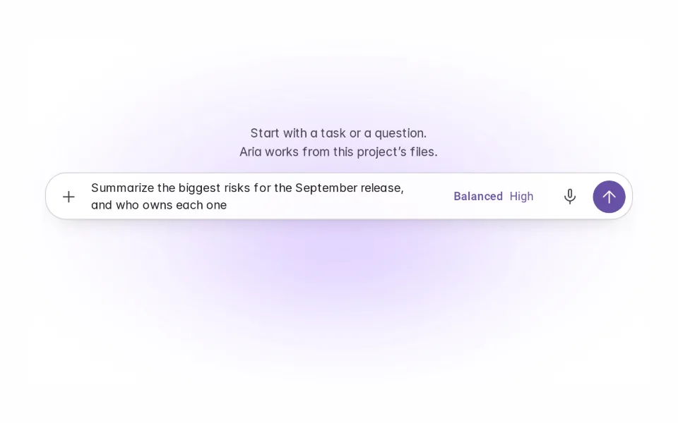
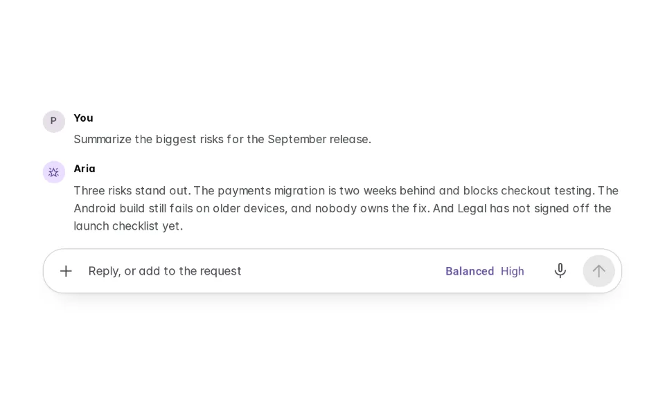

# Initial CTA

**Initially › Entry Points** · id `initial-cta` · API `PromptComposer`

> The large, inviting input that anchors the empty state.

Open it: [material-pattern.html?id=initial-cta](../../../../material-pattern.html?id=initial-cta)

## Intent

Answer "where do I start?" with a field, not a button — and let that field become the working composer the moment work begins.

## When to use

**Use when:** Whenever the main agent workspace has no conversation, task or history to show — a new conversation, a fresh project, a cleared thread. For people who already know agentic products as much as for anyone: this is not a tutorial, it is the empty state of the work surface.

**Not when:** Once there is meaningful activity. Leaving the oversized input in place beside a conversation turns an invitation into furniture competing with the work. Not as a marketing CTA, a sign-up prompt or a first-run explainer, and not as a replacement for Suggested Prompts — those are separate patterns and they stay visually secondary if they appear at all.

## Where the code lives

| Part | Location |
|---|---|
| Live Preview (states, customizer, code tab) | [`material-preview.js` L6424–6726](../../../../material-preview.js#L6424-L6726) |
| Simulator | [`material-sim.js` L2938–3051](../../../../material-sim.js#L2938-L3051) |
| Docs (intent, anatomy, usage) | [`material-patterns.js` L1227–1346](../../../../material-patterns.js#L1227-L1346) |
| Pattern CSS (`.md-icta`) | [`material-pattern.html` L1006–9096](../../../../material-pattern.html#L1006-L9096) · 95 lines |
| Sidebar entry | [`material-nav.js`](../../../../material-nav.js) |

## Nucleux packages

- `@nucleux/material`

## States (5)

### 01 · Resting _(initial)_

| | |
|---|---|
| Key | `resting` |
| Trigger | The workspace has no conversation, task or history yet. |
| Behaviour | The large composer is the focal point, with its placeholder suggesting what to do. Send is unavailable because there is nothing to send. Secondary actions stay quiet around it. |
| Action | Click or tab into the field. |

### 02 · Focused

| | |
|---|---|
| Key | `focused` |
| Trigger | The field receives focus — a click, a tap, or Tab. |
| Behaviour | The outline takes the primary colour and the corner squares up a step. The placeholder stays until the first keystroke and the send key is named underneath. The layout does not move. |
| Action | Start typing. |

### 03 · Typing

| | |
|---|---|
| Key | `typing` |
| Trigger | Text is being entered. |
| Behaviour | The placeholder is gone and the field grows line by line up to its ceiling. Send is available at a secondary emphasis while keys are moving; nothing else competes with the text. |
| Action | Pause, or keep writing. |

### 04 · Ready to submit

| | |
|---|---|
| Key | `ready` |
| Trigger | A request is in the field and the person has paused. |
| Behaviour | Send takes the primary fill. The request is still fully editable, and nothing is sent until the person sends it. |
| Action | Send it — Enter, or the send button. |

### 05 · Active conversation

| | |
|---|---|
| Key | `working` |
| Trigger | The first request is sent. |
| Behaviour | The request enters the workspace as the first turn, the agent starts, and the SAME composer shrinks and moves to its working place at the bottom. From here on it is the normal composer. |
| Action | Keep going in the working composer, or pick Resting to start over. |

## Simulator

An empty planning workspace. The large composer is the only thing to do here — type a request and send it, and watch the same composer move into its working place.

---

_Generated by `_build/catalog/make.js` — do not edit by hand; change the pattern and re-run._
