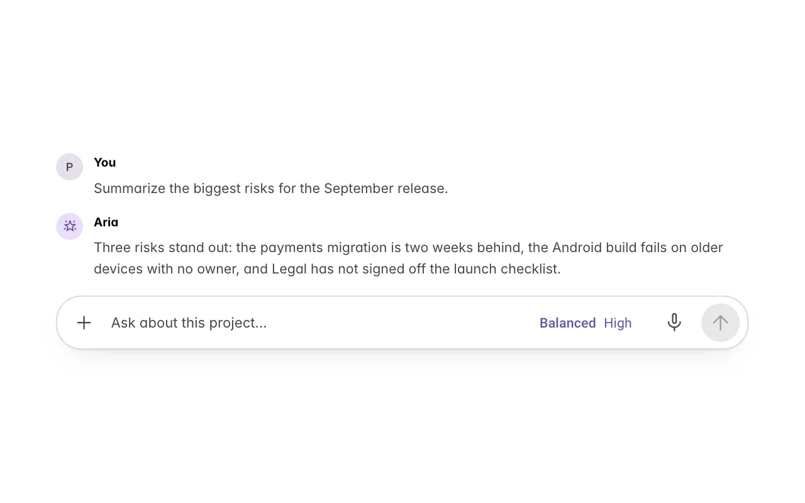
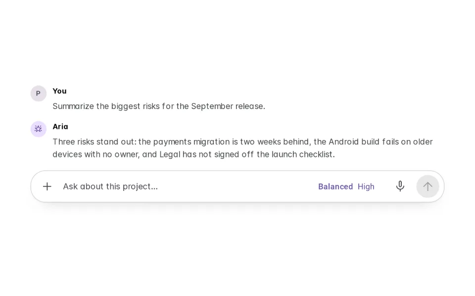
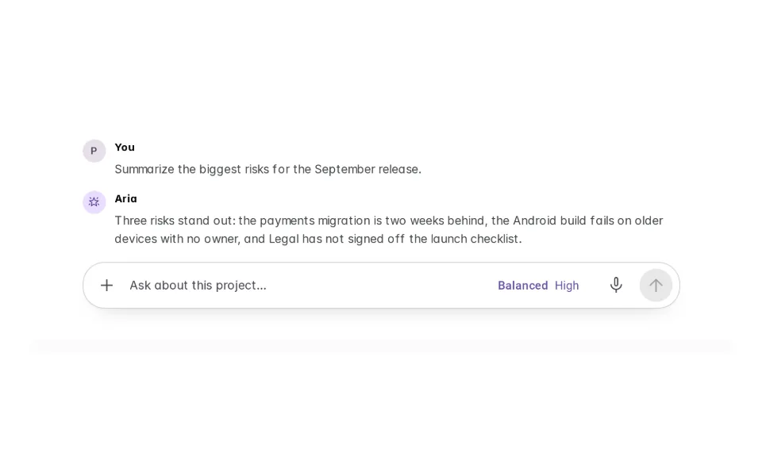
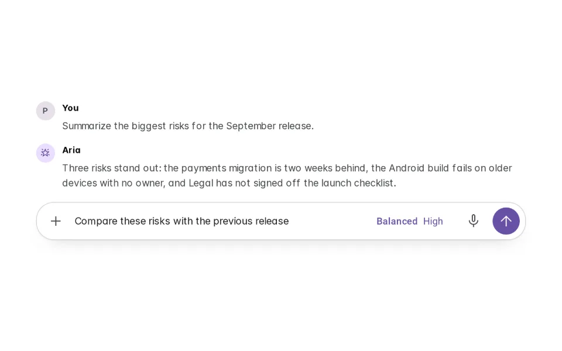
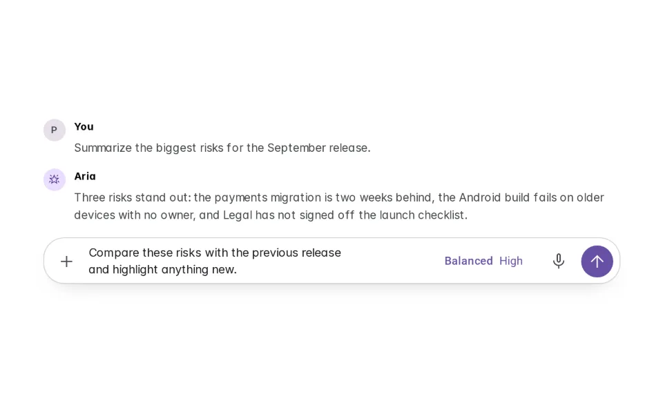
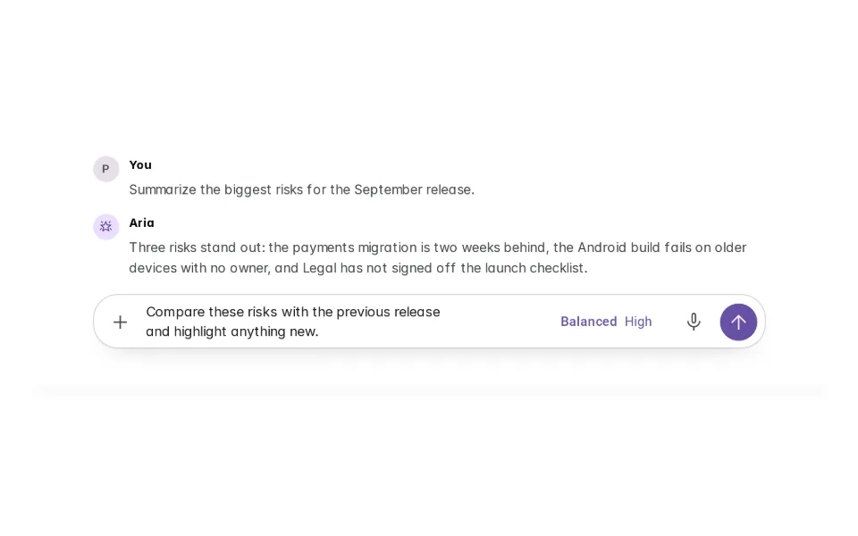
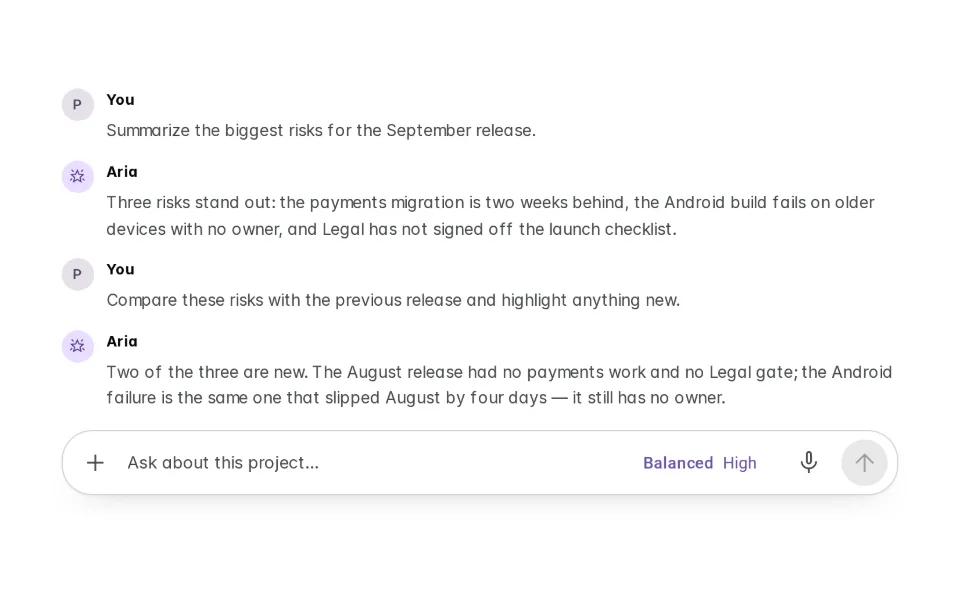
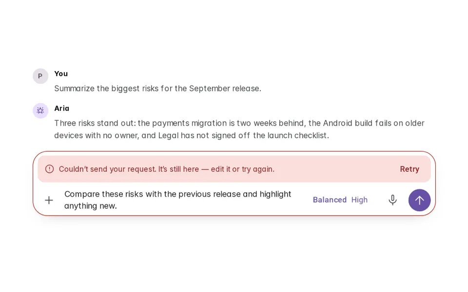

# Open Input

**Initially › Entry Points** · id `open-input` · API `PromptComposer`

> Free-form text box for any natural-language ask.

Open it: [material-pattern.html?id=open-input](../../../../material-pattern.html?id=open-input)

## Intent

The default way to talk to the agent once work is under way — free-form, always there, and never careless with what someone has typed.

## When to use

**Use when:** Wherever a person can make a request in words during ongoing work — conversational agents, task and coding agents, research tools, support agents, project workspaces, side panels — as the default entry point after the first request. Before any activity, the same composer is drawn at its larger Initial CTA size.

**Not when:** Not as the empty-state invitation (that is Initial CTA, the same composer at another size), not as a structured form when the request genuinely has fixed fields, and not as a command-only or search-only box. If the set of things a person can ask for is small and known, buttons beat a blank field.

## Where the code lives

| Part | Location |
|---|---|
| Live Preview (states, customizer, code tab) | [`material-preview.js` L6735–7039](../../../../material-preview.js#L6735-L7039) |
| Simulator | [`material-sim.js` L3072–3253](../../../../material-sim.js#L3072-L3253) |
| Docs (intent, anatomy, usage) | [`material-patterns.js` L1351–1472](../../../../material-patterns.js#L1351-L1472) |
| Sidebar entry | [`material-nav.js`](../../../../material-nav.js) |

## Nucleux packages

- `@nucleux/material`

## States (7)

### 01 · Empty _(initial)_

| | |
|---|---|
| Key | `empty` |
| Trigger | The conversation is running and nothing is typed. |
| Behaviour | The working composer at its compact size, docked under the conversation, placeholder showing. Send is unavailable. Not an invitation — the conversation is the focus. |
| Action | Click or tab into the field. Next: Focused. |

### 02 · Focused

| | |
|---|---|
| Key | `focused` |
| Trigger | The field receives focus. |
| Behaviour | Primary outline, the corner squares up a step, the caret is there. The placeholder stays until the first keystroke. Nothing moves. |
| Action | Start typing. Next: Typing. |

### 03 · Typing

| | |
|---|---|
| Key | `typing` |
| Trigger | Text is entered. |
| Behaviour | The placeholder goes and the text is the focus. Send is available at a secondary emphasis while keys are moving; the other controls still work and leave the text alone. |
| Action | Keep typing or edit. Next: Multi-line, or Ready to send. |

### 04 · Multi-line

| | |
|---|---|
| Key | `multiline` |
| Trigger | The request wraps, or Shift + Enter adds a line. |
| Behaviour | The composer eases taller a line at a time, controls anchored to the bottom row, up to its maximum — then the field scrolls inside itself. |
| Action | Continue typing, edit, or send. Next: Ready to send, or Empty. |

### 05 · Ready to send

| | |
|---|---|
| Key | `ready` |
| Trigger | Valid content is in the field and the person has paused. |
| Behaviour | Send takes the primary fill. The request is still fully editable; nothing sends until the host’s send key or the button. |
| Action | Send. Next: Submitted — or Error, if it fails. |

### 06 · Submitted

| | |
|---|---|
| Key | `submitted` |
| Trigger | The send went through. |
| Behaviour | The request is the newest turn; only now is the field cleared. The composer stays where it is, empty and focused. While Aria answers, Send is Stop and the field is still live. |
| Action | Write the next request. Next: Focused, Typing. |

### 07 · Error / unavailable

| | |
|---|---|
| Key | `error` |
| Trigger | The send did not go through. |
| Behaviour | One sentence in human words, inside the composer, with Retry. The request is exactly as it was and still editable. No code, no cleared field. |
| Action | Edit, then Retry or send. Next: Submitted. |

## Simulator

A conversation already under way, with the working composer where it always is. Type a follow-up, change the model or add context mid-sentence, send it — and try a failed send: the text stays.

---

_Generated by `_build/catalog/make.js` — do not edit by hand; change the pattern and re-run._
