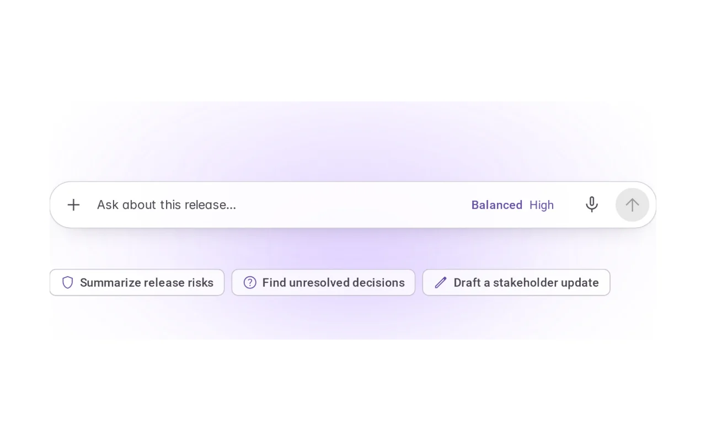
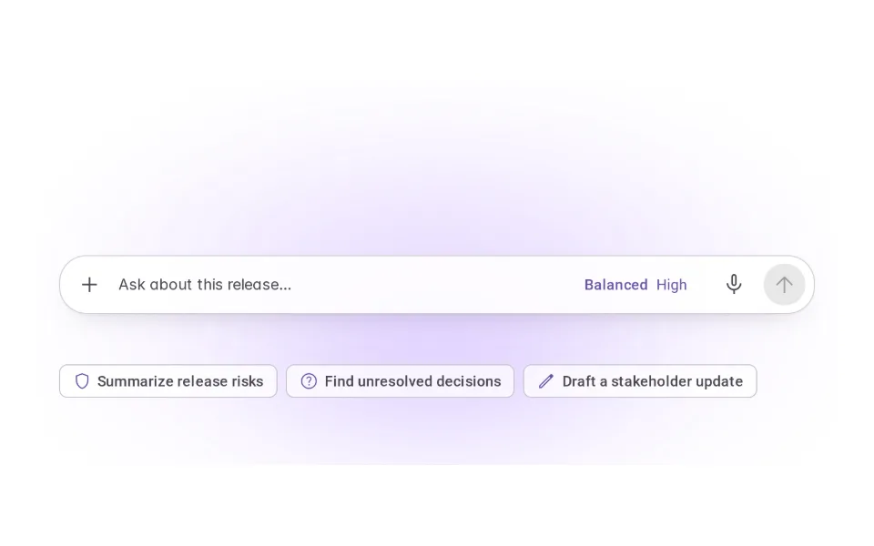
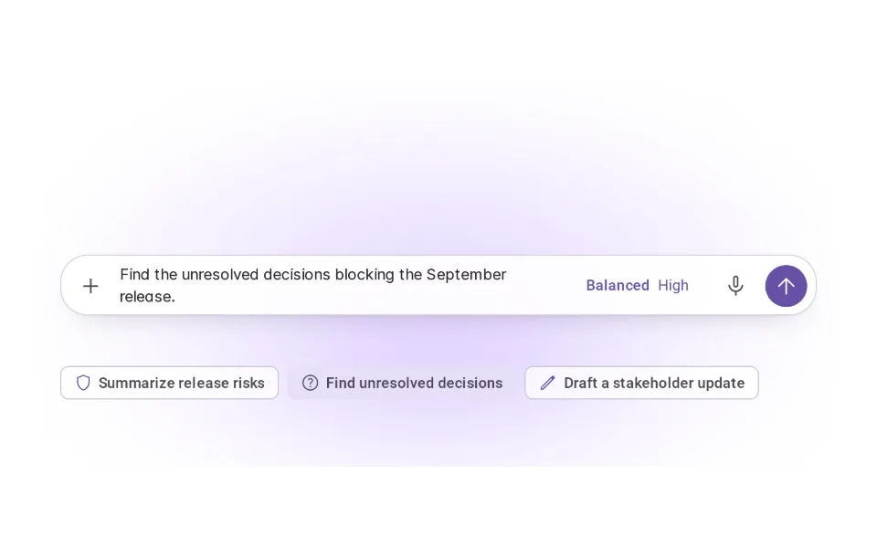
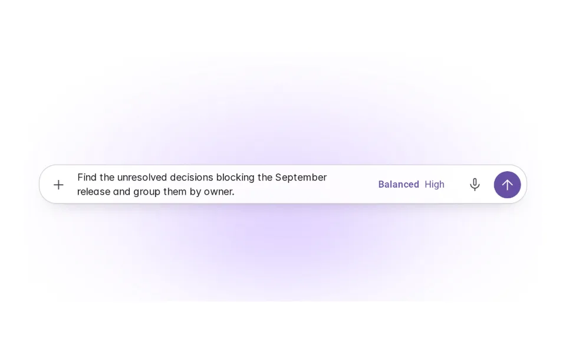
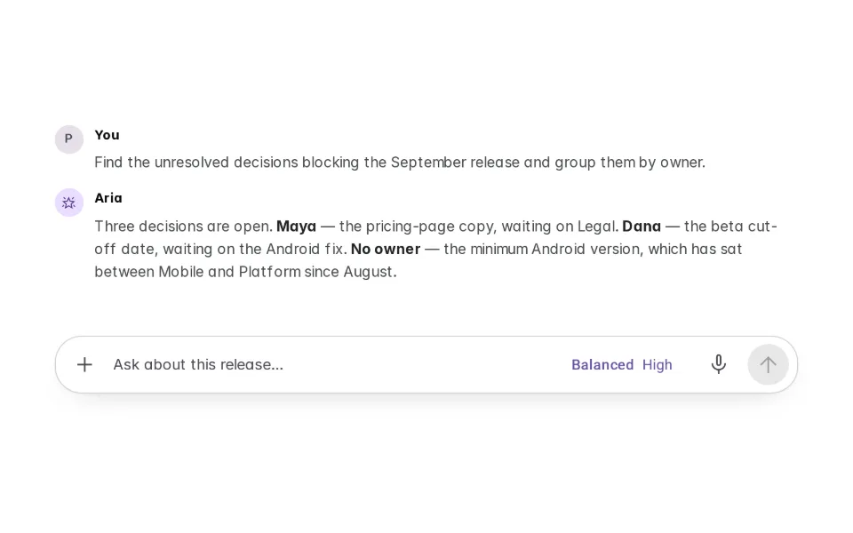

# Suggested Prompts

**Initially › Entry Points** · id `suggested-prompts` · API `SuggestedPrompts`

> Smart, context-aware preset actions to jumpstart engagement.

Open it: [material-pattern.html?id=suggested-prompts](../../../../material-pattern.html?id=suggested-prompts)

## Intent

Answer "what should I ask?" with three or four real actions from this workspace — and hand the chosen one to the composer as the person's own, editable text.

## When to use

**Use when:** On an empty or new conversation in a workspace with visible context worth asking about — a release plan, a research study, a design file, a ticket, a document — and in side panels opened next to that context. Wherever people hesitate over the first request.

**Not when:** Not as autocomplete (that completes what someone is already typing), not as proactive suggestions (the agent raising a next step because of something that happened), not as templates (structured scaffolds with fields), and not as a prompt library, marketplace or command menu. Not throughout a conversation: once it has started, the suggestions have done their job.

## Where the code lives

| Part | Location |
|---|---|
| Live Preview (states, customizer, code tab) | [`material-preview.js` L7047–7422](../../../../material-preview.js#L7047-L7422) |
| Simulator | [`material-sim.js` L3267–3464](../../../../material-sim.js#L3267-L3464) |
| Docs (intent, anatomy, usage) | [`material-patterns.js` L1477–1617](../../../../material-patterns.js#L1477-L1617) |
| Pattern CSS (`.md-spv`, `.md-sp`) | [`material-pattern.html` L1444–4018](../../../../material-pattern.html#L1444-L4018) · 86 lines |
| Sidebar entry | [`material-nav.js`](../../../../material-nav.js) |

## Nucleux packages

- `@nucleux/material`
- `@nucleux/md3-chip`
- `@nucleux/tokens`

## States (5)

### 01 · Suggestions available _(initial)_

| | |
|---|---|
| Key | `available` |
| Trigger | The workspace has context worth asking about and nothing is typed. |
| Behaviour | Three suggestions just below the composer, each an action named from what is on screen. The composer is level one and works on its own; the set is level two. |
| Action | Choose one, or ignore them and type. Next: Suggestion selected — or Prompt edited. |

### 02 · Suggestion selected

| | |
|---|---|
| Key | `selected` |
| Trigger | The person activates a suggestion (click, tap, Enter or Space). |
| Behaviour | The suggestion takes the secondary-container fill and its text travels into the composer. Nothing is sent. Focus moves to the field, and the placement is announced. |
| Action | Let it land. Next: Prompt placed in composer. |

### 03 · Prompt placed in composer

| | |
|---|---|
| Key | `placed` |
| Trigger | The chosen prompt has landed in the field. |
| Behaviour | Ordinary composer text with the caret at the end — not a chip, not locked. Send is ready. The set stays, the chosen one marked, so another can be chosen instead: it replaces the untouched text. |
| Action | Edit, choose another, add context, change the model, or send. Next: Prompt edited, Suggestion selected, or the conversation. |

### 04 · Prompt edited

| | |
|---|---|
| Key | `edited` |
| Trigger | The person changes the placed text — or writes their own instead. |
| Behaviour | It is simply their request now. No preset styling, no lock; the set steps aside, so no suggestion can overwrite their words. Clear the field and the suggestions come back. |
| Action | Send. Next: Conversation started. |

### 05 · Conversation started

| | |
|---|---|
| Key | `conversation` |
| Trigger | The request was sent. |
| Behaviour | The request is the first turn and Aria answers. The suggestions do not come back: they are an entry aid, not navigation. The composer stays, empty and ready. |
| Action | Continue in the composer. Reset from the state list. |

## Simulator

A planning workspace with the September release open. Three suggestions sit above the composer, each drawn from what the workspace shows. Choose one, change it, send it — or switch workspace in the sidebar and watch the suggestions follow.

---

_Generated by `_build/catalog/make.js` — do not edit by hand; change the pattern and re-run._
