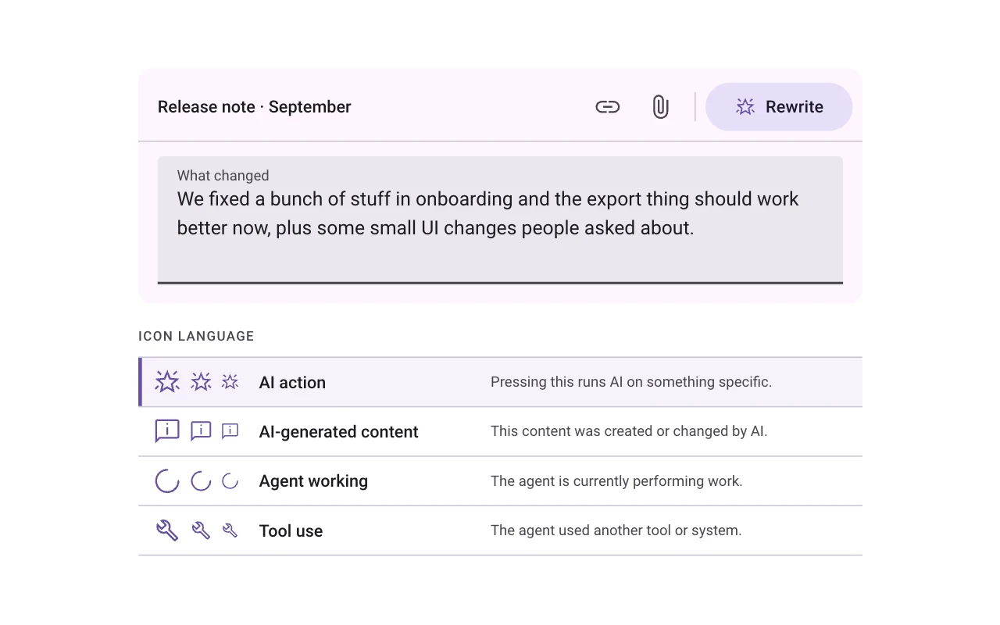
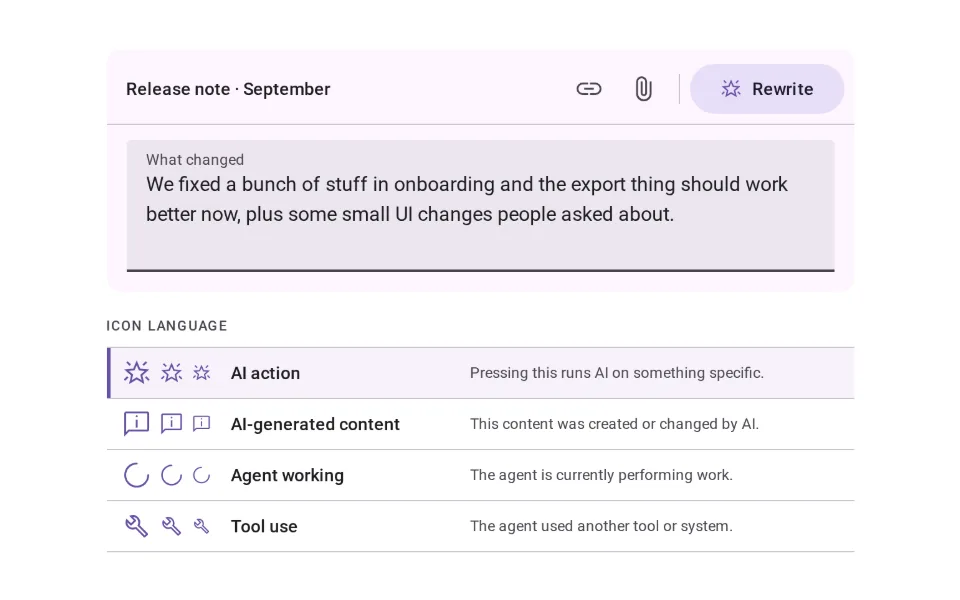
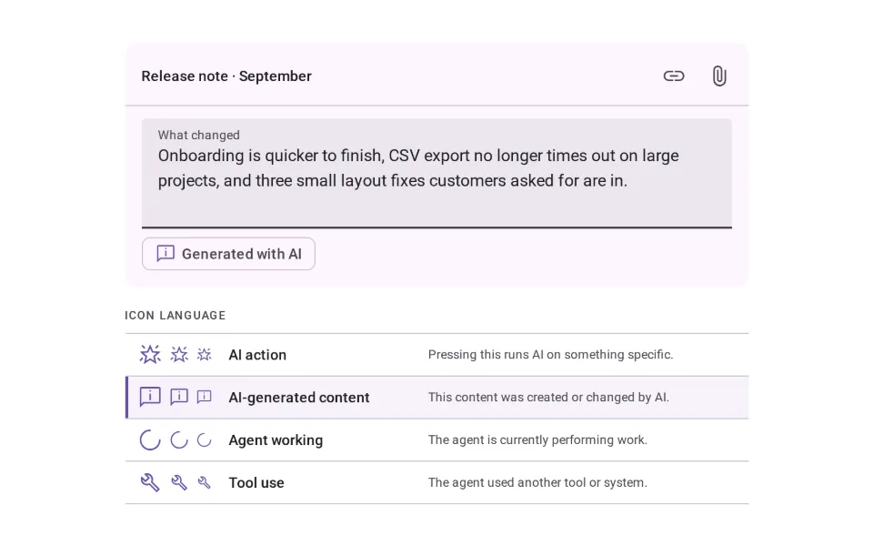
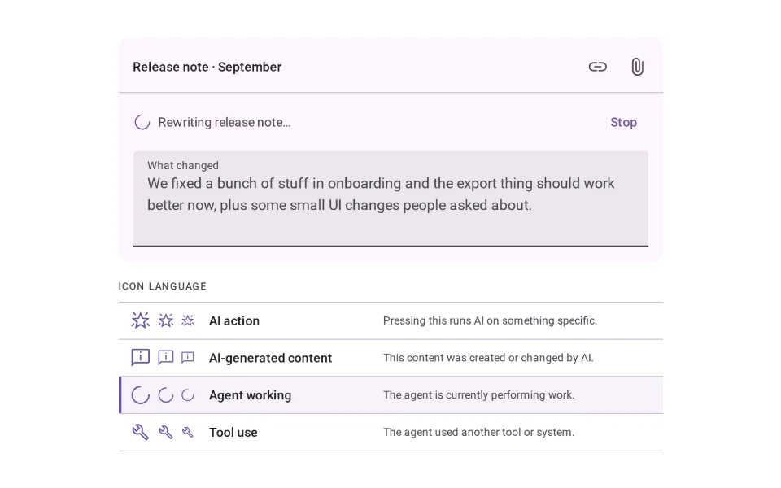
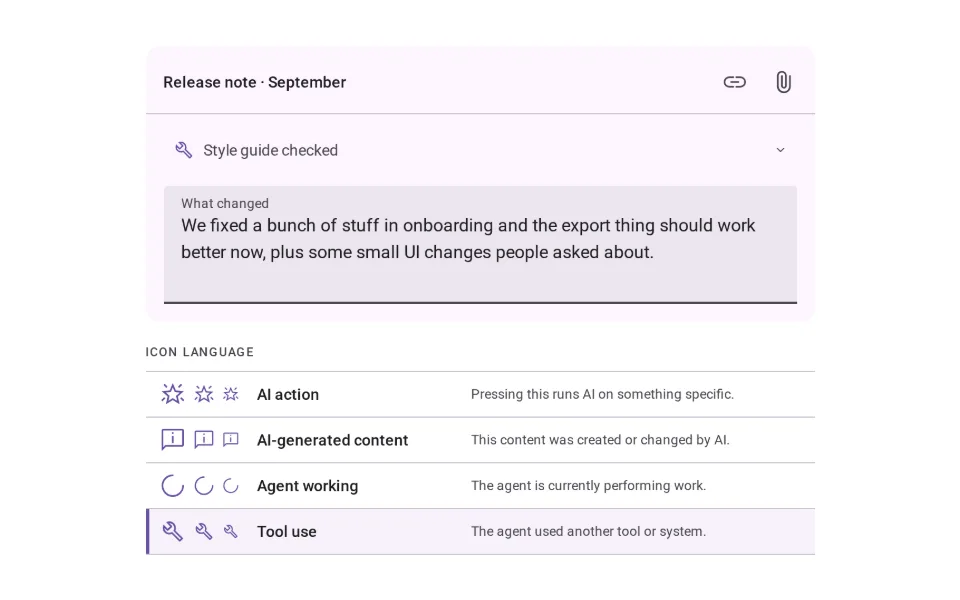

# Icons

**Initially › Entry Points** · id `ai-icons` · API `AiIcon`

> One stable mark per AI meaning: action, generated content, agent working, tool use.

Open it: [material-pattern.html?id=ai-icons](../../../../material-pattern.html?id=ai-icons)

## Intent

Give each AI meaning its own mark — run AI, made by AI, the agent is working, the agent used a tool — and keep each mark for that meaning only, everywhere in the product.

## When to use

**Use when:** Wherever a product mixes AI capability with ordinary controls and content: toolbars and menus with AI actions, fields the agent can fill, documents and records holding AI-written text, and any surface where the agent works in the background or reaches into other systems.

**Not when:** Not for "new", "premium" or "beta" — those get words. Not as decoration on a feature that happens to be recent. Not as the agent's identity (that is the avatar and name), and not as a substitute for a label where a mistaken press matters.

## Where the code lives

| Part | Location |
|---|---|
| Live Preview (states, customizer, code tab) | [`material-preview.js` L7433–7952](../../../../material-preview.js#L7433-L7952) |
| Simulator | [`material-sim.js` L2777–2925](../../../../material-sim.js#L2777-L2925) |
| Docs (intent, anatomy, usage) | [`material-patterns.js` L1622–1758](../../../../material-patterns.js#L1622-L1758) |
| Pattern CSS (`.md-aiiv`) | [`material-pattern.html` L3918–4014](../../../../material-pattern.html#L3918-L4014) · 59 lines |
| Sidebar entry | [`material-nav.js`](../../../../material-nav.js) |

## Nucleux packages

_None named in this pattern's code — it is built from shared Material 3 kit components._

## States (16)

### 01 · Resting _(initial)_

| | |
|---|---|
| Key | `rest` |
| Trigger | The editor is open with a draft in it. |
| Behaviour | Rewrite carries the AI-action mark beside its word; Link and Attach carry ordinary icons. |
| Meaning | “AI will do something specific when I press this.” |
| Action | Point at, tab to, or press Rewrite. Clear the draft to see Disabled. |
| Next | Hover, Focus or Pressed. |

### 02 · Hover

| | |
|---|---|
| Key | `hover` |
| Trigger | A pointer rests on Rewrite. |
| Behaviour | The 8% Material state layer, and the tooltip “Rewrite with AI”. |
| Meaning | The same AI action, offered. |
| Action | Press, or move away. |
| Next | Pressed, or Resting. |

### 03 · Focus

| | |
|---|---|
| Key | `focus` |
| Trigger | Rewrite receives keyboard focus. |
| Behaviour | The visible focus ring and the 12% layer; the tooltip shows on focus too, and Escape hides it. |
| Meaning | The same AI action, ready for Enter or Space. |
| Action | Enter or Space presses it; Tab moves on. |
| Next | Pressed, or Resting. |

### 04 · Pressed

| | |
|---|---|
| Key | `pressed` |
| Trigger | Rewrite is being pressed. |
| Behaviour | The 12% pressed layer. Releasing it starts the work. |
| Meaning | “I asked AI to do this.” |
| Action | Release. |
| Next | Working. |

### 05 · Working

| | |
|---|---|
| Key | `working` |
| Trigger | Rewrite was released. |
| Behaviour | The button’s mark changes from the AI-action mark to the turning working mark, and its word to “Rewriting…”. It is unavailable until the work ends; the draft stays readable. |
| Meaning | The requested AI operation is running now. |
| Action | Wait, or Stop where the product supports cancelling. |
| Next | Complete — or Resting if stopped. |

### 06 · Complete

| | |
|---|---|
| Key | `complete` |
| Trigger | The rewrite finished. |
| Behaviour | Rewrite returns to its AI-action mark, and a short line confirms the result with Undo. |
| Meaning | The AI action is done, and can be run again. |
| Action | Keep it, Undo, or press Rewrite again. |
| Next | Resting. |

### 07 · Disabled

| | |
|---|---|
| Key | `disabled` |
| Trigger | There is nothing for the AI to act on — the draft is empty. |
| Behaviour | Rewrite dims to 38% but keeps its AI-action mark and stays focusable; its tooltip says why: “Write something first”. |
| Meaning | This is still an AI action, unavailable for now. |
| Action | Write in the draft. |
| Next | Resting. |

### 08 · Disclosed

| | |
|---|---|
| Key | `gen` |
| Trigger | The release note holds text Aria wrote. |
| Behaviour | One “Generated with AI” label, with the generated-content mark, sits under the text it describes — once, not on every line. |
| Meaning | “This content came from AI.” Disclosure, not an action. |
| Action | Point at or tab to the label; press it for details. |
| Next | Hover or focus, or Details. |

### 09 · Hover or focus

| | |
|---|---|
| Key | `gen-hover` |
| Trigger | A pointer rests on the label, or it receives keyboard focus. |
| Behaviour | The state layer, the focus ring on focus, and a tooltip saying who wrote it and from what. |
| Meaning | The same provenance, explained in a sentence. |
| Action | Press for details, or move on. |
| Next | Details, or Disclosed. |

### 10 · Details

| | |
|---|---|
| Key | `gen-open` |
| Trigger | The label was pressed. |
| Behaviour | A rich tooltip says what Aria did and from what, and offers the original back. |
| Meaning | What AI changed, and how to reverse it. |
| Action | Show the original, or close (Escape). |
| Next | Disclosed. |

### 11 · Working

| | |
|---|---|
| Key | `work` |
| Trigger | An AI action started — here, Rewrite. |
| Behaviour | The working mark turns steadily beside “Rewriting release note…”, with Stop. Screen readers hear “Agent working: rewriting release note”, not the animation. |
| Meaning | The agent is doing something right now. |
| Action | Wait, or Stop. |
| Next | Complete, or Stopped. |

### 12 · Complete

| | |
|---|---|
| Key | `work-done` |
| Trigger | The agent finished. |
| Behaviour | The turning mark is gone the moment the work ends; a still line says what was done. |
| Meaning | Nothing is running any more. |
| Action | Read the result, or run it again. |
| Next | Working (Run again). |

### 13 · Stopped

| | |
|---|---|
| Key | `work-stopped` |
| Trigger | Stop was pressed while the agent worked. |
| Behaviour | The mark stops and goes; the line says the draft is unchanged. |
| Meaning | The work was cancelled; nothing changed. |
| Action | Run it again, or carry on. |
| Next | Working (Run again). |

### 14 · Tool used

| | |
|---|---|
| Key | `tool` |
| Trigger | Aria checked the draft against the team’s style guide before suggesting changes. |
| Behaviour | An activity line led by the tool-use mark names the tool and the act: “Style guide checked”. |
| Meaning | “The agent used another capability to do this work.” |
| Action | Point at or tab to it; press it for what was checked. |
| Next | Hover or focus, or Details. |

### 15 · Hover or focus

| | |
|---|---|
| Key | `tool-hover` |
| Trigger | A pointer rests on the activity line, or it receives keyboard focus. |
| Behaviour | The state layer, the focus ring on focus, and a tooltip naming the system. |
| Meaning | The same tool use, named in full. |
| Action | Press for details. |
| Next | Details, or Tool used. |

### 16 · Details

| | |
|---|---|
| Key | `tool-open` |
| Trigger | The activity line was pressed. |
| Behaviour | It expands in place to list what the tool found and what changed because of it. |
| Meaning | What the tool contributed, inspectable. |
| Action | Collapse it (press again or Escape). |
| Next | Tool used. |

## Simulator

One AI interaction, four meanings. Press Rewrite and watch each stage keep its own mark: the action, the work, the tool and the result never borrow each other’s.

---

_Generated by `_build/catalog/make.js` — do not edit by hand; change the pattern and re-run._
