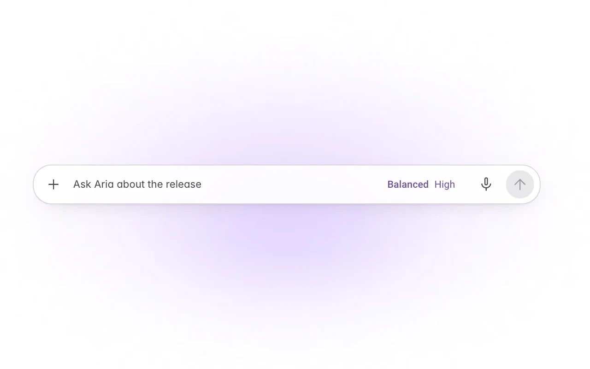
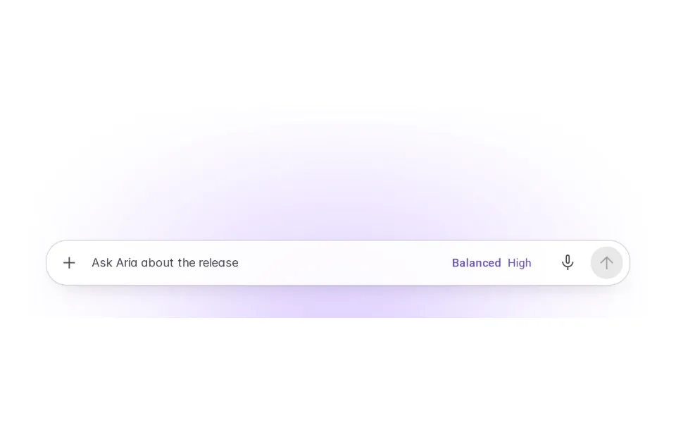
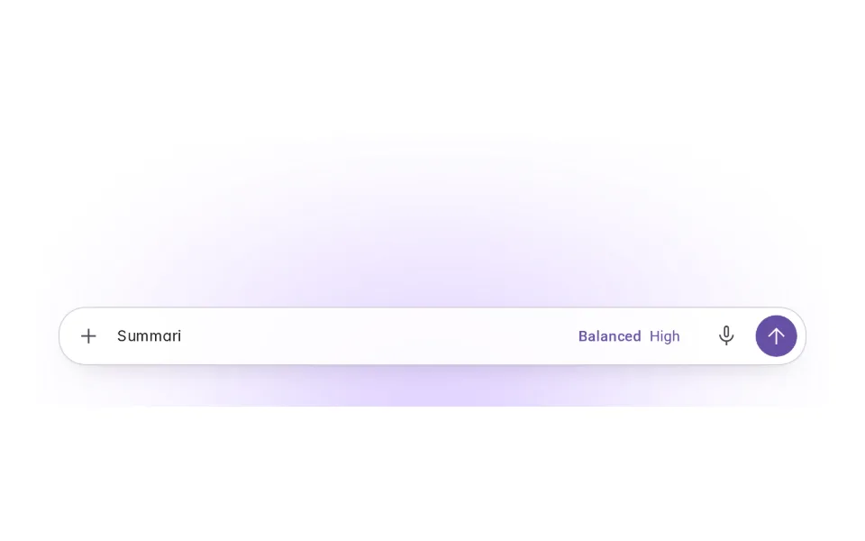
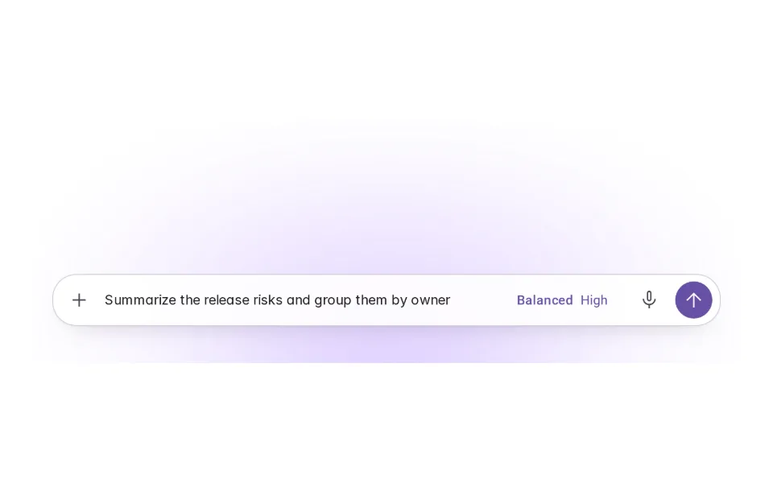
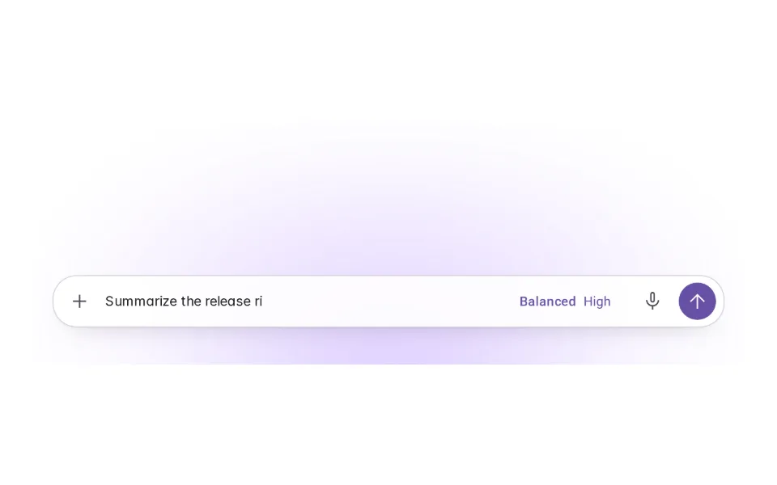
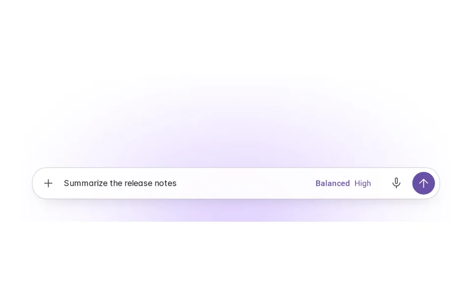

# Autocomplete

**Initially › Entry Points** · id `autocomplete` · API `Autocomplete`

> Ghost text that anticipates and completes user actions.

Open it: [material-pattern.html?id=autocomplete](../../../../material-pattern.html?id=autocomplete)

## Intent

Save typing on requests people make often, without taking any of the final instruction out of their hands.

## When to use

**Use when:** In a composer or field where people repeat requests, refer to commands, people, files or tools by name, and where a completion can be predicted from what they have typed so far.

**Not when:** Not before anything is typed (that is Suggested Prompts). Not for the agent raising something on its own (that is Proactive Suggestions). Not for structured scaffolds with fields (Templates). Not where a wrong completion is costly and hard to spot — legal, financial or medical wording.

## Where the code lives

| Part | Location |
|---|---|
| Live Preview (states, customizer, code tab) | [`material-preview.js` L8299–8464](../../../../material-preview.js#L8299-L8464) |
| Simulator | [`material-sim.js` L3478–3569](../../../../material-sim.js#L3478-L3569) |
| Docs (intent, anatomy, usage) | [`material-patterns.js` L1763–1877](../../../../material-patterns.js#L1763-L1877) |
| Pattern CSS (`.md-acv`, `.md-agentav`) | [`material-pattern.html` L631–3905](../../../../material-pattern.html#L631-L3905) · 10 lines |
| Sidebar entry | [`material-nav.js`](../../../../material-nav.js) |

## Nucleux packages

_None named in this pattern's code — it is built from shared Material 3 kit components._

## States (7)

### 01 · Empty / no suggestion _(initial)_

| | |
|---|---|
| Key | `empty` |
| Trigger | Nothing typed. |
| Behaviour | The composer as usual. Nothing is suggested before the person starts — that would be Suggested Prompts, not autocomplete. |
| Action | Start typing. Next: Typing. |

### 02 · Typing

| | |
|---|---|
| Key | `typing` |
| Trigger | Text is entered, but not enough to finish usefully — or nothing matches. |
| Behaviour | No suggestion. The composer behaves exactly as without autocomplete. |
| Action | Keep typing. Next: Suggestion available. |

### 03 · Suggestion available

| | |
|---|---|
| Key | `available` |
| Trigger | What is typed is the start of a known request. |
| Behaviour | The rest appears after the caret in a lighter colour with its key (Tab) at the end. It is not in the field: a screen reader hears “Suggestion: …”, separately from the text. |
| Action | Tab (or tap it) to accept, Escape to dismiss, or keep typing. Next: Accepted, Ignored, Dismissed, No longer relevant. |

### 04 · Suggestion accepted

| | |
|---|---|
| Key | `accepted` |
| Trigger | Tab, →, or a tap on the suggestion. |
| Behaviour | It becomes ordinary editable text with the caret at the end. Nothing is sent; Send is ready for when the person is. |
| Action | Edit it, or send. Next: Typing, or the conversation. |

### 05 · Suggestion ignored

| | |
|---|---|
| Key | `ignored` |
| Trigger | The person keeps typing the same words instead of accepting. |
| Behaviour | The suggestion follows along, shortening as they type — never overwriting a character they wrote. |
| Action | Keep typing, or accept the rest. Next: Accepted, No longer relevant. |

### 06 · Suggestion dismissed

| | |
|---|---|
| Key | `dismissed` |
| Trigger | Escape. |
| Behaviour | It goes, and does not come back for this request while the person keeps writing the same words. |
| Action | Keep typing. Next: Typing. |

### 07 · No longer relevant

| | |
|---|---|
| Key | `irrelevant` |
| Trigger | What is typed stops matching the suggestion. |
| Behaviour | It disappears at once. The person’s words are untouched. |
| Action | Keep typing. Next: Typing, or a new suggestion. |

## Simulator

Start a request in the composer. When what you type is the start of one people here often send, the rest appears after the caret. Tab takes it; it is never sent for you.

---

_Generated by `_build/catalog/make.js` — do not edit by hand; change the pattern and re-run._
