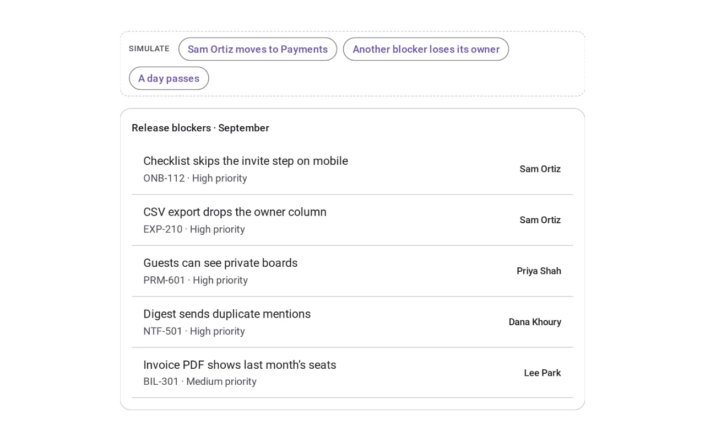
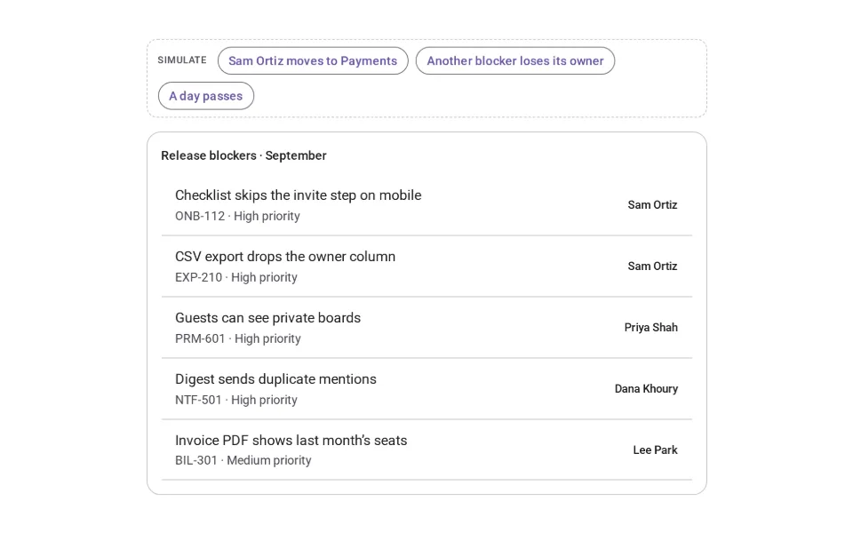
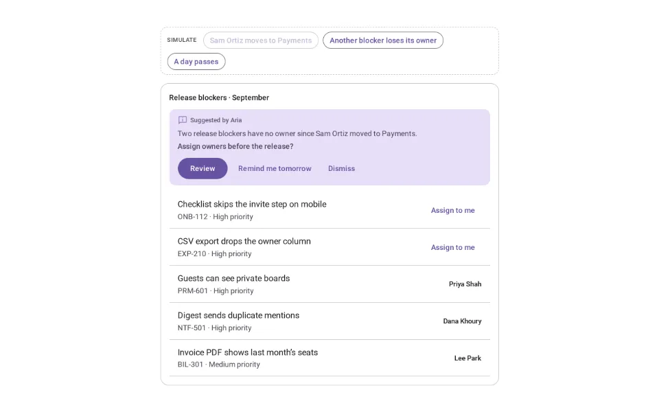
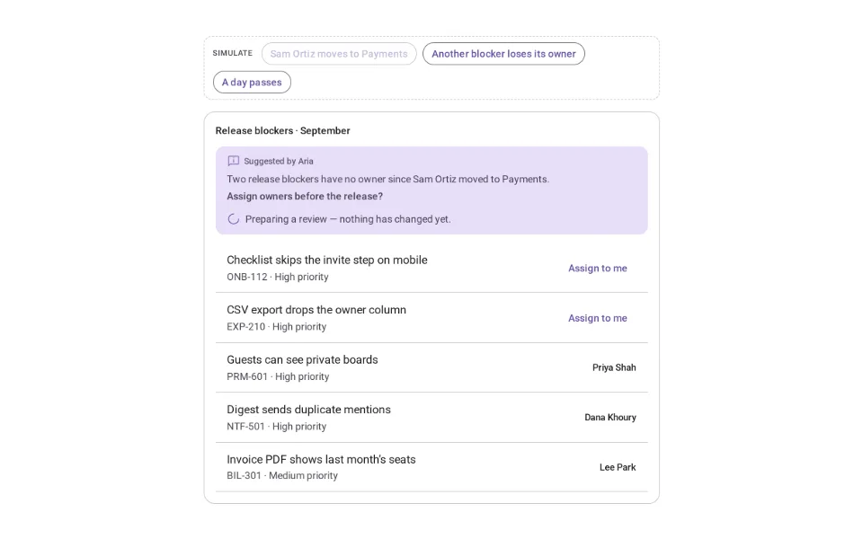
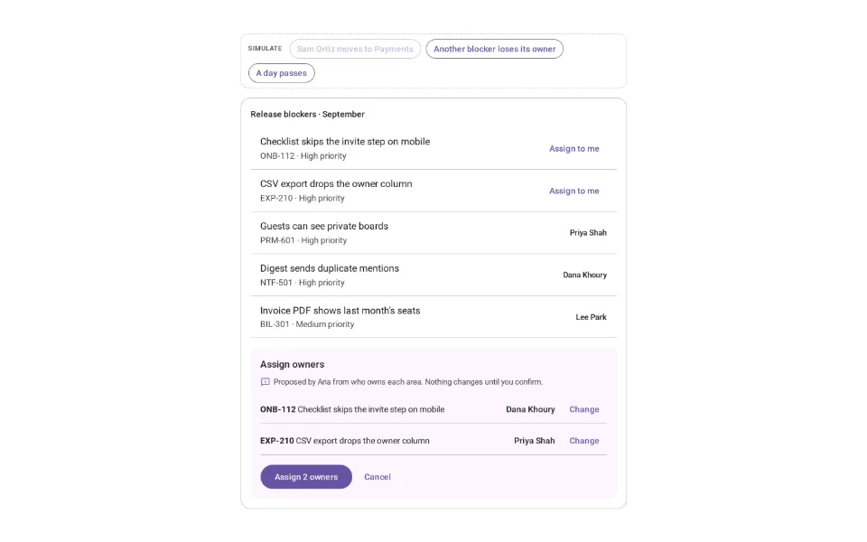
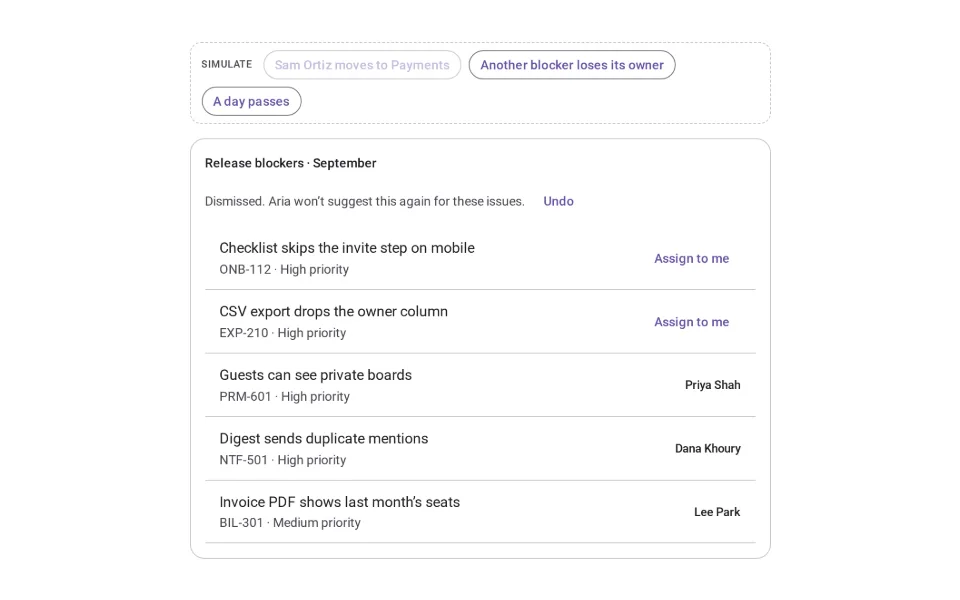
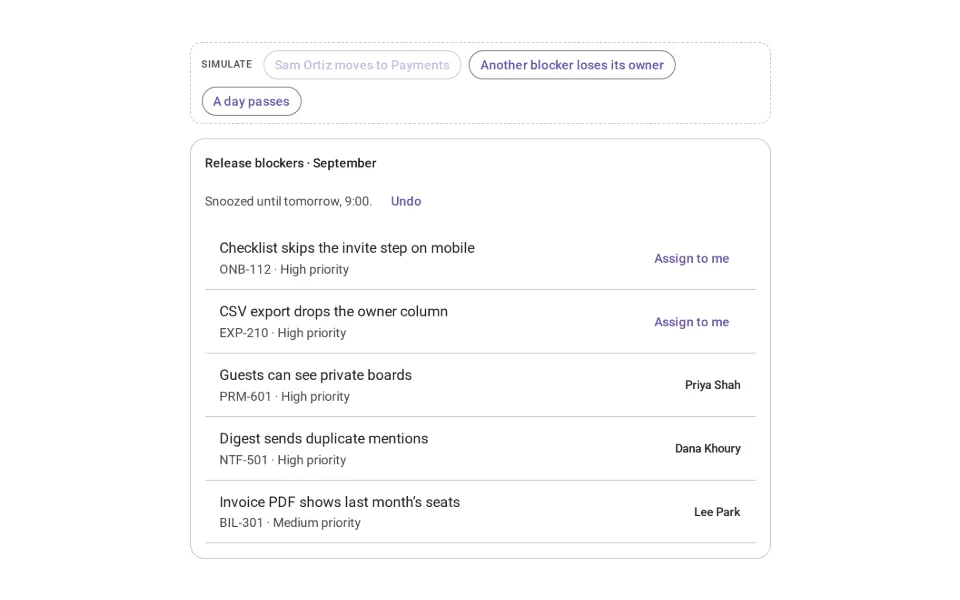
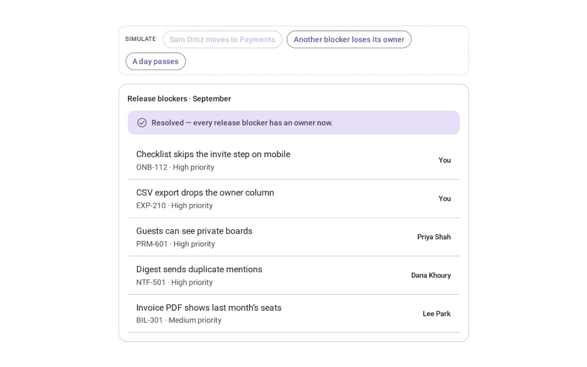

# Proactive Suggestions

**Initially › Entry Points** · id `proactive` · API `ProactiveSuggestion`

> Invisible AI moments that arrive exactly when needed.

Open it: [material-pattern.html?id=proactive](../../../../material-pattern.html?id=proactive)

## Intent

Surface an opportunity or a problem the person would otherwise have to go looking for, as a recommendation they can review, snooze or dismiss — never as an action already taken.

## When to use

**Use when:** During ongoing work, when a specific, checkable condition becomes true and there is a clear next step: unowned blockers before a release, an unanswered email, a duplicate issue, a missed deadline, a step left out of a checklist.

**Not when:** Not to start a conversation (that is Suggested Prompts) or to finish what someone is typing (Autocomplete). Not for low-value or speculative tips, not on a timer with no new evidence, and not as a modal that interrupts the task. Never as a disguised action: if it would change something, it is a review first.

## Where the code lives

| Part | Location |
|---|---|
| Live Preview (states, customizer, code tab) | [`material-preview.js` L7961–8141](../../../../material-preview.js#L7961-L8141) |
| Simulator | [`material-sim.js` L2652–2760](../../../../material-sim.js#L2652-L2760) |
| Docs (intent, anatomy, usage) | [`material-patterns.js` L1882–1992](../../../../material-patterns.js#L1882-L1992) |
| Pattern CSS (`.md-prov`, `.md-pro`) | [`material-pattern.html` L3805–3867](../../../../material-pattern.html#L3805-L3867) · 41 lines |
| Sidebar entry | [`material-nav.js`](../../../../material-nav.js) |

## Nucleux packages

_None named in this pattern's code — it is built from shared Material 3 kit components._

## States (7)

### 01 · Dormant _(initial)_

| | |
|---|---|
| Key | `dormant` |
| Trigger | Nothing worth raising — or the reason has been dealt with. |
| Behaviour | Nothing is shown. The agent watches the work, silently. |
| Action | Simulate “Sam Ortiz moves to Payments”. Next: Suggested. |

### 02 · Suggested

| | |
|---|---|
| Key | `suggested` |
| Trigger | The agent noticed something: two release blockers lost their owner. |
| Behaviour | A compact card where the work is: who suggests it, why it appeared, what it recommends — as a question — and Review, Remind me tomorrow, Dismiss. Nothing has changed; the list is fully usable. |
| Action | Review, snooze, dismiss — or fix it yourself. Next: Action preparing, Snoozed, Dismissed, No longer relevant. |

### 03 · Action preparing

| | |
|---|---|
| Key | `preparing` |
| Trigger | The person pressed Review. |
| Behaviour | The working mark and “Preparing a review — nothing has changed yet.” |
| Action | Wait a moment. Next: Accepted. |

### 04 · Accepted

| | |
|---|---|
| Key | `accepted` |
| Trigger | The review is ready. |
| Behaviour | The proposed owners, each changeable, and one confirming action. Nothing is assigned until the person confirms. |
| Action | Change, confirm (Undo stays available) or cancel. Next: Dormant. |

### 05 · Dismissed

| | |
|---|---|
| Key | `dismissed` |
| Trigger | The person pressed Dismiss. |
| Behaviour | It goes, with Undo. It is remembered for these issues: the same evidence never brings it back — only something new does. |
| Action | Carry on. Next: Dormant — or Suggested on new evidence. |

### 06 · Snoozed

| | |
|---|---|
| Key | `snoozed` |
| Trigger | The person chose Remind me tomorrow. |
| Behaviour | It goes until tomorrow, 9:00, with Undo. It returns then only if the reason is still true. |
| Action | Simulate “A day passes”. Next: Suggested, or Dormant if resolved. |

### 07 · No longer relevant

| | |
|---|---|
| Key | `irrelevant` |
| Trigger | The reason stopped being true — the person assigned the owners themselves. |
| Behaviour | It says so briefly and withdraws on its own. |
| Action | Nothing. Next: Dormant. |

## Simulator

Work through release readiness. When Aria notices something worth raising, it offers one next step — with the reason, and nothing done until you confirm.

---

_Generated by `_build/catalog/make.js` — do not edit by hand; change the pattern and re-run._
