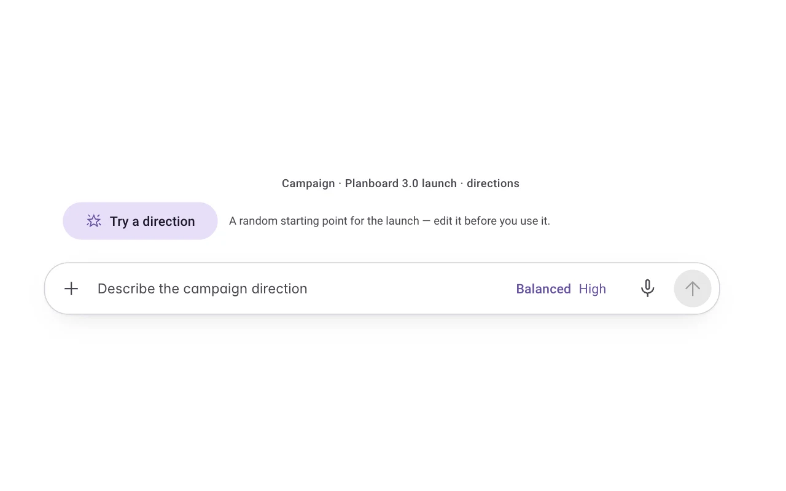
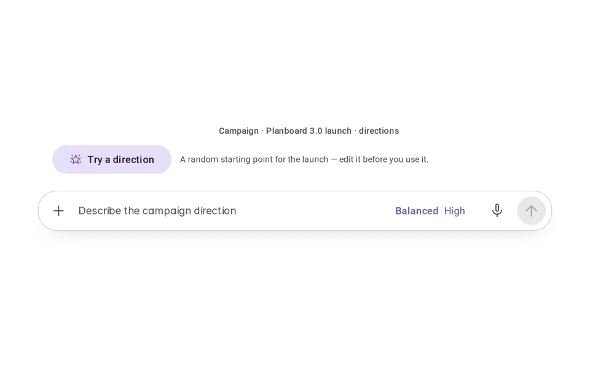
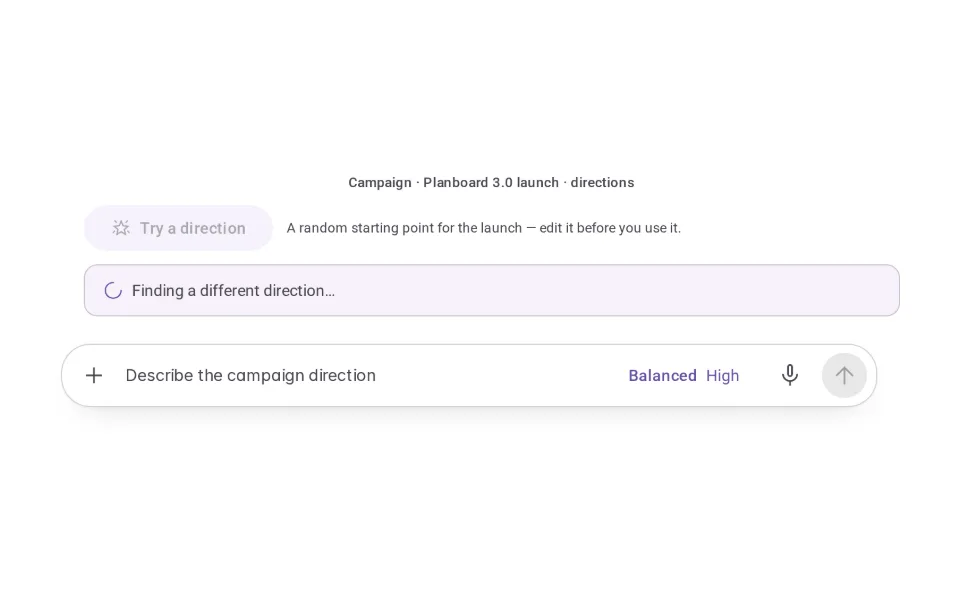
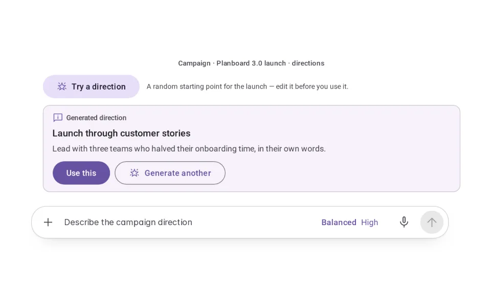
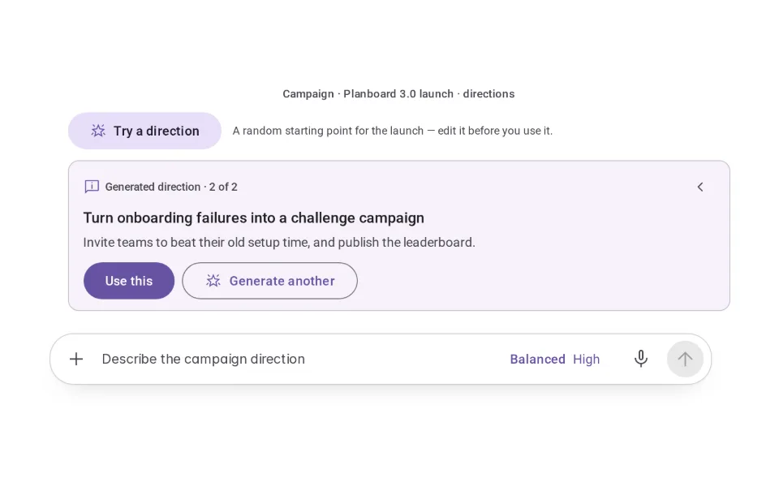
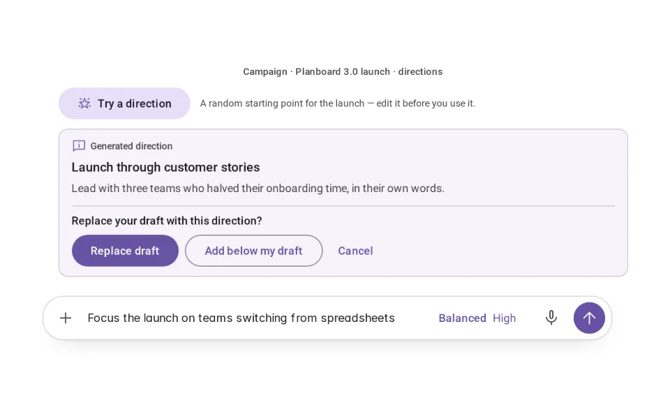
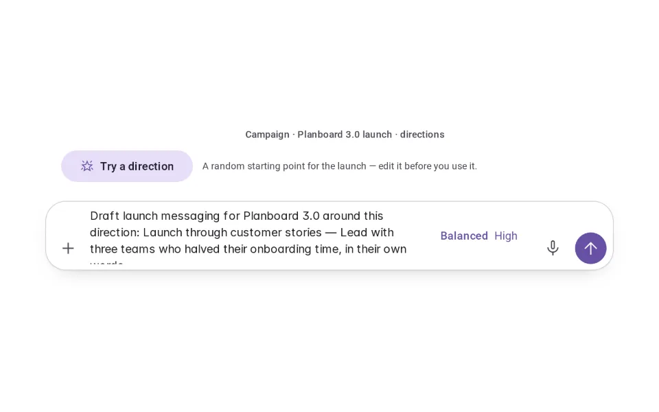

# Randomize

**Initially › Entry Points** · id `randomize` · API `Randomize`

> A 'dice' that kickstarts the experience with a fun result.

Open it: [material-pattern.html?id=randomize](../../../../material-pattern.html?id=randomize)

## Intent

Help people explore alternatives — campaign angles, ideas, styles, presets — without inventing every one themselves, while the composer stays theirs.

## When to use

**Use when:** Creative and exploratory work where variety is the point and nothing is at stake: campaign directions, naming, ideas, visual styles, presets, prompt inspiration, starting configurations for generative tools.

**Not when:** Not in finance, legal, medical, safety, destructive or otherwise deterministic workflows, where a random "direction" has no value and may mislead. Not as a replacement for open input, and not as a disguised way to run something.

## Where the code lives

| Part | Location |
|---|---|
| Live Preview (states, customizer, code tab) | [`material-preview.js` L8148–8290](../../../../material-preview.js#L8148-L8290) |
| Simulator | [`material-sim.js` L3583–3678](../../../../material-sim.js#L3583-L3678) |
| Docs (intent, anatomy, usage) | [`material-patterns.js` L1997–2099](../../../../material-patterns.js#L1997-L2099) |
| Pattern CSS (`.md-rndv`) | [`material-pattern.html` L3796–3798](../../../../material-pattern.html#L3796-L3798) · 3 lines |
| Sidebar entry | [`material-nav.js`](../../../../material-nav.js) |

## Nucleux packages

_None named in this pattern's code — it is built from shared Material 3 kit components._

## States (6)

### 01 · Ready _(initial)_

| | |
|---|---|
| Key | `ready` |
| Trigger | An exploratory workspace — campaign concepts for the Planboard 3.0 launch. |
| Behaviour | One optional control above the composer, saying what it gives: a random starting direction. The composer works on its own. |
| Action | Press Try a direction — or just type. Next: Generating. |

### 02 · Generating

| | |
|---|---|
| Key | `generating` |
| Trigger | Try a direction (or Generate another) was pressed. |
| Behaviour | The working mark and “Finding a different direction…”. Nothing else changes. |
| Action | Wait a moment. Next: New suggestion. |

### 03 · New suggestion

| | |
|---|---|
| Key | `suggestion` |
| Trigger | A direction came back. |
| Behaviour | One direction — a title and a line — marked as generated, with Use this and Generate another. Nothing is placed or run yet. |
| Action | Use it, or generate another. Next: Applied, Generate another. |

### 04 · Generate another

| | |
|---|---|
| Key | `another` |
| Trigger | The person asked for another. |
| Behaviour | A different direction — never a repeat this round — with “2 of 2” and a way back to the previous one. |
| Action | Keep going, step back, or use one. Next: Applied. |

### 05 · Replace confirmation

| | |
|---|---|
| Key | `confirm` |
| Trigger | Use this, while the composer holds the person’s own words. |
| Behaviour | It asks: replace the draft, add the direction below it, or cancel. Their words are never silently replaced. |
| Action | Choose. Next: Applied, or back to the suggestion. |

### 06 · Applied to composer

| | |
|---|---|
| Key | `applied` |
| Trigger | The direction was placed. |
| Behaviour | An editable prompt in the shared composer, focus and caret there. Nothing is sent. |
| Action | Edit it, then send — or try another direction. Next: the conversation. |

## Simulator

Exploring campaign directions for a launch. Try a direction for a random starting point, generate another until one is worth pursuing, then put it in the composer and make it yours.

---

_Generated by `_build/catalog/make.js` — do not edit by hand; change the pattern and re-run._
