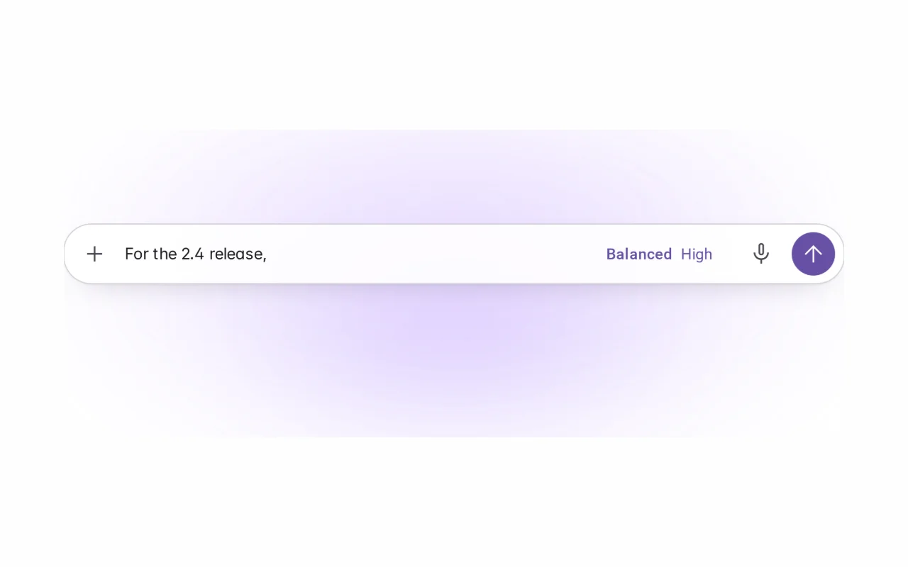
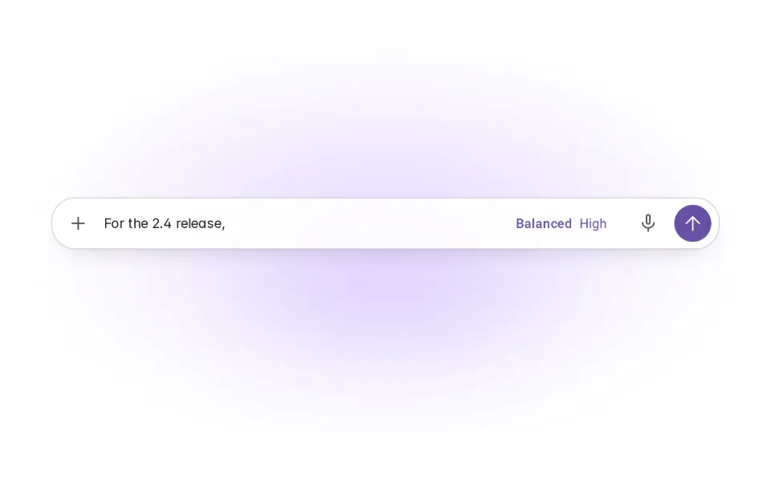
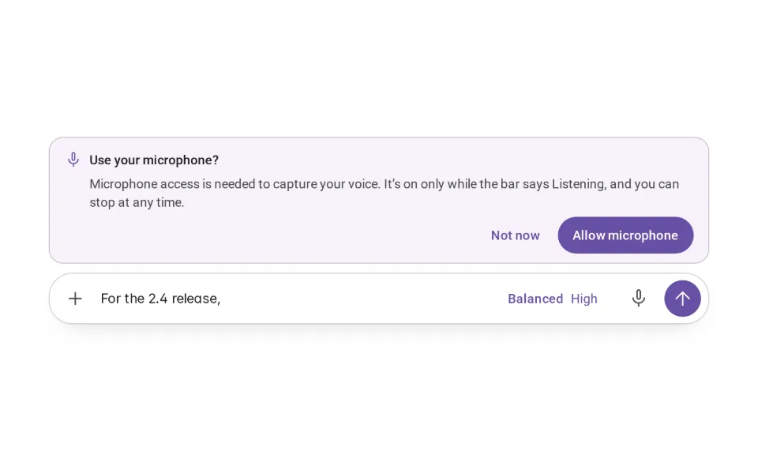
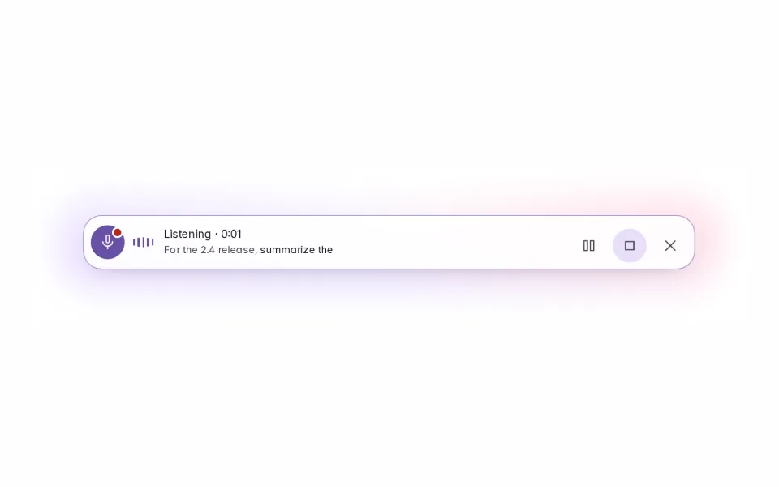
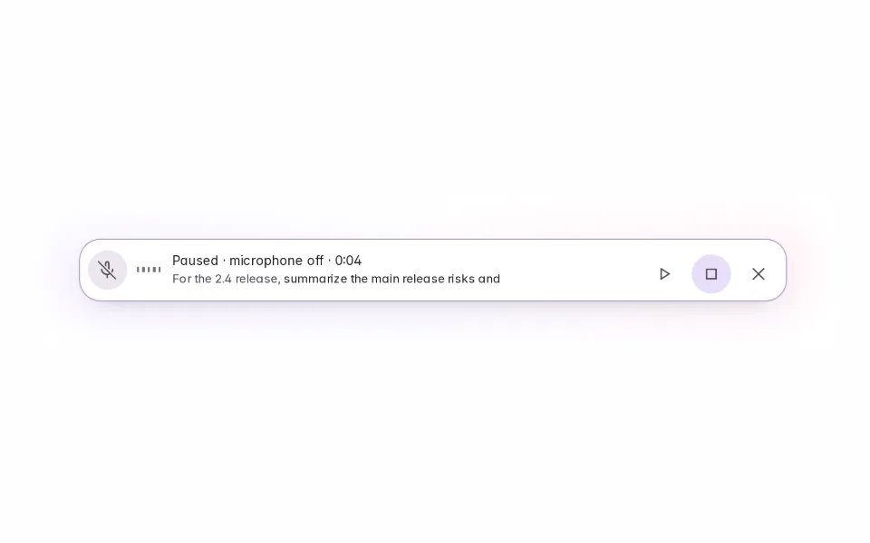
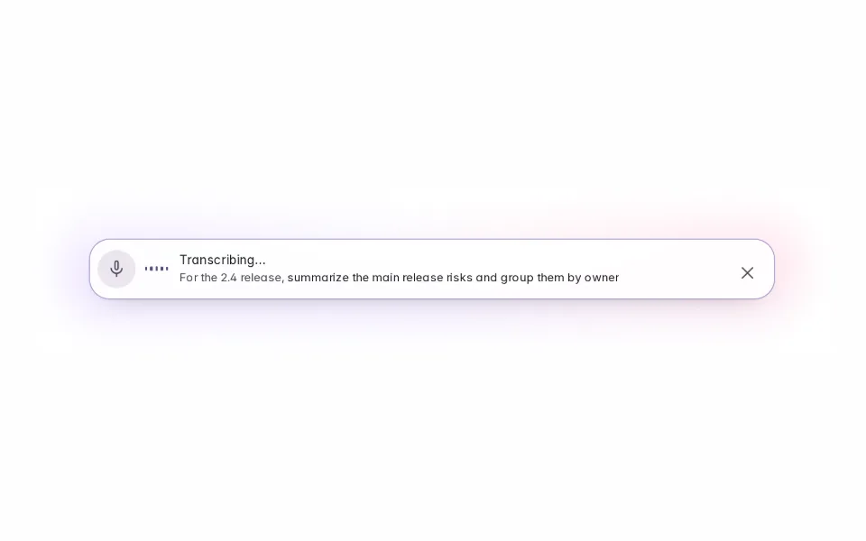
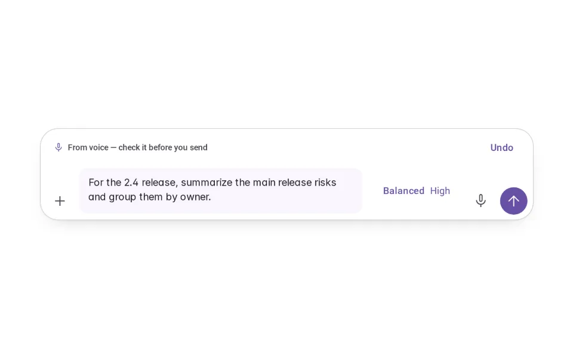
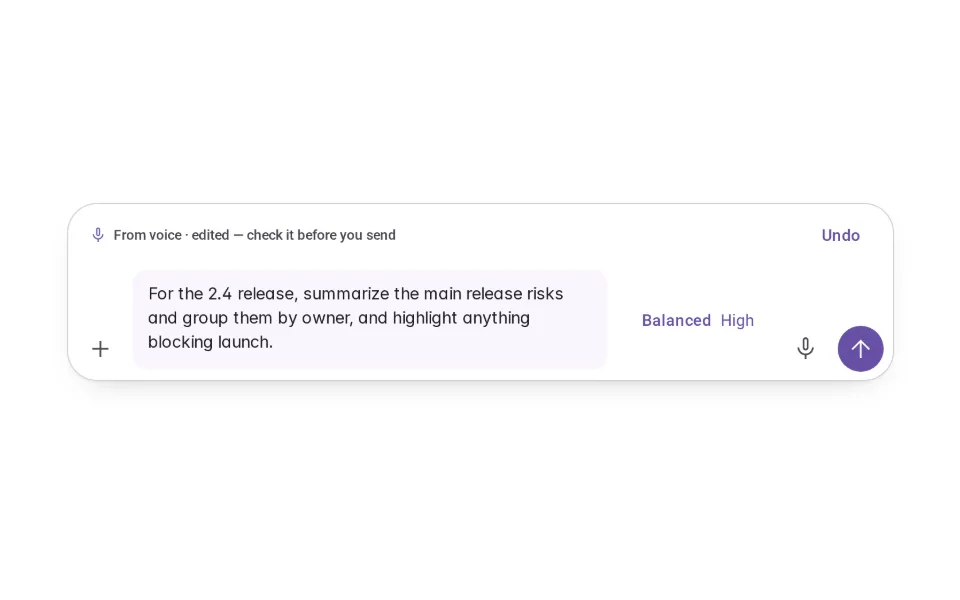
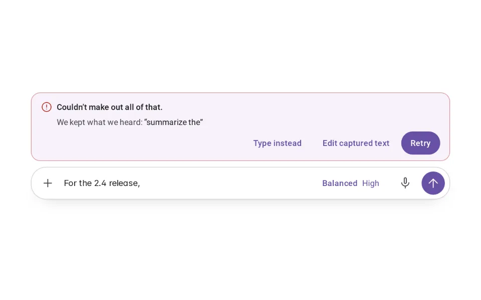
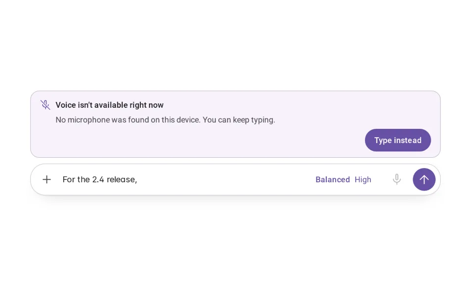

# Voice Input

**Initially › Expressive Input** · id `voice-input` · API `AgentComposer`

> Speak into the composer; review the words, then send.

Open it: [material-pattern.html?id=voice-input](../../../../material-pattern.html?id=voice-input)

## Intent

Speech as an INPUT method into the shared composer: speech → transcript → editable text → the person sends. Not a separate voice assistant.

## When to use

**Use when:** Wherever a request is quicker said than typed, and the product already has a composer to say it into. Not as a novelty alternative to a keyboard that is there and working, and not at all where the request commits something that a misheard word would commit wrongly — there, hold the text for correction first.

## Where the code lives

| Part | Location |
|---|---|
| Live Preview (states, customizer, code tab) | [`material-preview.js` L10806–11006](../../../../material-preview.js#L10806-L11006) |
| Simulator | [`material-sim.js` L5676–5822](../../../../material-sim.js#L5676-L5822) |
| Docs (intent, anatomy, usage) | [`material-patterns.js` L2802–2925](../../../../material-patterns.js#L2802-L2925) |
| Sidebar entry | [`material-nav.js`](../../../../material-nav.js) |

## Nucleux packages

_None named in this pattern's code — it is built from shared Material 3 kit components._

## States (9)

### 01 · Ready _(initial)_

| | |
|---|---|
| Key | `ready` |
| Trigger | The composer at rest — here with a few words already typed. |
| Behaviour | The ordinary composer with a microphone in it. No gradient, no capture. |
| Meaning | You can type, or speak instead. Voice is optional. |
| Action | Press the microphone (the first time, the browser asks for it). |
| Next | Permission required, or Listening. |

### 02 · Permission required

| | |
|---|---|
| Key | `permission` |
| Trigger | The microphone was pressed and access has not been given yet. |
| Behaviour | A panel above the bar says what is needed, why, when it is on and how to stop. The composer stays usable under it. |
| Meaning | Nothing is recording yet. |
| Action | Allow microphone, or Not now (keep typing). |
| Next | Listening, or Ready. |

### 03 · Listening

| | |
|---|---|
| Key | `listening` |
| Trigger | Capture started. |
| Behaviour | The bar keeps its place and becomes the voice session: a lit microphone with a dot, “Listening · 0:04”, the words as they are heard after anything already typed, and Pause, Stop, Cancel. The gradient behind it swells a little with each word and settles in silence. |
| Meaning | The microphone is on. Nothing is sent. |
| Action | Pause, Stop (keep the words) or Cancel (discard this recording). |
| Next | Paused, Processing, or Ready. |

### 04 · Paused

| | |
|---|---|
| Key | `paused` |
| Trigger | Pause was pressed. |
| Behaviour | The microphone turns off (“Paused · microphone off”), the dot goes, the gradient settles. What was heard stays. |
| Meaning | Not listening; your progress is kept. |
| Action | Resume, Stop or Cancel. |
| Next | Listening, Processing, or Ready. |

### 05 · Processing

| | |
|---|---|
| Key | `processing` |
| Trigger | Stop was pressed, silence ended it, or the time limit was reached. |
| Behaviour | The microphone is off. “Transcribing…”, with the gradient drifting slowly. Only Cancel is offered. |
| Meaning | Turning speech into text. Still nothing sent. |
| Action | Wait, or Cancel. |
| Next | Transcribed, or Couldn’t understand. |

### 06 · Transcribed

| | |
|---|---|
| Key | `transcribed` |
| Trigger | Transcription finished. |
| Behaviour | The bar is a text composer again. The words join what was typed, marked “From voice — check it before you send”, with Undo. The caret is in the field. |
| Meaning | This is what was understood. It has not been sent. |
| Action | Edit it, Undo it, or Send. |
| Next | Editing transcript, Ready (Undo), or sent. |

### 07 · Editing transcript

| | |
|---|---|
| Key | `editing` |
| Trigger | The person changes the transcribed text. |
| Behaviour | The marker reads “From voice · edited”; Undo still returns to what was typed before voice. |
| Meaning | Your correction wins. Voice only drafted it. |
| Action | Send, or keep editing. |
| Next | Sent → Ready. |

### 08 · Couldn’t understand

| | |
|---|---|
| Key | `nounderstand` |
| Trigger | Too little could be made out to trust. |
| Behaviour | A panel says what happened and keeps what was heard; the typed text is untouched. No guess is put in the field. |
| Meaning | Nothing was lost, and nothing was guessed. |
| Action | Retry, Edit captured text, or Type instead. |
| Next | Listening, Editing transcript, or Ready. |

### 09 · Unavailable

| | |
|---|---|
| Key | `unavailable` |
| Trigger | No microphone was found, or the device blocks it. |
| Behaviour | The microphone button is unavailable with its reason; a note says so. Typing works exactly as before. |
| Meaning | Voice is off for now; the composer is not. |
| Action | Type instead. |
| Next | Ready. |

## Simulator

Voice is a way of writing the request, not a different product. Speak, see exactly what was heard, fix it, and send it yourself.

---

_Generated by `_build/catalog/make.js` — do not edit by hand; change the pattern and re-run._
