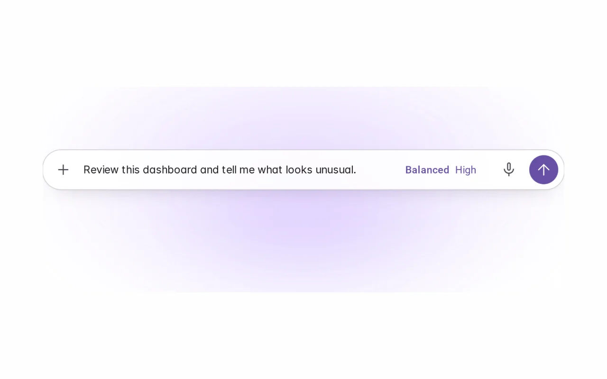
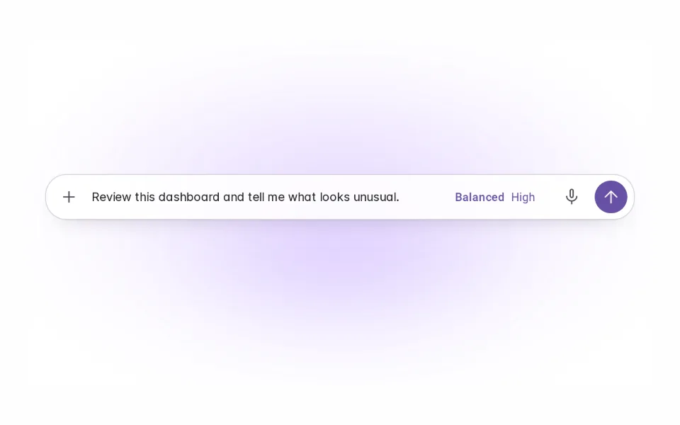
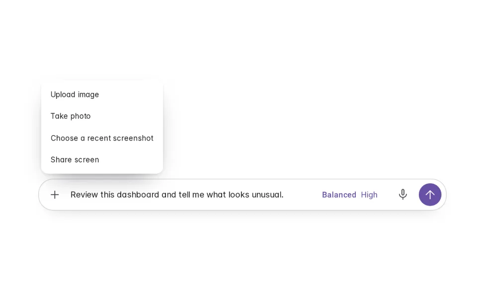
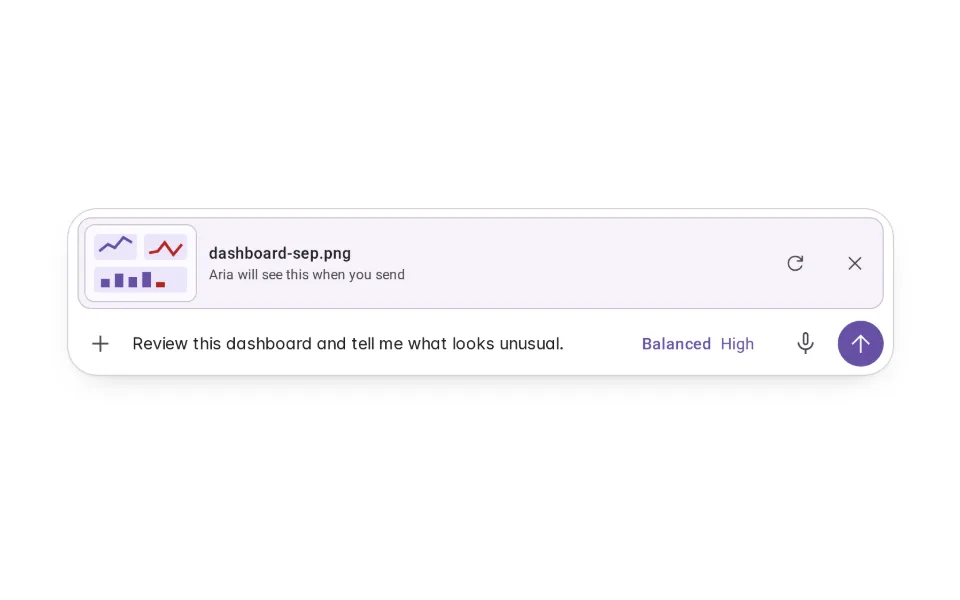
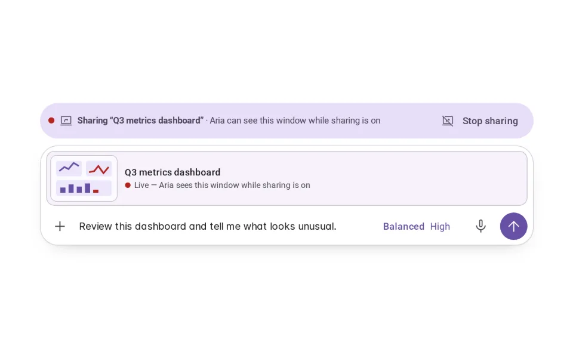
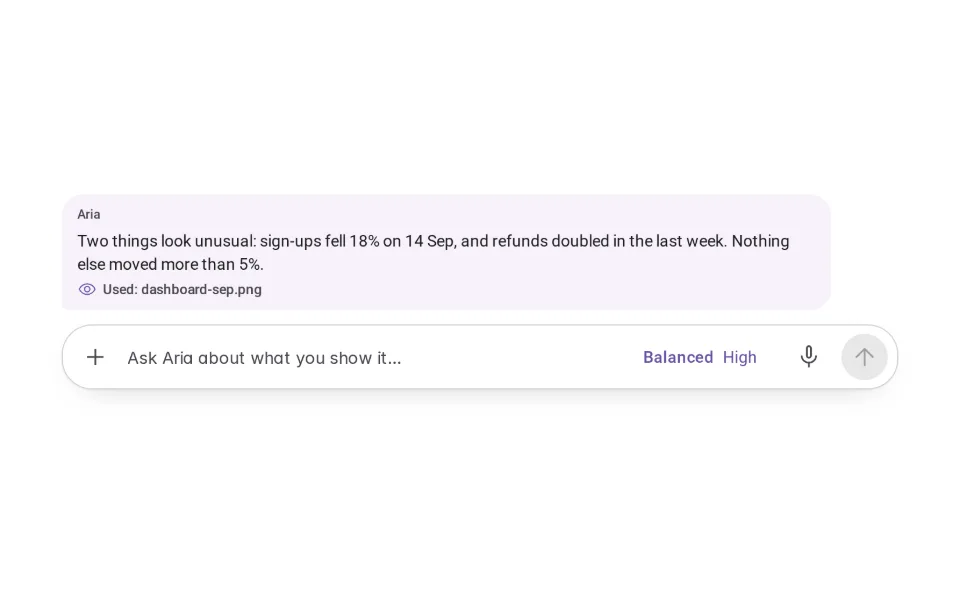
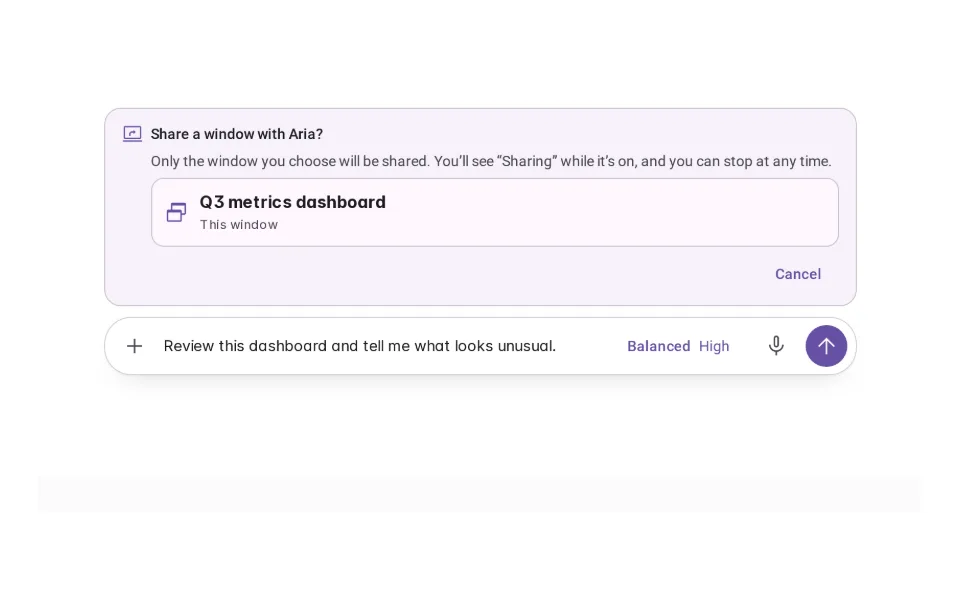
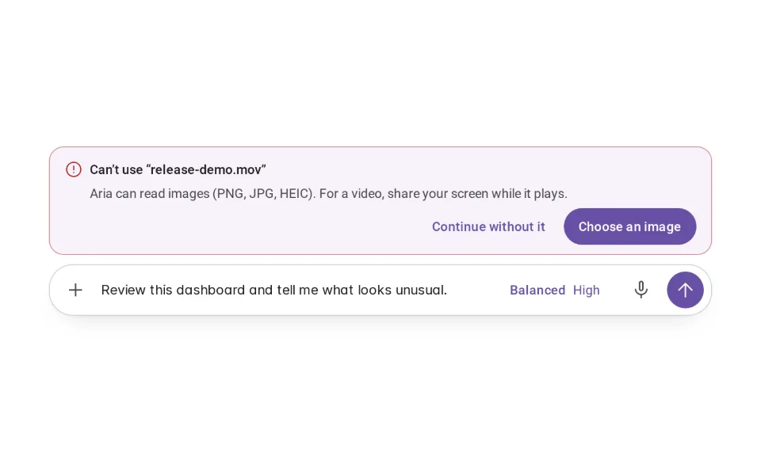
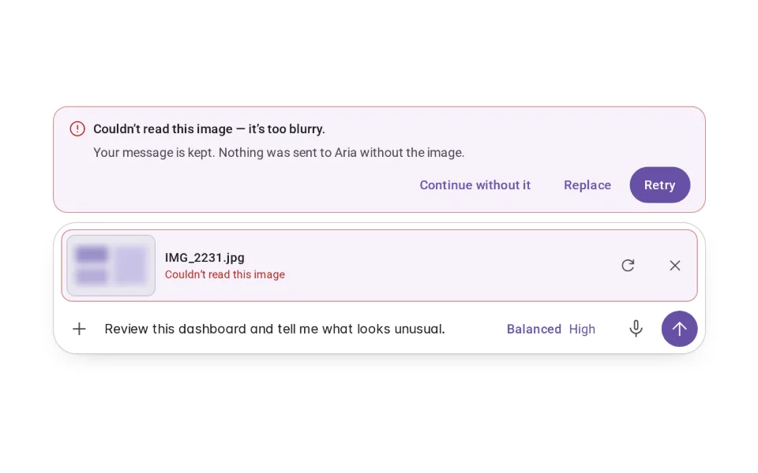

# Visual Input

**Initially › Expressive Input** · id `visual-input` · API `AgentComposer`

> Show an image, a photo or a window — as context you control.

Open it: [material-pattern.html?id=visual-input](../../../../material-pattern.html?id=visual-input)

## Intent

Visual context joins the request in the shared composer: recognisable, removable, combined with words — and screen sharing is a visible, stoppable state.

## When to use

**Use when:** Where the evidence is visual and describing it in words is slower or less accurate: error screens and stack traces, damage and defects, whiteboards, receipts, labels, charts in somebody else's document, field and medical photographs.

## Where the code lives

| Part | Location |
|---|---|
| Live Preview (states, customizer, code tab) | [`material-preview.js` L11015–11180](../../../../material-preview.js#L11015-L11180) |
| Simulator | [`material-sim.js` L5833–5946](../../../../material-sim.js#L5833-L5946) |
| Docs (intent, anatomy, usage) | [`material-patterns.js` L2930–3044](../../../../material-patterns.js#L2930-L3044) |
| Pattern CSS (`.md-vi`) | [`material-pattern.html` L6541–6594](../../../../material-pattern.html#L6541-L6594) · 17 lines |
| Sidebar entry | [`material-nav.js`](../../../../material-nav.js) |

## Nucleux packages

_None named in this pattern's code — it is built from shared Material 3 kit components._

## States (9)

### 01 · No visual _(initial)_

| | |
|---|---|
| Key | `none` |
| Trigger | The composer, with words typed and nothing shown yet. |
| Behaviour | An ordinary composer. Visual context is offered under +. |
| Meaning | Aria only has your words. |
| Action | Press + to add an image, a photo, a screenshot or a window. |
| Next | Selecting. |

### 02 · Selecting

| | |
|---|---|
| Key | `selecting` |
| Trigger | + was pressed. |
| Behaviour | A menu lists only the sources this product allows: Upload image, Take photo, Choose a recent screenshot, Share screen. |
| Meaning | Nothing is shared yet. |
| Action | Choose a source, or close the menu. |
| Next | Visual attached, Permission required, Unsupported. |

### 03 · Visual attached

| | |
|---|---|
| Key | `attached` |
| Trigger | An image was chosen. |
| Behaviour | A card with a real preview joins the composer above the words, with its name, “Aria will see this when you send”, Replace and Remove. The words are untouched. |
| Meaning | This is exactly what Aria will see — and only when you send. |
| Action | Add words, Replace, Remove, or Send. |
| Next | Processing, No visual (Remove), Selecting (Replace). |

### 04 · Sharing

| | |
|---|---|
| Key | `sharing` |
| Trigger | A window was chosen to share. |
| Behaviour | A persistent bar — red dot, “Sharing ‘Q3 metrics dashboard’”, Stop sharing — sits above the composer, and the card says it is live. |
| Meaning | Aria can see this window, and only this window, until you stop. |
| Action | Ask about it, or Stop sharing at any time. |
| Next | Processing, or No visual (Stop sharing). |

### 05 · Processing

| | |
|---|---|
| Key | `processing` |
| Trigger | The request was sent with a visual. |
| Behaviour | The card says “Aria is reading this image…” with a slow sheen across the preview; Replace and Remove step aside. |
| Meaning | Aria is using the visual now. Nothing else happens because of it. |
| Action | Wait. |
| Next | Ready, or Failed. |

### 06 · Ready

| | |
|---|---|
| Key | `ready` |
| Trigger | Aria finished reading it. |
| Behaviour | Your message shows the visual it carried; the answer says which visual it used. The composer is clear for the next request. |
| Meaning | You can see what Aria used to answer. |
| Action | Ask a follow-up, or add another visual. |
| Next | No visual, or Selecting. |

### 07 · Permission required

| | |
|---|---|
| Key | `permission` |
| Trigger | Take photo or Share screen was chosen. |
| Behaviour | A panel above the composer says what is needed, why, when it is on and how to stop — and, for sharing, lets you choose the one window. |
| Meaning | Nothing is captured or shared yet. |
| Action | Choose the window (or Allow camera), or Cancel. |
| Next | Sharing / Visual attached, or No visual. |

### 08 · Unsupported

| | |
|---|---|
| Key | `unsupported` |
| Trigger | A file that cannot be used was chosen (here, a video). |
| Behaviour | A panel says what cannot be used and what can; the words stay. |
| Meaning | Nothing was added. |
| Action | Choose an image, or continue without it. |
| Next | Selecting, or No visual. |

### 09 · Failed

| | |
|---|---|
| Key | `failed` |
| Trigger | Aria could not read the image (too blurry). |
| Behaviour | The card is marked, a panel says why, and the message is kept — nothing was sent without the image. |
| Meaning | Nothing is lost; the request waits for you. |
| Action | Retry, Replace, or Continue without it. |
| Next | Processing, Selecting, or No visual. |

## Simulator

Show Aria what you are looking at, and stop showing it whenever you like. Sharing is a state you can always see, and stopping it never ends the conversation.

---

_Generated by `_build/catalog/make.js` — do not edit by hand; change the pattern and re-run._
