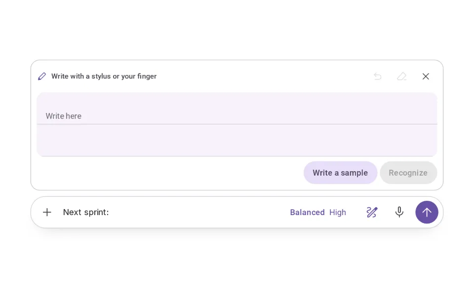
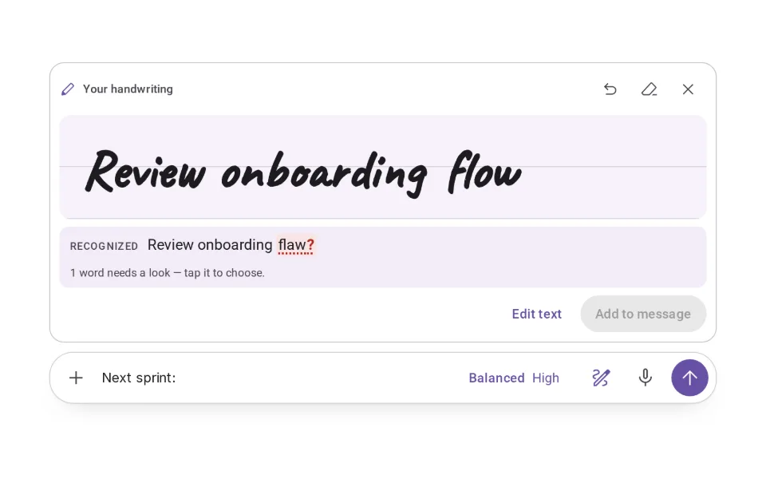
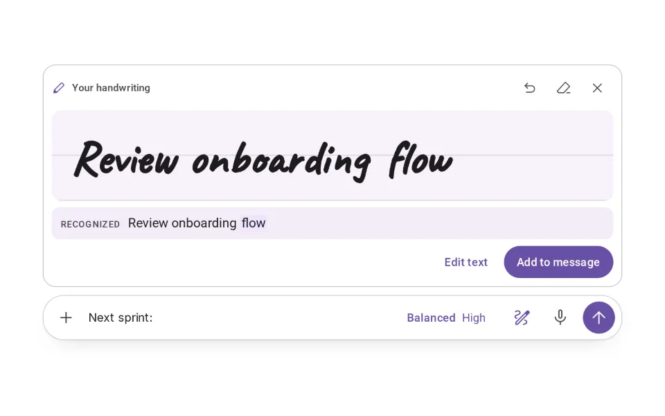
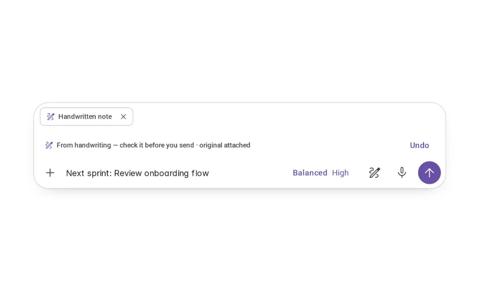
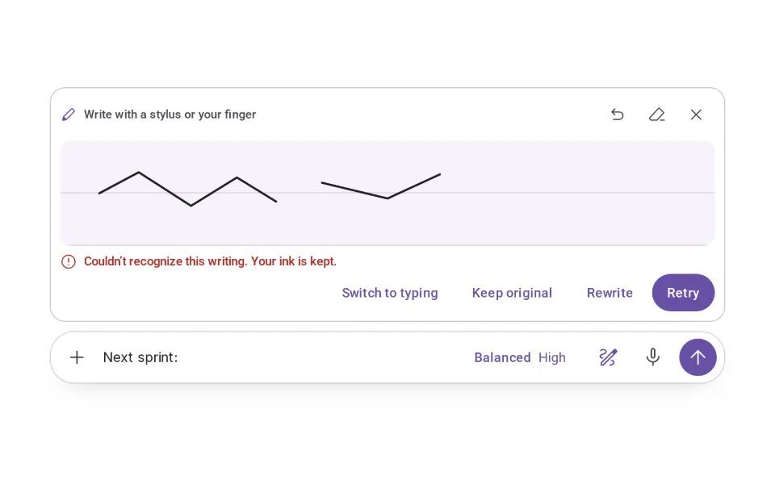
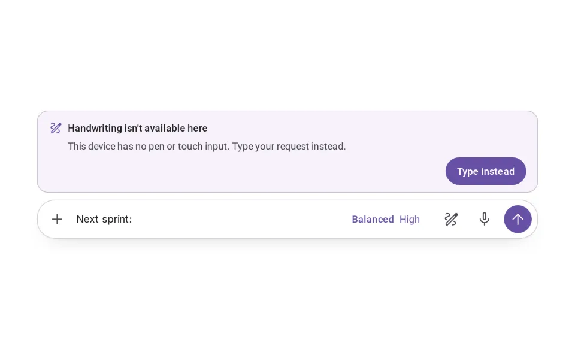

# Handwriting Input

**Initially › Expressive Input** · id `handwriting` · API `AgentComposer`

> Write by hand; review what was recognized before it joins your message.

Open it: [material-pattern.html?id=handwriting](../../../../material-pattern.html?id=handwriting)

## Intent

A pen in the shared composer. Handwriting, recognized text and accepted text stay distinct, and nothing uncertain is ever accepted silently.

## When to use

**Use when:** On pen- and touch-capable surfaces, for short requests, notes and annotations where writing is quicker or more natural than typing. Not as the only way in: the field always works, and on a device without pen or touch the pen is shown unavailable and typing carries on.

## Where the code lives

| Part | Location |
|---|---|
| Live Preview (states, customizer, code tab) | [`material-preview.js` L11186–11342](../../../../material-preview.js#L11186-L11342) |
| Simulator | [`material-sim.js` L5966–6095](../../../../material-sim.js#L5966-L6095) |
| Docs (intent, anatomy, usage) | [`material-patterns.js` L3049–3145](../../../../material-patterns.js#L3049-L3145) |
| Pattern CSS (`.md-hwp`, `.md-hw`) | [`material-pattern.html` L6599–6649](../../../../material-pattern.html#L6599-L6649) · 32 lines |
| Sidebar entry | [`material-nav.js`](../../../../material-nav.js) |

## Nucleux packages

_None named in this pattern's code — it is built from shared Material 3 kit components._

## States (8)

### 01 · Ready _(initial)_

| | |
|---|---|
| Key | `ready` |
| Trigger | The pen in the composer was pressed. |
| Behaviour | A writing pad opens above the composer, which stays where it was and keeps what was typed (“Next sprint:”). Undo, Clear and Close sit on the pad. |
| Meaning | Nothing is written or recognized yet. |
| Action | Write with a stylus, a finger or the mouse — or Close. |
| Next | Writing. |

### 02 · Writing

| | |
|---|---|
| Key | `writing` |
| Trigger | Ink is on the pad. |
| Behaviour | Strokes appear as they are drawn. Undo removes the last stroke; Clear removes all of it. Recognize is offered; nothing is read yet. |
| Meaning | This ink is the original. It is yours, not text yet. |
| Action | Keep writing, Undo, Clear, or Recognize. |
| Next | Recognizing. |

### 03 · Recognizing

| | |
|---|---|
| Key | `recognizing` |
| Trigger | Recognize was pressed (or, in automatic mode, the pen paused). |
| Behaviour | The status says “Recognizing your writing…”; a slow sheen crosses the ink, which stays in view. Undo and Clear step aside. |
| Meaning | The ink is being read. Nothing joins the message because of it. |
| Action | Wait. |
| Next | Recognized, or Couldn’t recognize. |

### 04 · Recognized

| | |
|---|---|
| Key | `recognized` |
| Trigger | Recognition finished. |
| Behaviour | Under the ink: “Recognized: Review onboarding flaw?”. The uncertain word is a button marked “?”, and Add to message is disabled until it is settled. |
| Meaning | This is what was read — not yet what you said. |
| Action | Tap the uncertain word and choose, or Edit text. |
| Next | Editing recognition, or Added to message. |

### 05 · Editing recognition

| | |
|---|---|
| Key | `editing` |
| Trigger | A word was corrected. |
| Behaviour | The corrected word (“flow”) is marked as yours; nothing is uncertain any more, so Add to message is enabled. |
| Meaning | The text reads right. It is still not in the message. |
| Action | Add to message, or Edit text in the composer. |
| Next | Added to message. |

### 06 · Added to message

| | |
|---|---|
| Key | `added` |
| Trigger | Add to message was pressed. |
| Behaviour | The words join what was typed — never replacing it — marked “From handwriting” with Undo. The ink is attached as “Handwritten note”, removable. |
| Meaning | Accepted text. Nothing is sent until you send. |
| Action | Edit, Undo, remove the original, or Send. |
| Next | Ready (after sending), or back to what was typed (Undo). |

### 07 · Couldn’t recognize

| | |
|---|---|
| Key | `failed` |
| Trigger | Too little of the ink could be read to trust. |
| Behaviour | A message says so; the ink stays on the pad. Rewrite, Retry, Keep original (send the ink as an image) and Switch to typing are offered. Nothing is guessed into the message. |
| Meaning | Nothing is lost, and nothing was added. |
| Action | Rewrite, Retry, Keep original, or Switch to typing. |
| Next | Ready, Recognizing, or Added to message (original only). |

### 08 · Unavailable

| | |
|---|---|
| Key | `unavailable` |
| Trigger | The device has no pen or touch input (or handwriting is turned off). |
| Behaviour | The pen is shown disabled; pressing it explains why, in a panel above the composer. The field works as always. |
| Meaning | Handwriting is optional; typing never depends on it. |
| Action | Type instead. |
| Next | — |

## Simulator

Handwriting is a way of writing the request, not a different product. Write, see what was recognized, settle anything uncertain, and add it to your message yourself.

---

_Generated by `_build/catalog/make.js` — do not edit by hand; change the pattern and re-run._
