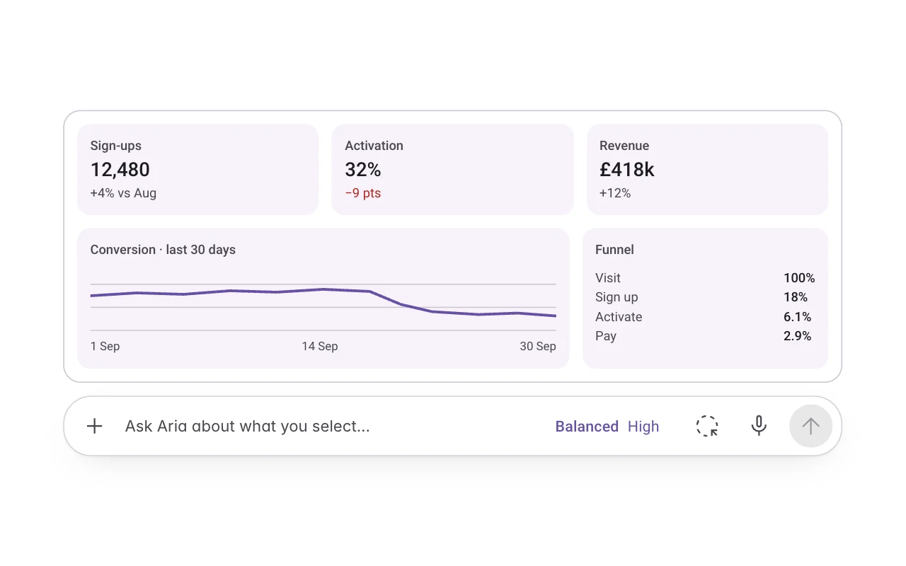
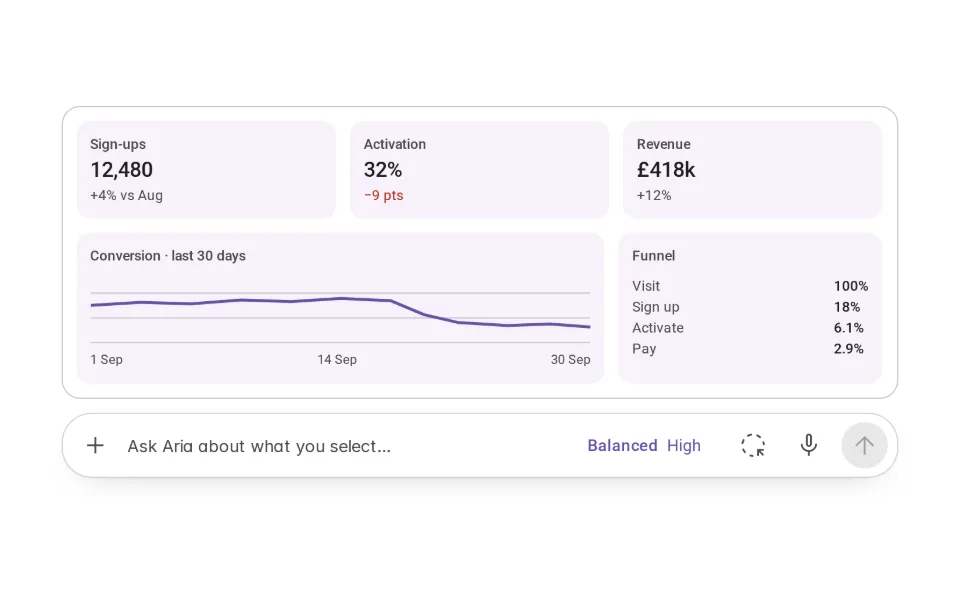
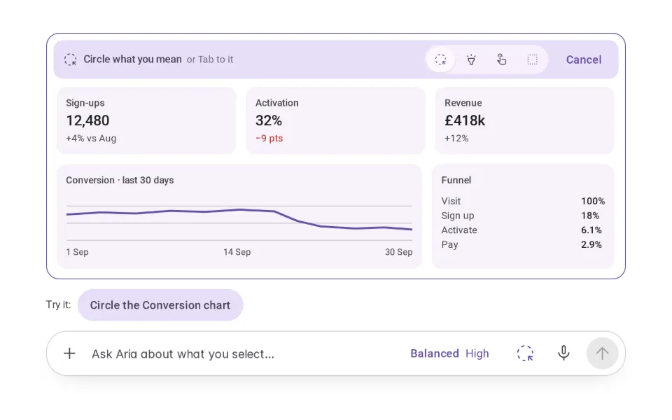
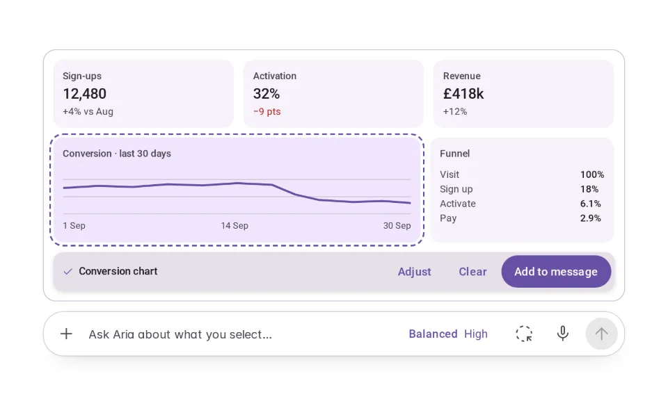
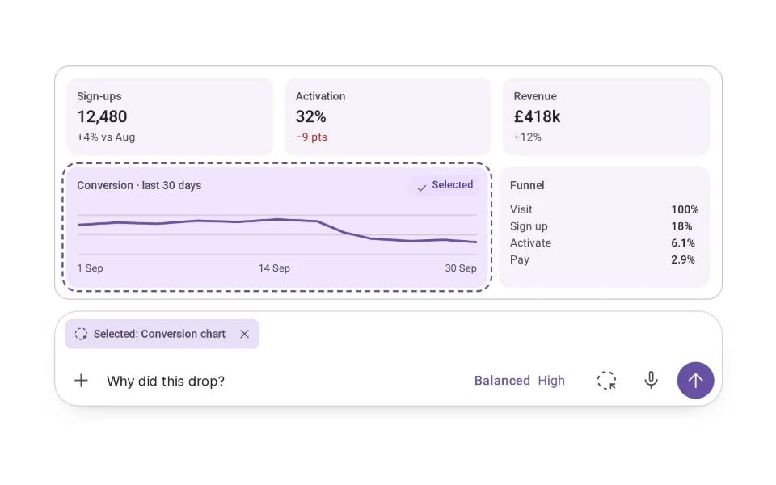
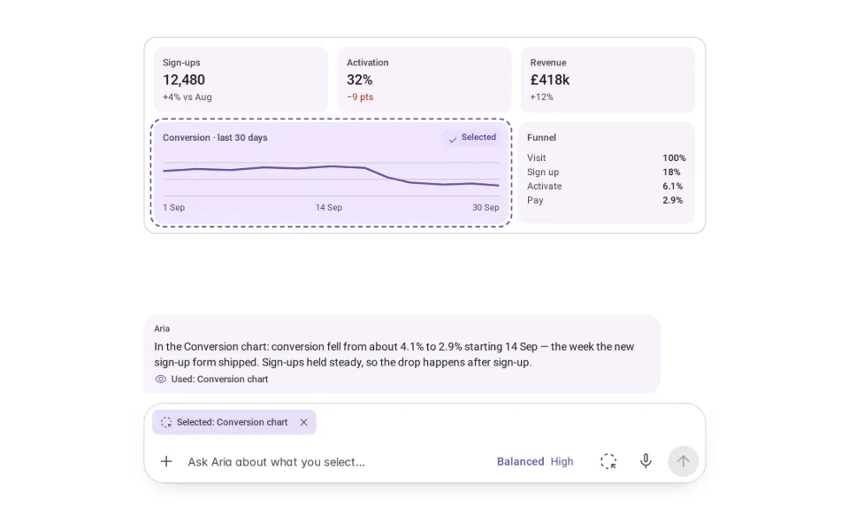
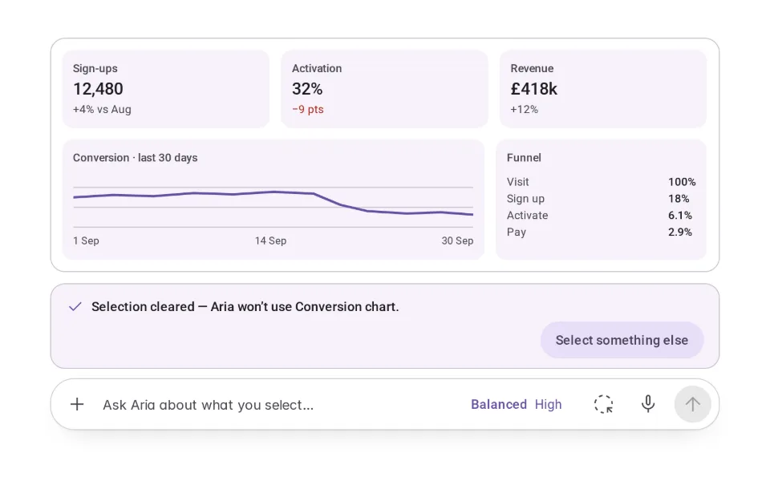
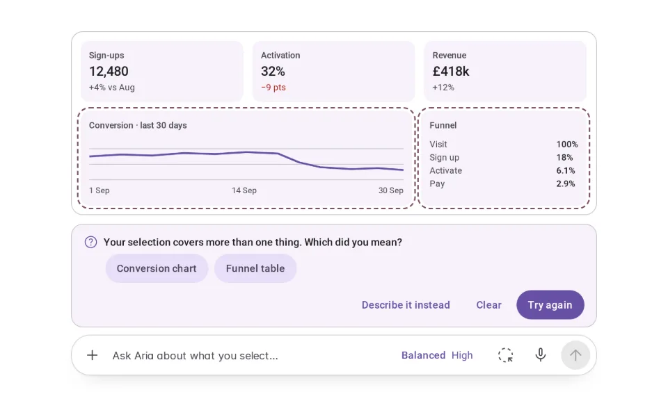

# Gesture Input

**Initially › Expressive Input** · id `gesture` · API `AgentComposer`

> Circle or tap what's on screen; it joins your request by name.

Open it: [material-pattern.html?id=gesture](../../../../material-pattern.html?id=gesture)

## Intent

Contextual screen selection on the shared composer: point at the thing, see it named, add it to the request — and an ambiguous selection asks rather than guesses.

## When to use

**Use when:** Wherever a request is about something already on screen: a chart, a row, a region of a design, a paragraph. Not as the only way to refer to things — words always work — and never as a way to trigger actions.

## Where the code lives

| Part | Location |
|---|---|
| Live Preview (states, customizer, code tab) | [`material-preview.js` L11348–11507](../../../../material-preview.js#L11348-L11507) |
| Simulator | [`material-sim.js` L6109–6227](../../../../material-sim.js#L6109-L6227) |
| Docs (intent, anatomy, usage) | [`material-patterns.js` L3150–3254](../../../../material-patterns.js#L3150-L3254) |
| Pattern CSS (`.md-gep`, `.md-button`, `.md-ge`) | [`material-pattern.html` L705–8884](../../../../material-pattern.html#L705-L8884) · 72 lines |
| Sidebar entry | [`material-nav.js`](../../../../material-nav.js) |

## Nucleux packages

_None named in this pattern's code — it is built from shared Material 3 kit components._

## States (7)

### 01 · Ready _(initial)_

| | |
|---|---|
| Key | `ready` |
| Trigger | A dashboard on screen and the composer below it. |
| Behaviour | An ordinary composer with a Select on screen button. |
| Meaning | Aria only has your words. |
| Action | Press Select on screen. |
| Next | Selecting. |

### 02 · Selecting

| | |
|---|---|
| Key | `selecting` |
| Trigger | Select on screen was pressed. |
| Behaviour | A toolbar on the dashboard — “Circle what you mean — or Tab to it” — with Circle, Highlight, Tap and Region, and Cancel. Every item on the dashboard becomes a button. |
| Meaning | Nothing is selected or shared yet. A gesture here only points. |
| Action | Circle, highlight, tap or drag a box — or Tab to an item and press Enter. Escape cancels. |
| Next | Selection made, or Couldn’t identify selection. |

### 03 · Selection made

| | |
|---|---|
| Key | `made` |
| Trigger | A gesture landed on one thing. |
| Behaviour | That thing gets a boundary, and a bar on it names it — “Conversion chart” — with Adjust, Clear and Add to message. |
| Meaning | This is what you pointed at. It is not in the message yet. |
| Action | Add to message, Adjust, or Clear. |
| Next | Context added, Selecting (Adjust), or Ready (Clear). |

### 04 · Context added

| | |
|---|---|
| Key | `added` |
| Trigger | Add to message (or automatic adding). |
| Behaviour | A chip in the composer — “Selected: Conversion chart” — with ✕; the chart keeps a quiet “Selected” tag. The words are yours to write. |
| Meaning | Aria will use the chart with your words, when you send. |
| Action | Ask, remove the selection, or select something else. |
| Next | Agent using selection, or Selection cleared. |

### 05 · Agent using selection

| | |
|---|---|
| Key | `using` |
| Trigger | The message was sent with a selection. |
| Behaviour | The chart says “Aria is looking at this” under a slow sheen; the chip is outlined. The answer names the chart it used. |
| Meaning | Aria is using the chart — and only the chart. Nothing is changed. |
| Action | Wait. |
| Next | Context added (the selection stays for follow-ups). |

### 06 · Selection cleared

| | |
|---|---|
| Key | `cleared` |
| Trigger | The selection was removed. |
| Behaviour | The chip and the boundary are gone; a note says Aria won’t use the chart, with Select something else. |
| Meaning | The conversation continues without it. |
| Action | Select something else, or keep typing. |
| Next | Selecting, or Ready. |

### 07 · Couldn’t identify selection

| | |
|---|---|
| Key | `failed` |
| Trigger | A gesture covered two things (or nothing). |
| Behaviour | Both candidates are marked and a panel asks “Which did you mean?” with a button for each, Try again, Describe it instead and Clear. Nothing is guessed. |
| Meaning | Nothing is selected until you say. |
| Action | Choose one, try again, describe it in words, or clear. |
| Next | Selection made, Selecting, or Ready. |

## Simulator

Point at what you mean, and it joins your request by name. A gesture only points — it never changes anything — and when it could mean two things, Aria asks.

---

_Generated by `_build/catalog/make.js` — do not edit by hand; change the pattern and re-run._
