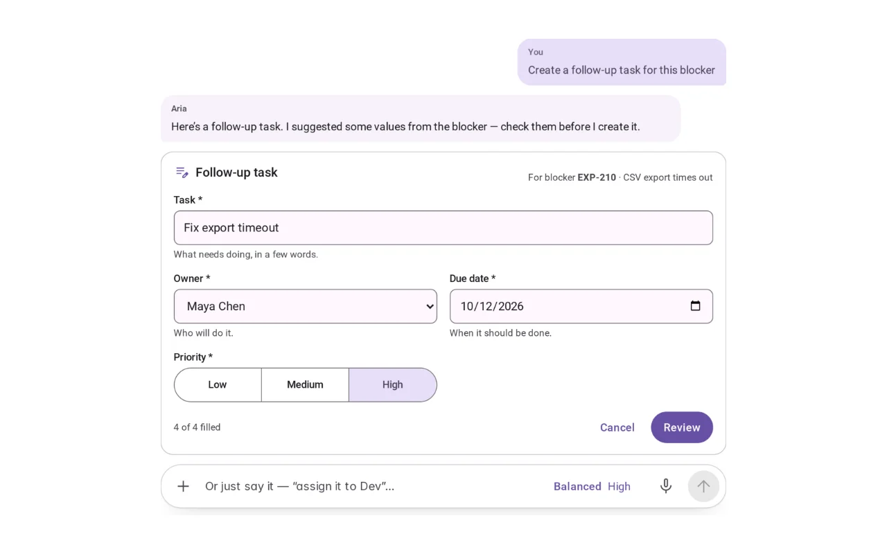
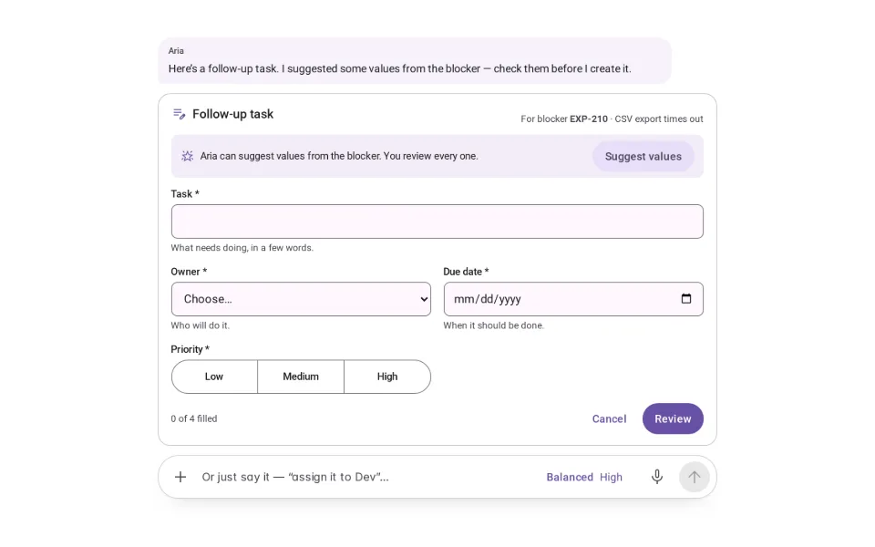
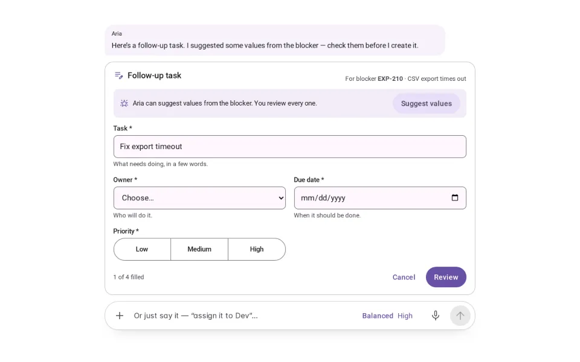
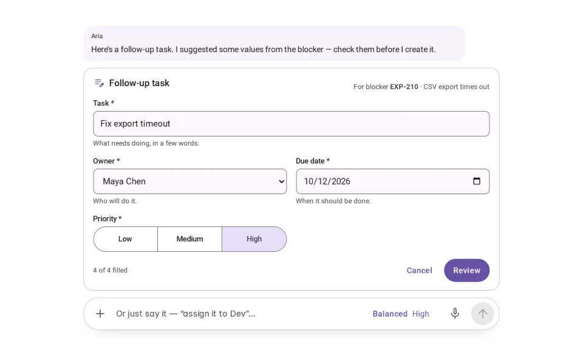
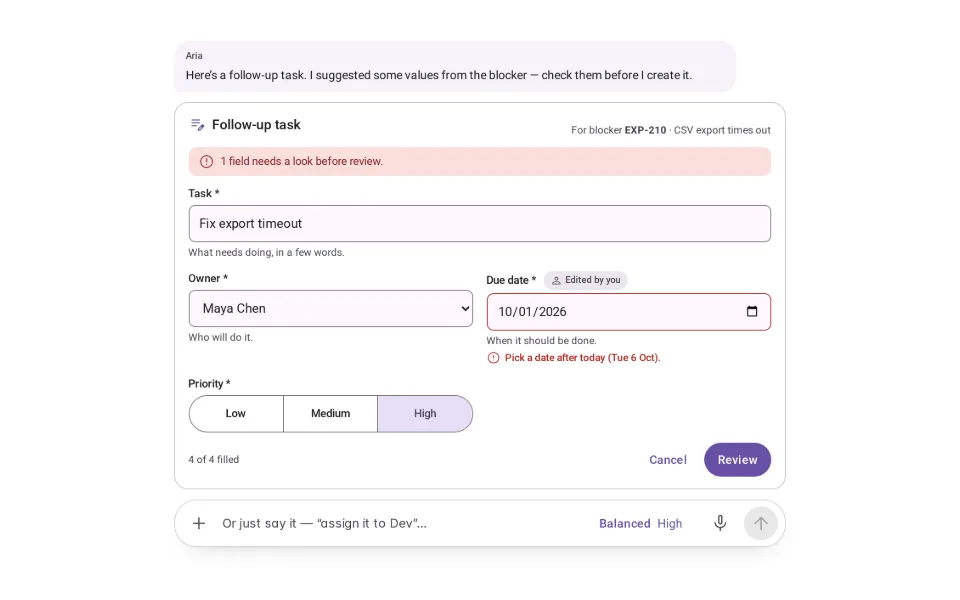
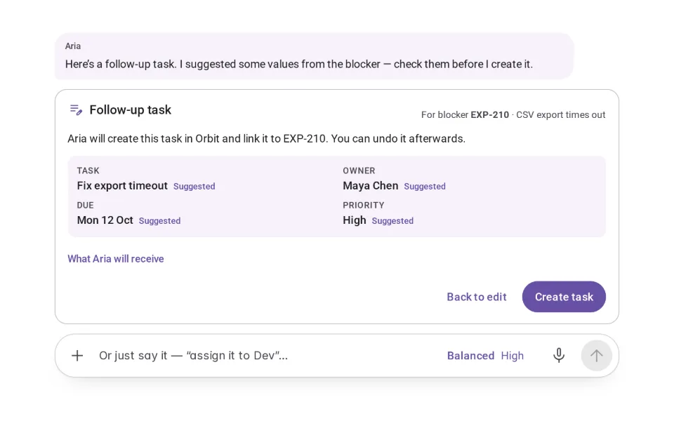
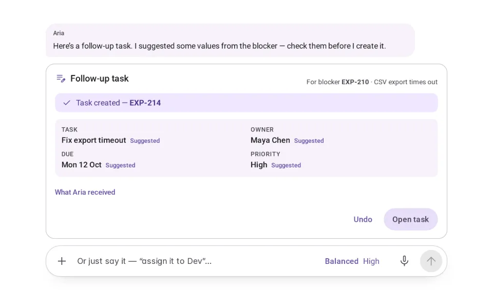
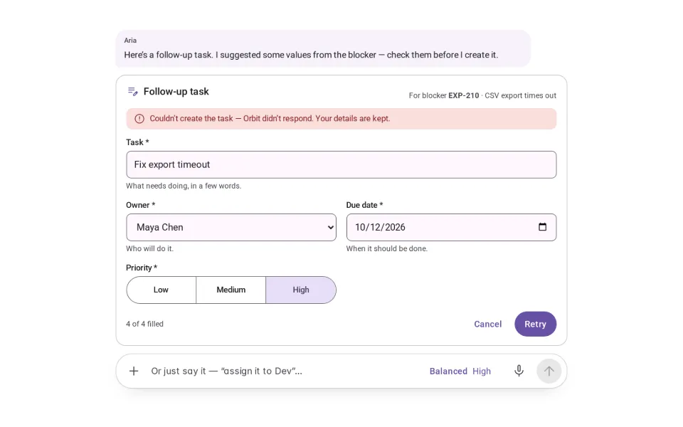

# Structured Input

**Initially › Expressive Input** · id `structured-input` · API `AgentForm`

> A compact form for exact values — suggestions marked, actions confirmed.

Open it: [material-pattern.html?id=structured-input](../../../../material-pattern.html?id=structured-input)

## Intent

A small form that complements open input: the request starts in words; the exact values are set in fields, checked next to each field, reviewed, and only then acted on.

## When to use

**Use when:** When an action needs specific, validated values (create a task, book a slot, file an expense), or when a request is ambiguous in ways a few fields settle faster than questions. Not for open questions, and not instead of the composer — the person can always say it in words.

## Where the code lives

| Part | Location |
|---|---|
| Live Preview (states, customizer, code tab) | [`material-preview.js` L11512–12631](../../../../material-preview.js#L11512-L12631) |
| Simulator | [`material-sim.js` L6240–6342](../../../../material-sim.js#L6240-L6342) |
| Docs (intent, anatomy, usage) | [`material-patterns.js` L3259–3353](../../../../material-patterns.js#L3259-L3353) |
| Pattern CSS (`.md-sip`) | [`material-pattern.html` L6797–6797](../../../../material-pattern.html#L6797-L6797) · 1 lines |
| Sidebar entry | [`material-nav.js`](../../../../material-nav.js) |

## Nucleux packages

_None named in this pattern's code — it is built from shared Material 3 kit components._

## States (7)

### 01 · Empty

| | |
|---|---|
| Key | `empty` |
| Trigger | Aria needs exact values and has none yet. |
| Behaviour | A compact form under the request: Task, Owner, Due date, Priority — labels, helper text, required marks — and “Suggest values”. |
| Meaning | Nothing will happen until the form is complete and you confirm. |
| Action | Fill it in, or ask for suggestions. |
| Next | Partially completed. |

### 02 · Partially completed

| | |
|---|---|
| Key | `partial` |
| Trigger | Some fields are filled. |
| Behaviour | A count (“1 of 4 filled”); required fields still empty are marked by their label, not yet by an error. |
| Meaning | You can carry on in any order. |
| Action | Fill the rest, or Cancel. |
| Next | Complete. |

### 03 · Complete _(initial)_

| | |
|---|---|
| Key | `complete` |
| Trigger | Every required field has a value. |
| Behaviour | Owner, Due date and Priority were filled in by Aria from the blocker — Aria’s message says so — and stay editable. A value you change is marked “Edited by you”. Review is ready. |
| Meaning | Suggestions are offers. Nothing you set is changed for you. |
| Action | Edit anything, then Review. |
| Next | Ready to submit, or Validation error. |

### 04 · Validation error

| | |
|---|---|
| Key | `invalid` |
| Trigger | Review found a problem. |
| Behaviour | The message sits under its field (“Pick a date after today”), the field is marked invalid, a summary counts what needs a look, and focus moves to the first one. |
| Meaning | Nothing was sent. Your values are untouched. |
| Action | Fix the field — the error clears as soon as it is right. |
| Next | Complete. |

### 05 · Ready to submit

| | |
|---|---|
| Key | `ready` |
| Trigger | Review passed. |
| Behaviour | A summary of the values, which were suggested and which you edited, “What Aria will receive” (the exact payload), Back to edit and Create task. |
| Meaning | Creating a task changes another system, so it waits for you. |
| Action | Create task, or Back to edit. |
| Next | Submitted, or Couldn’t submit. |

### 06 · Submitted

| | |
|---|---|
| Key | `submitted` |
| Trigger | Create task succeeded. |
| Behaviour | “Task created — EXP-214”, the values, “What Aria received”, Undo and Open task. |
| Meaning | The outcome is visible, and reversible. |
| Action | Open the task, or Undo. |
| Next | Complete (Undo). |

### 07 · Couldn’t submit

| | |
|---|---|
| Key | `failed` |
| Trigger | Creating the task failed. |
| Behaviour | An alert says what happened; every value is kept; Retry and Cancel. |
| Meaning | Nothing was created, and nothing is lost. |
| Action | Retry, edit, or Cancel. |
| Next | Ready to submit / Submitted, or Complete. |

## Simulator

Open input for the request, a small form for the exact values. Suggestions are offers you can see and change; creating the task waits for you.

---

_Generated by `_build/catalog/make.js` — do not edit by hand; change the pattern and re-run._
