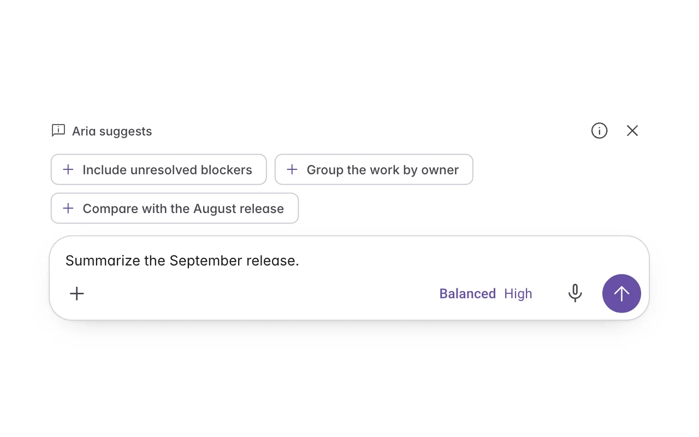
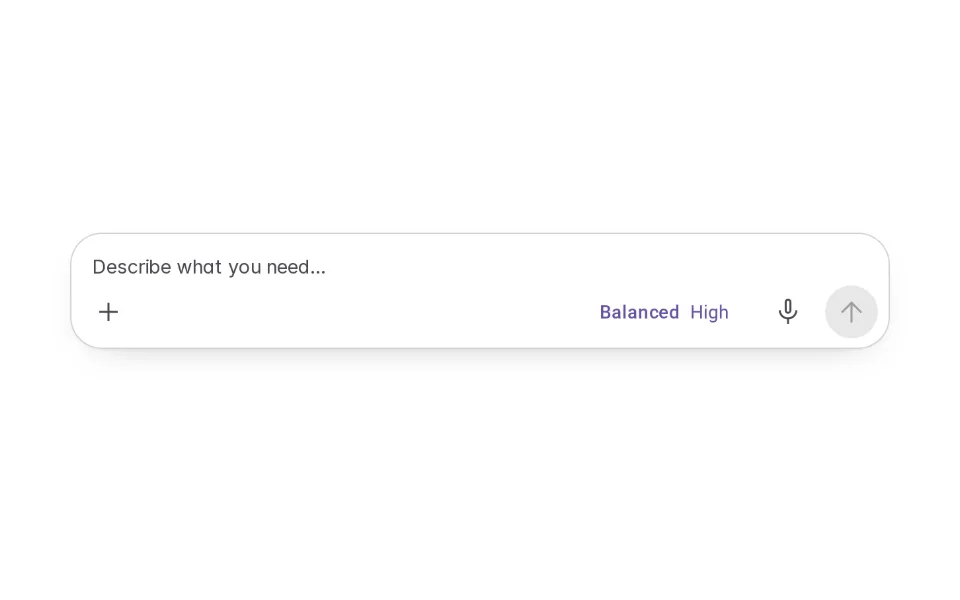
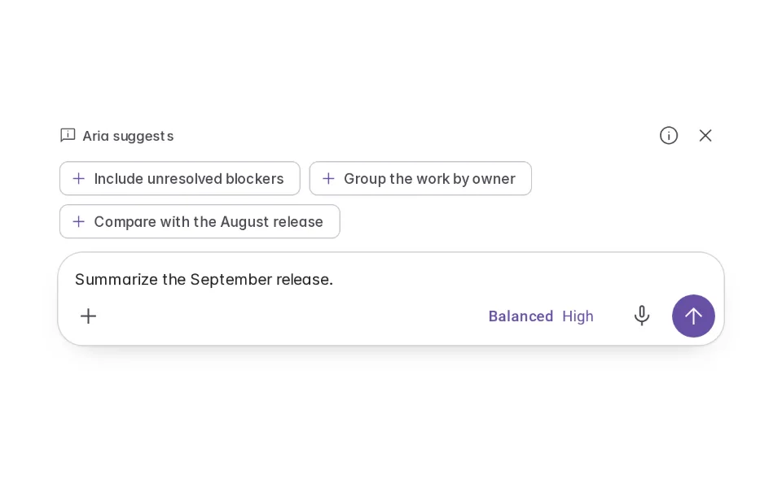
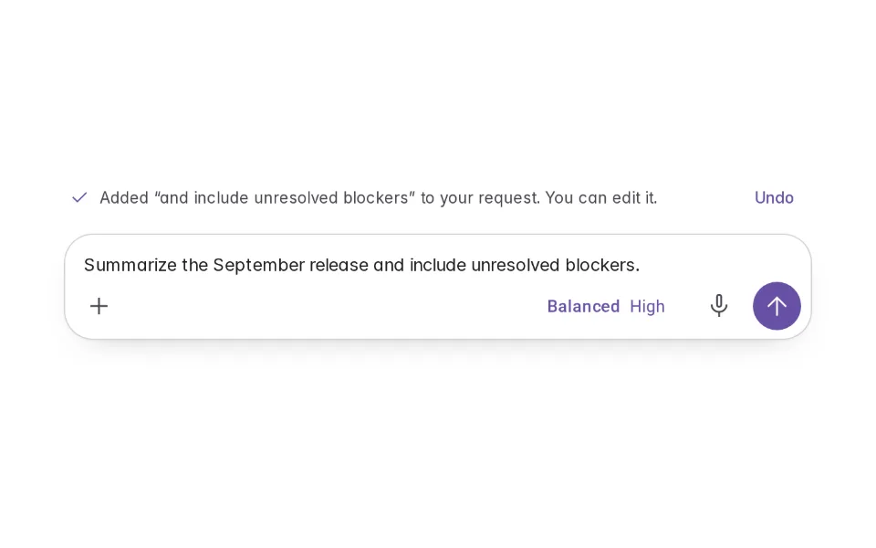
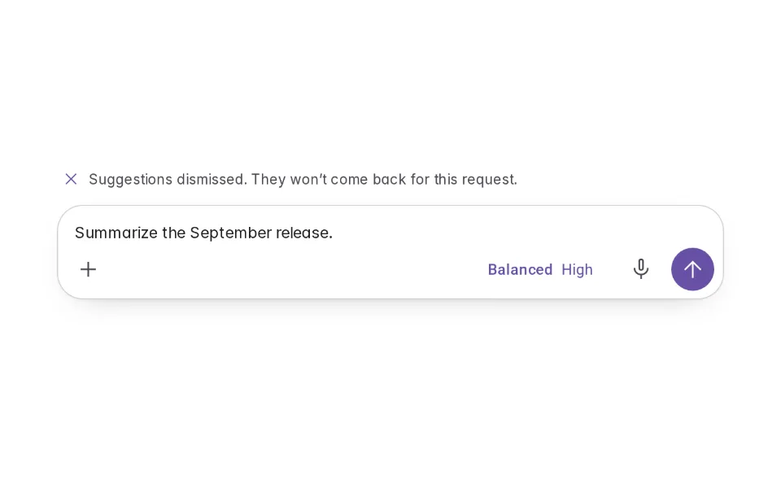
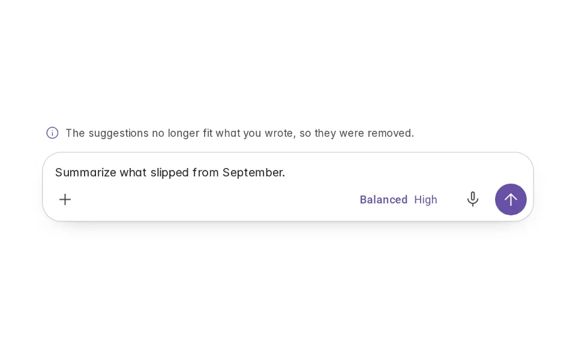

# Suggestions

**Initially › Prompt Scaffolds** · id `suggestions` · API `PromptSuggestion`

> Aria suggests one detail to add to the request you’re writing — marked as its suggestion, added only if you choose, never sent for you.

Open it: [material-pattern.html?id=suggestions](../../../../material-pattern.html?id=suggestions)

## Intent

Helps someone improve a request they are already writing: after a pause, Aria offers a few relevant details — context, a constraint, an expected outcome — as chips they can add, ignore or dismiss. Their words are never replaced.

## When to use

**Use when:** When a request in progress is missing a detail the product can reliably infer from context — a time range, an audience, a constraint. Not while someone is still typing, and not to propose a different request.

## Where the code lives

| Part | Location |
|---|---|
| Live Preview (states, customizer, code tab) | [`material-preview.js` L2333–2525](../../../../material-preview.js#L2333-L2525) |
| Simulator | [`material-sim.js` L1702–1789](../../../../material-sim.js#L1702-L1789) |
| Docs (intent, anatomy, usage) | [`material-patterns.js` L3354–3373](../../../../material-patterns.js#L3354-L3373) |
| Category CSS block | [`material-pattern.html` PSX-START (L8184)](../../../../material-pattern.html#L8184) |
| Sidebar entry | [`material-nav.js`](../../../../material-nav.js) |

## Nucleux packages

- `@nucleux/md3-agent-composer`
- `@nucleux/md3-button`
- `@nucleux/md3-chip`
- `@nucleux/md3-icon-button`
- `@nucleux/tokens`

## States (5)

### 01 · No suggestion

| | |
|---|---|
| Key | `none` |
| Trigger | They are typing, or nothing would make the request better. |
| Behaviour | The composer on its own. Nothing appears while keys are moving. |
| Meaning | Carry on writing. |
| Action | Type a request. |
| Next | Suggestion available |

### 02 · Suggestion available _(initial)_

| | |
|---|---|
| Key | `available` |
| Trigger | They paused on “Summarize the September release.” |
| Behaviour | A short row of suggestion chips just above the composer, marked as Aria’s: what each would add, why (on request), and Dismiss. Their text is untouched. |
| Meaning | Aria thinks this would make the request better. |
| Action | Add it, dismiss it, or keep typing. |
| Next | Accepted, Dismissed or No longer relevant |

### 03 · Suggestion accepted

| | |
|---|---|
| Key | `accepted` |
| Trigger | They pressed Add to prompt. |
| Behaviour | The words are added after theirs — never replacing them — and a line names what was added, with Undo. Nothing is sent. |
| Meaning | The request now includes it, and it is still theirs to edit. |
| Action | Edit, undo, or send. |
| Next | — |

### 04 · Suggestion dismissed

| | |
|---|---|
| Key | `dismissed` |
| Trigger | They pressed Dismiss. |
| Behaviour | The suggestion goes and does not come back for this request. |
| Meaning | Their request stays exactly as written. |
| Action | Keep writing. |
| Next | — |

### 05 · No longer relevant

| | |
|---|---|
| Key | `irrelevant` |
| Trigger | They rewrote the request so the suggestion no longer fits. |
| Behaviour | The suggestion withdraws on its own, quietly. |
| Meaning | Nothing to add right now. |
| Action | Keep writing. |
| Next | Suggestion available |

## Simulator

Write the request — or press “Type the request” — and pause. Suggestions appear just above the composer. Add one, edit what you have, then send. Nothing is sent or rewritten for you.

---

_Generated by `_build/catalog/make.js` — do not edit by hand; change the pattern and re-run._
