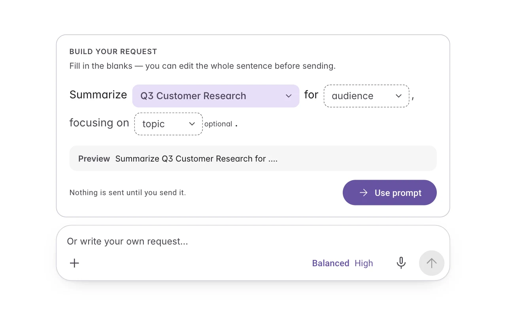
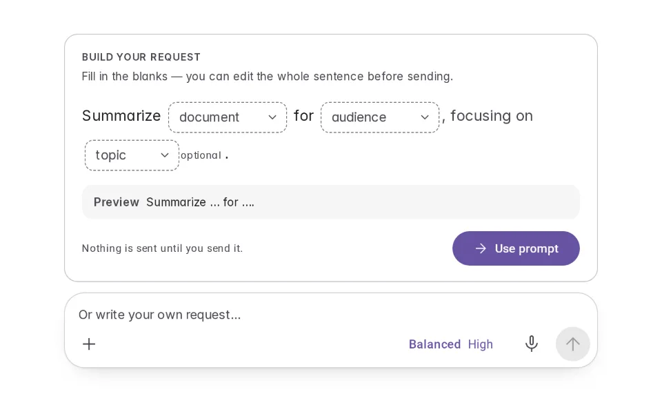
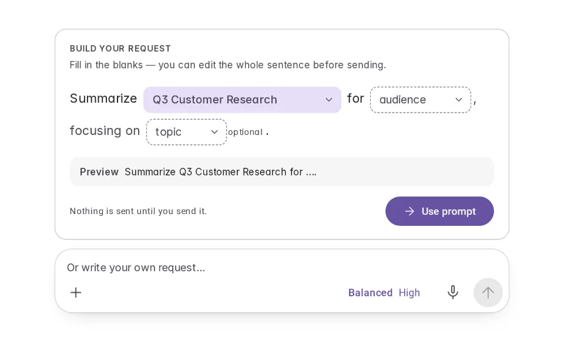
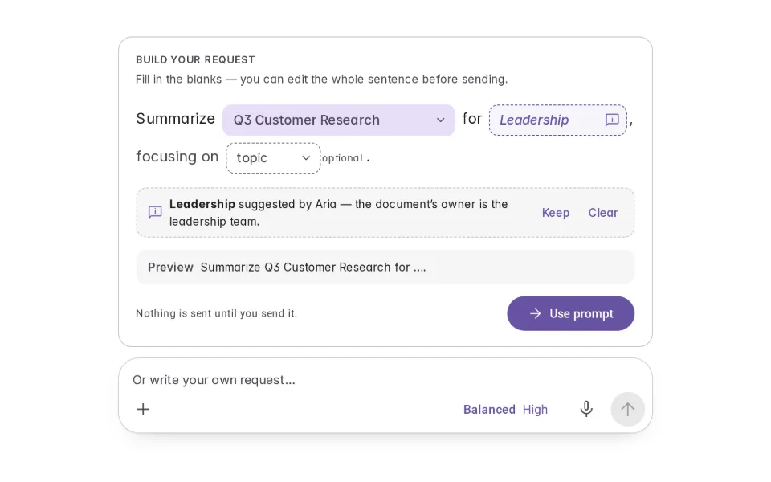
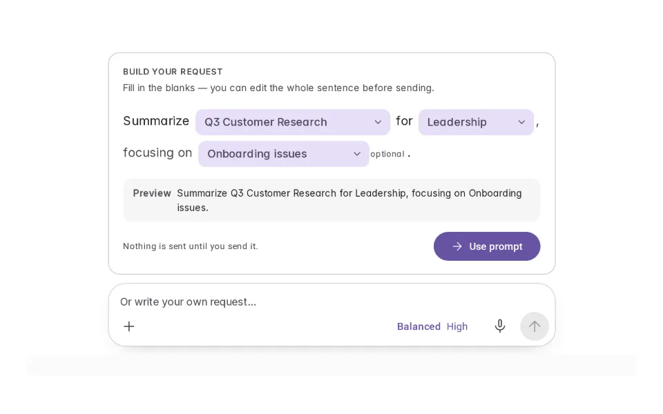
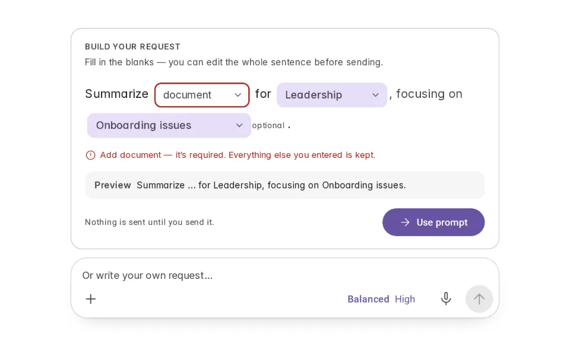
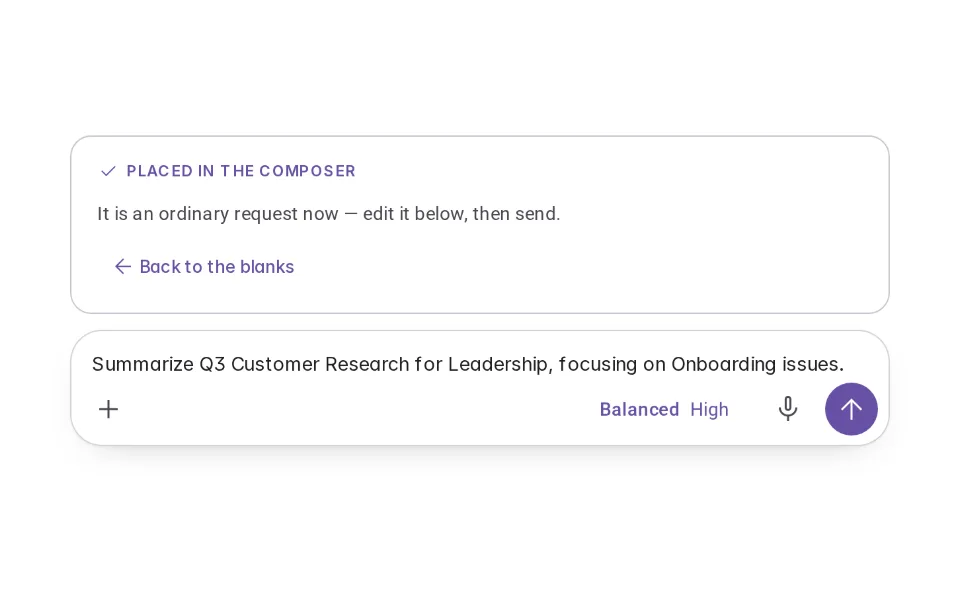

# Madlibs

**Initially › Prompt Scaffolds** · id `madlibs` · API `PromptMadlib`

> A request written as a sentence with a few labelled blanks — fill them, read the result, then edit it in the composer before sending.

Open it: [material-pattern.html?id=madlibs](../../../../material-pattern.html?id=madlibs)

## Intent

Helps someone write a request that needs a few specific details: a sentence with labelled blanks, required and optional marked, the assembled request visible as they go, and the result placed in the composer to edit — not sent.

## When to use

**Use when:** For common requests with two to four variable details — summaries, briefs, comparisons. Not for open-ended requests, and not as a substitute for a form with many fields.

## Where the code lives

| Part | Location |
|---|---|
| Live Preview (states, customizer, code tab) | [`material-preview.js` L2528–2755](../../../../material-preview.js#L2528-L2755) |
| Simulator | [`material-sim.js` L1802–1890](../../../../material-sim.js#L1802-L1890) |
| Docs (intent, anatomy, usage) | [`material-patterns.js` L3374–3393](../../../../material-patterns.js#L3374-L3393) |
| Category CSS block | [`material-pattern.html` PSX-START (L8184)](../../../../material-pattern.html#L8184) |
| Sidebar entry | [`material-nav.js`](../../../../material-nav.js) |

## Nucleux packages

- `@nucleux/md3-agent-composer`
- `@nucleux/md3-button`
- `@nucleux/prompt-template`
- `@nucleux/tokens`

## States (6)

### 01 · Empty scaffold

| | |
|---|---|
| Key | `empty` |
| Trigger | A request that needs a few specific details. |
| Behaviour | A sentence with labelled blanks. Required and optional blanks are marked; the assembled request shows what is still missing. |
| Meaning | Fill these in and the request is written. |
| Action | Fill a blank. |
| Next | Partially completed |

### 02 · Partially completed _(initial)_

| | |
|---|---|
| Key | `partial` |
| Trigger | They filled one blank. |
| Behaviour | Filled blanks read as part of the sentence; the rest are still marked. |
| Meaning | What is done, and what is left. |
| Action | Fill the rest. |
| Next | AI suggestion available, or Complete |

### 03 · AI suggestion available

| | |
|---|---|
| Key | `suggestion` |
| Trigger | Aria can infer a value from what they chose. |
| Behaviour | The blank shows Aria’s value, marked “Suggested”, with Keep and Clear. It is not part of the request until kept. |
| Meaning | A likely value — theirs to accept. |
| Action | Keep, clear, or type another. |
| Next | Complete |

### 04 · Complete

| | |
|---|---|
| Key | `complete` |
| Trigger | Every required blank has a value they chose. |
| Behaviour | The assembled sentence reads cleanly; Use prompt is available. |
| Meaning | The request is written. |
| Action | Use prompt. |
| Next | Ready to use |

### 05 · Validation needed

| | |
|---|---|
| Key | `validation` |
| Trigger | They pressed Use prompt with a required blank empty. |
| Behaviour | That blank is flagged with words, focus moves to it, and everything else they entered stays. |
| Meaning | One detail is missing. |
| Action | Fill it. |
| Next | Complete |

### 06 · Ready to use

| | |
|---|---|
| Key | `ready` |
| Trigger | They pressed Use prompt. |
| Behaviour | The sentence is in the composer — editable, unsent. |
| Meaning | It is an ordinary request now. |
| Action | Edit, then send. |
| Next | — |

## Simulator

Aria offers a guided sentence for a stakeholder summary. Fill the blanks — the request assembles as you go — then Use prompt puts it in the composer to edit and send.

---

_Generated by `_build/catalog/make.js` — do not edit by hand; change the pattern and re-run._
