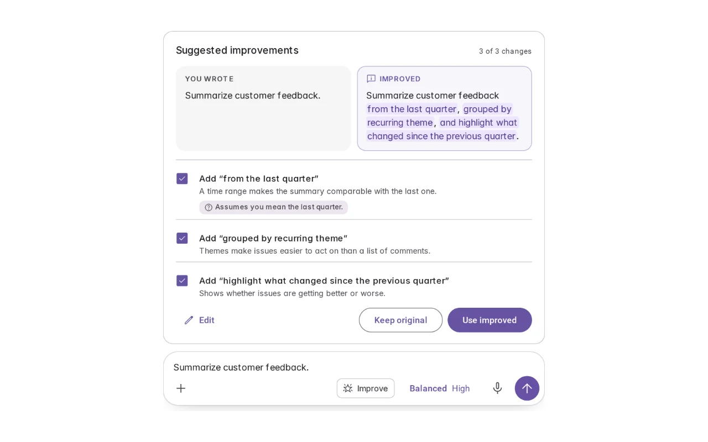
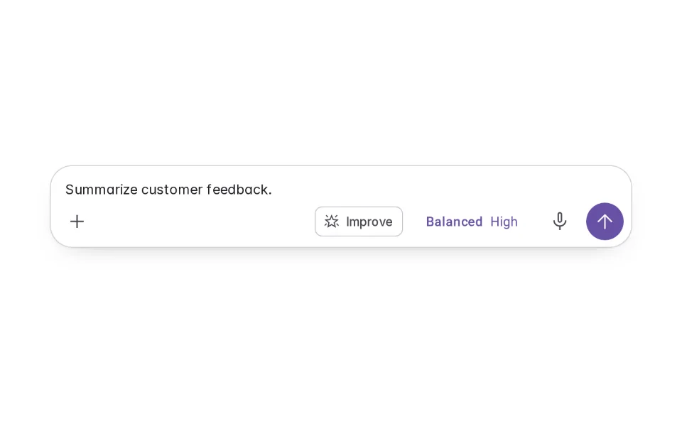
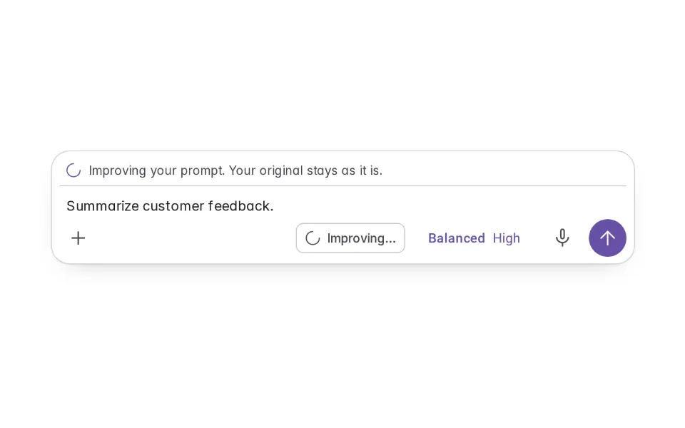
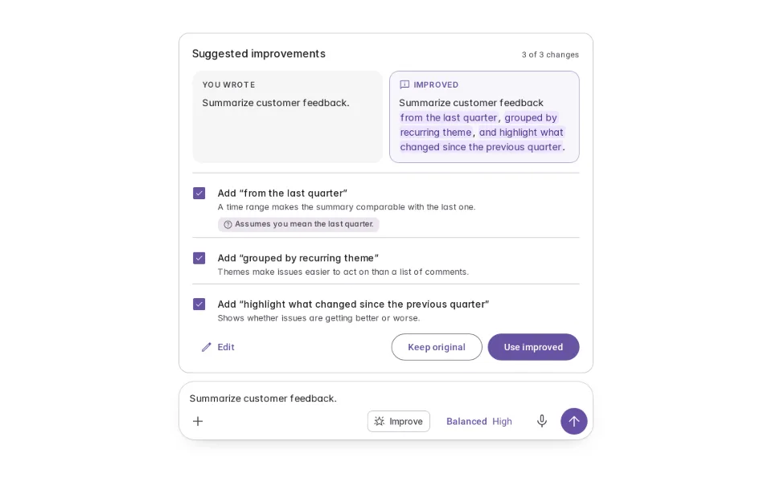
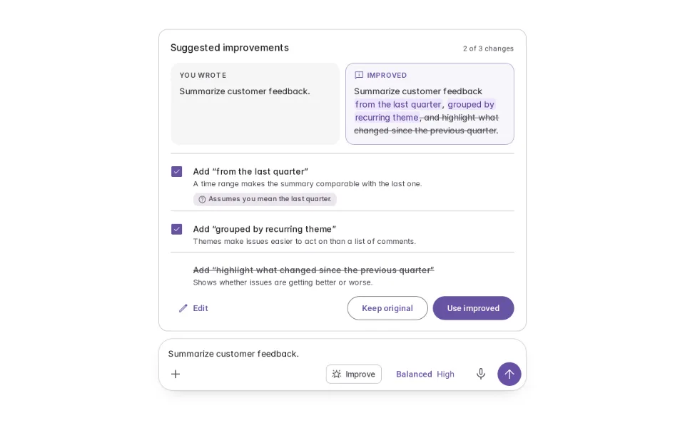
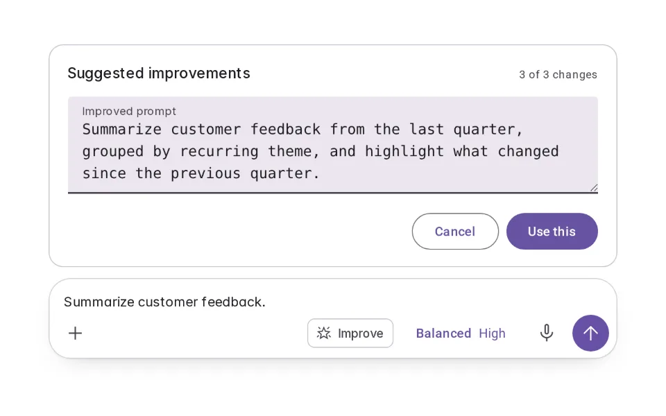
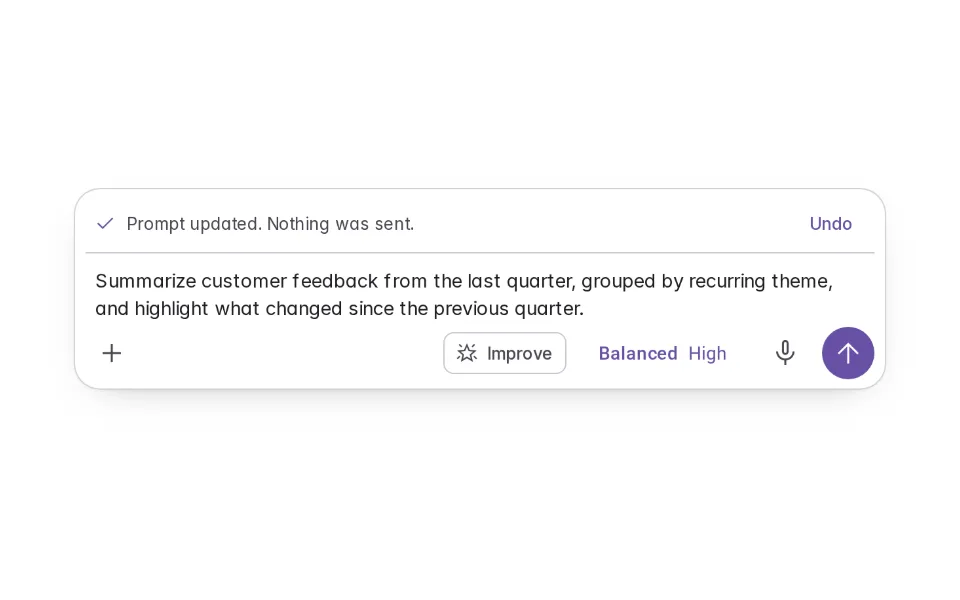
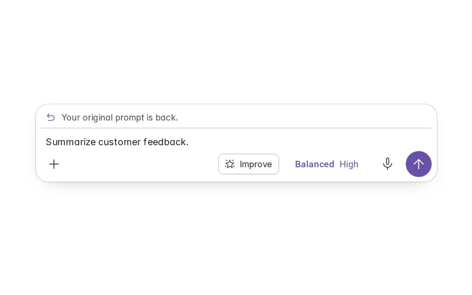
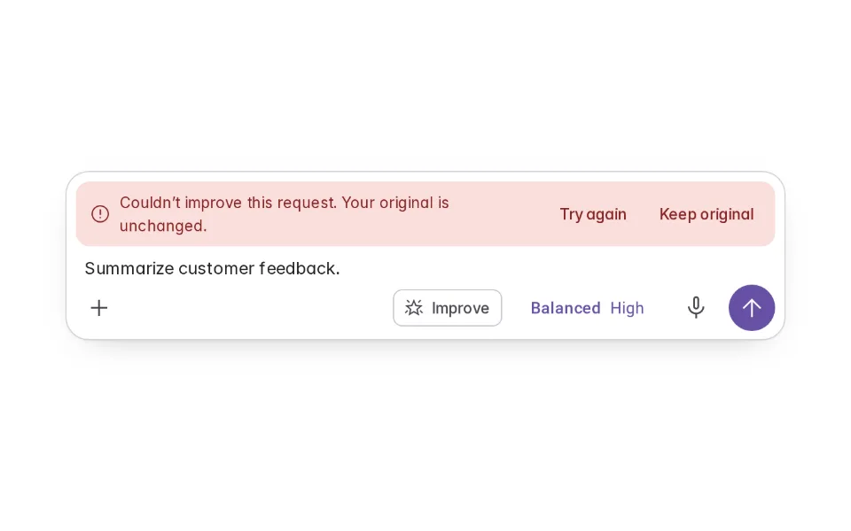

# Prompt Enhancer

**Initially › Prompt Scaffolds** · id `prompt-enhancer` · API `PromptEnhancer`

> Proposes a clearer version of the request you wrote — every addition marked and explained, the original kept until you choose.

Open it: [material-pattern.html?id=prompt-enhancer](../../../../material-pattern.html?id=prompt-enhancer)

## Intent

Helps someone improve a request they have already written: Aria proposes a clearer version, shows exactly what it added and why, flags assumptions, and leaves the original in the composer until they use, edit or reject the suggestion.

## When to use

**Use when:** When a request is short or vague and the product can make it more specific without guessing the intent. Not for already-specific requests, and not to make every prompt longer.

## Where the code lives

| Part | Location |
|---|---|
| Live Preview (states, customizer, code tab) | [`material-preview.js` L2758–2995](../../../../material-preview.js#L2758-L2995) |
| Simulator | [`material-sim.js` L1903–1997](../../../../material-sim.js#L1903-L1997) |
| Docs (intent, anatomy, usage) | [`material-patterns.js` L3394–3413](../../../../material-patterns.js#L3394-L3413) |
| Category CSS block | [`material-pattern.html` PSX-START (L8184)](../../../../material-pattern.html#L8184) |
| Sidebar entry | [`material-nav.js`](../../../../material-nav.js) |

## Nucleux packages

- `@nucleux/md3-agent-composer`
- `@nucleux/md3-button`
- `@nucleux/md3-card`
- `@nucleux/prompt-enhancer`
- `@nucleux/tokens`

## States (8)

### 01 · Original

| | |
|---|---|
| Key | `original` |
| Trigger | They have written a short request. |
| Behaviour | Their prompt in the composer, with Improve beside the model chip. |
| Meaning | They can ask for a clearer version — or just send. |
| Action | Improve, or send. |
| Next | Enhancing |

### 02 · Enhancing

| | |
|---|---|
| Key | `enhancing` |
| Trigger | They pressed Improve. |
| Behaviour | Improve says “Improving…”; the original stays in the composer, readable and untouched. |
| Meaning | Aria is working on a suggestion. Nothing has changed yet. |
| Action | Wait, or cancel. |
| Next | Enhanced, or Enhancement failed |

### 03 · Enhanced _(initial)_

| | |
|---|---|
| Key | `enhanced` |
| Trigger | Aria proposed an improvement. |
| Behaviour | A review above the composer: their words, plus each addition marked and explained. An assumption is labelled. The composer still holds the original. |
| Meaning | What would change, and why. |
| Action | Use it, edit it, remove a change, or keep the original. |
| Next | Reviewing, Edited, Accepted |

### 04 · Reviewing changes

| | |
|---|---|
| Key | `reviewing` |
| Trigger | They removed one change. |
| Behaviour | The removed addition is struck from the suggestion; the rest stay. |
| Meaning | They are choosing which improvements to keep. |
| Action | Use the rest, or restore it. |
| Next | Accepted |

### 05 · Edited

| | |
|---|---|
| Key | `edited` |
| Trigger | They chose Edit. |
| Behaviour | The suggested prompt in a text field they can change freely. |
| Meaning | The suggestion is a starting point. |
| Action | Use this, or cancel. |
| Next | Accepted |

### 06 · Accepted

| | |
|---|---|
| Key | `accepted` |
| Trigger | They chose Use improved. |
| Behaviour | The composer now holds the improved prompt — editable, unsent — with Undo. |
| Meaning | Their request was updated; nothing was sent. |
| Action | Edit, undo, or send. |
| Next | Reverted |

### 07 · Reverted

| | |
|---|---|
| Key | `reverted` |
| Trigger | They pressed Undo. |
| Behaviour | The original prompt is back exactly as written. |
| Meaning | Nothing was lost. |
| Action | Send, or improve again. |
| Next | Original |

### 08 · Enhancement failed

| | |
|---|---|
| Key | `failed` |
| Trigger | Aria couldn’t produce a suggestion. |
| Behaviour | One line says so; the original is untouched. Try again, or keep the original. |
| Meaning | Nothing changed. |
| Action | Try again, or carry on. |
| Next | Enhancing, or Original |

## Simulator

Press Improve on a short request. Aria proposes a clearer one with every addition marked and explained — remove the one you don’t need, use the rest, and send. Your original stays until you choose.

---

_Generated by `_build/catalog/make.js` — do not edit by hand; change the pattern and re-run._
