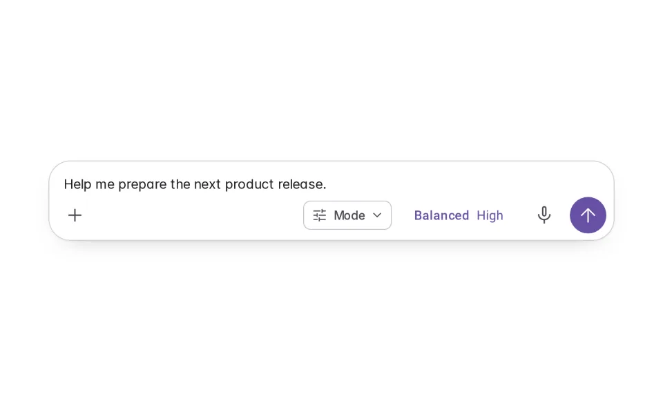
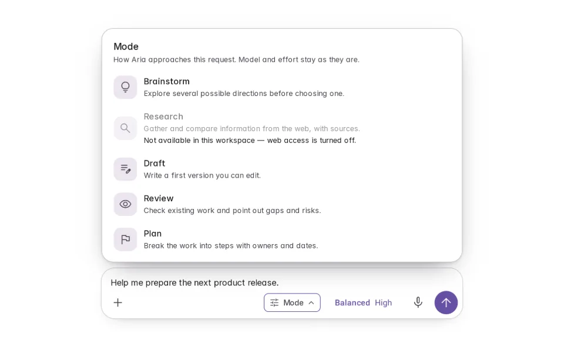
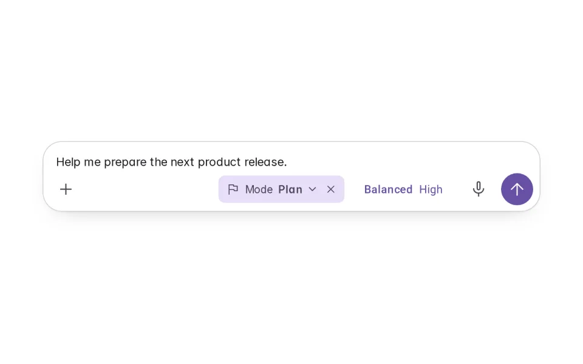
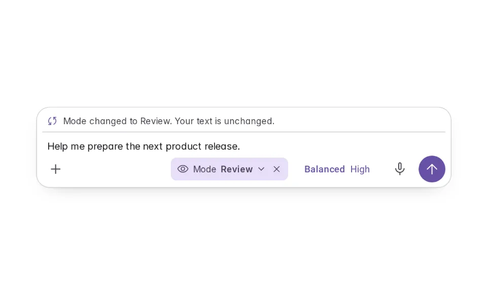
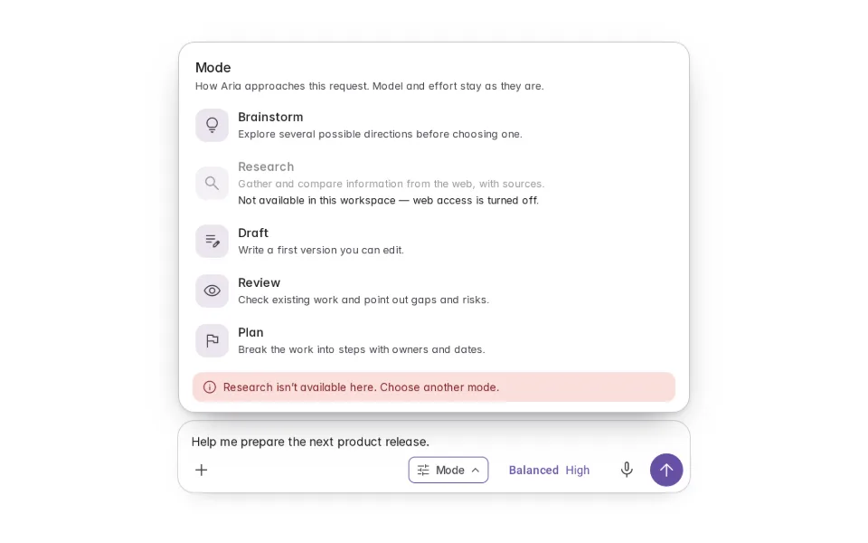

# Modes

**Initially › Prompt Scaffolds** · id `modes` · API `ModePicker`

> Choose how the agent approaches the task — Brainstorm, Draft, Review, Plan — shown in the composer, separate from the model.

Open it: [material-pattern.html?id=modes](../../../../material-pattern.html?id=modes)

## Intent

Lets someone choose how the agent should work on a request — explore, draft, review, plan — without describing the working style every time. The mode is visible in the composer, changes nothing they wrote, and is separate from which model answers.

## When to use

**Use when:** When the product genuinely works differently per approach — different steps, tools or output. Not as labels over the same behaviour, and not to stand in for model selection or reasoning effort.

## Where the code lives

| Part | Location |
|---|---|
| Live Preview (states, customizer, code tab) | [`material-preview.js` L2998–3164](../../../../material-preview.js#L2998-L3164) |
| Simulator | [`material-sim.js` L2010–2093](../../../../material-sim.js#L2010-L2093) |
| Docs (intent, anatomy, usage) | [`material-patterns.js` L3414–3433](../../../../material-patterns.js#L3414-L3433) |
| Category CSS block | [`material-pattern.html` PSX-START (L8184)](../../../../material-pattern.html#L8184) |
| Sidebar entry | [`material-nav.js`](../../../../material-nav.js) |

## Nucleux packages

- `@nucleux/md3-agent-composer`
- `@nucleux/md3-button`
- `@nucleux/md3-chip`
- `@nucleux/md3-menu`
- `@nucleux/tokens`

## States (5)

### 01 · No mode selected

| | |
|---|---|
| Key | `none` |
| Trigger | They are writing a request. |
| Behaviour | A Mode control beside the model chip. Aria works the general way until a mode is chosen. |
| Meaning | They can choose how Aria should approach this. |
| Action | Open Mode, or just send. |
| Next | Mode picker open |

### 02 · Mode picker open

| | |
|---|---|
| Key | `open` |
| Trigger | They opened Mode. |
| Behaviour | A short list of modes, each with one line on what changes. An unavailable mode says why. |
| Meaning | What each mode would do with this request. |
| Action | Choose one, or close. |
| Next | Mode selected |

### 03 · Mode selected _(initial)_

| | |
|---|---|
| Key | `selected` |
| Trigger | They chose Plan. |
| Behaviour | The Mode chip in the composer now reads “Plan”, with a way to change or remove it. The text and the model are untouched. |
| Meaning | Aria will approach this as a planning task. |
| Action | Send, change, or clear. |
| Next | Mode changed |

### 04 · Mode changed

| | |
|---|---|
| Key | `changed` |
| Trigger | They switched Plan to Review. |
| Behaviour | The chip updates and one line says what changed — and that their text is the same. |
| Meaning | The next request will be a review. |
| Action | Send. |
| Next | — |

### 05 · Mode unavailable

| | |
|---|---|
| Key | `unavailable` |
| Trigger | They chose a mode this workspace can’t support. |
| Behaviour | The mode isn’t applied; the picker says why and offers the others. |
| Meaning | That approach isn’t possible here. |
| Action | Choose another. |
| Next | Mode selected |

## Simulator

Open Mode in the composer and choose Plan, then send: Aria answers with steps. Switch to Review and ask again — same model, same context, a different way of working.

---

_Generated by `_build/catalog/make.js` — do not edit by hand; change the pattern and re-run._
