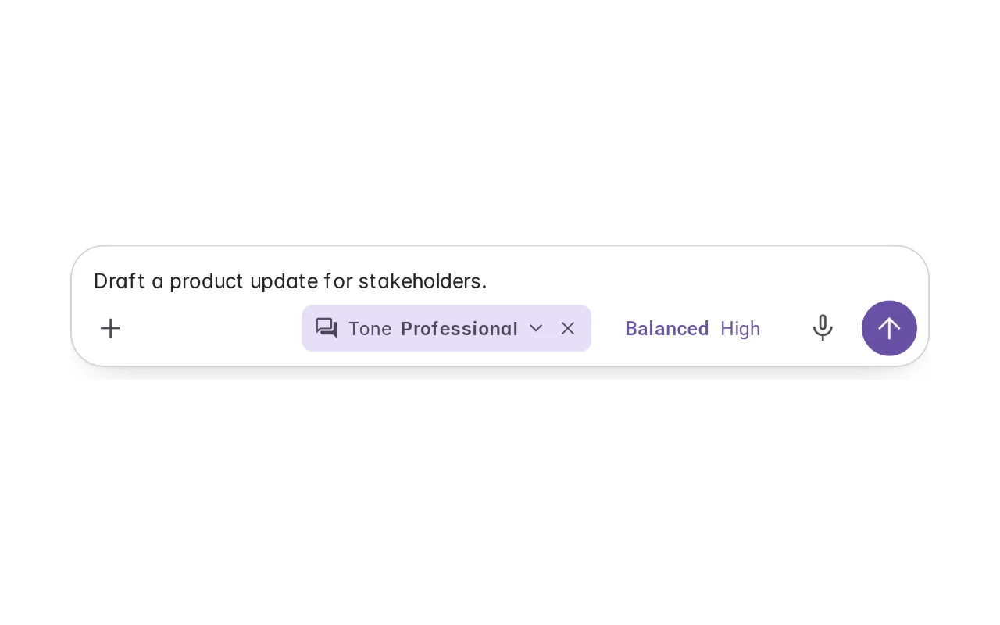
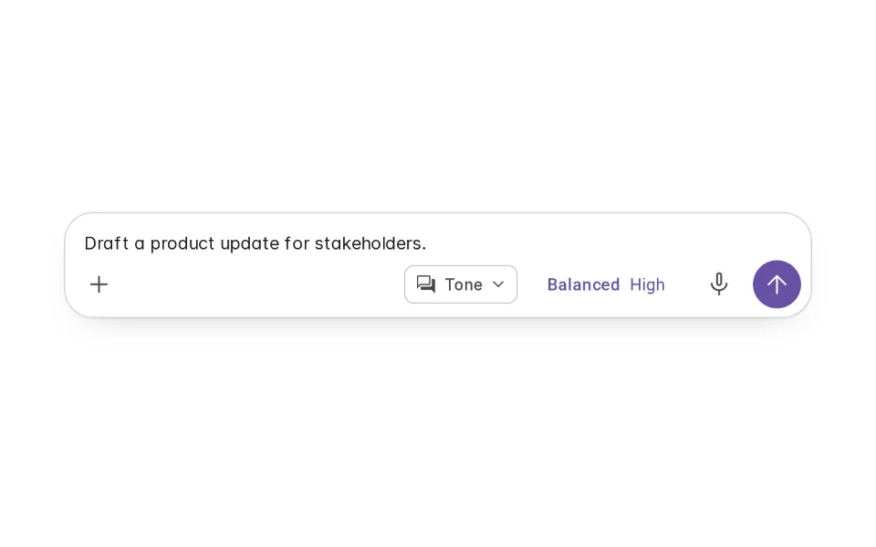
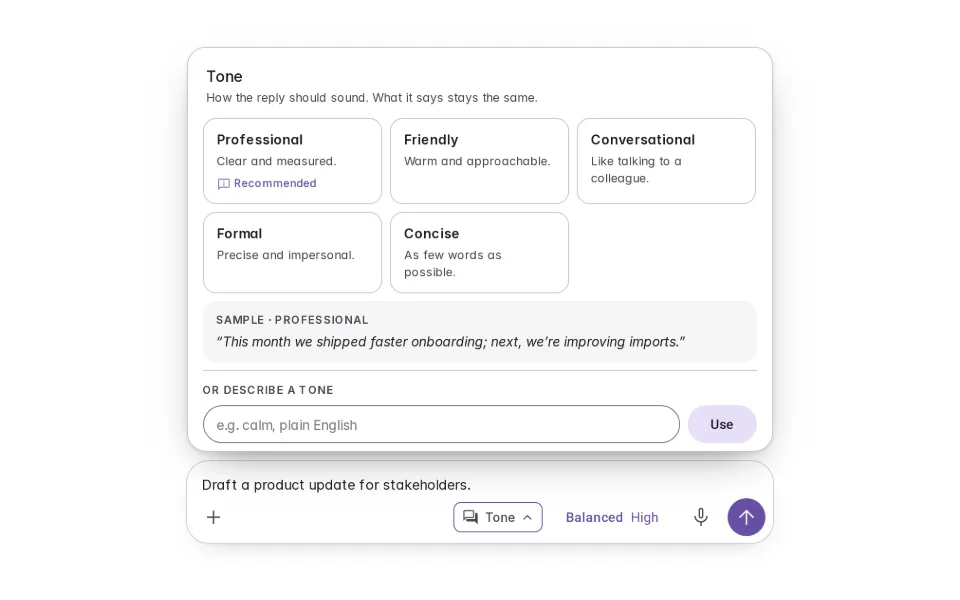
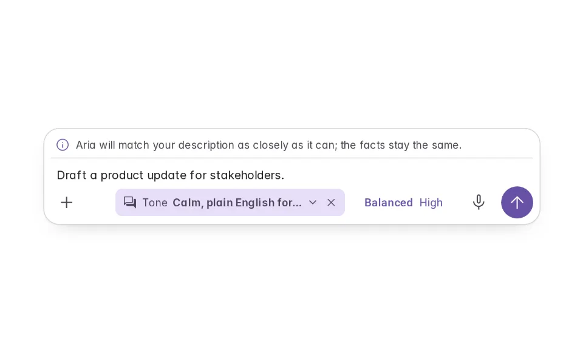
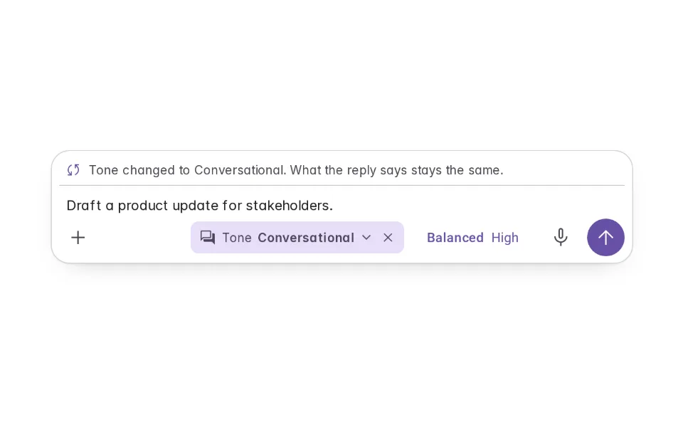
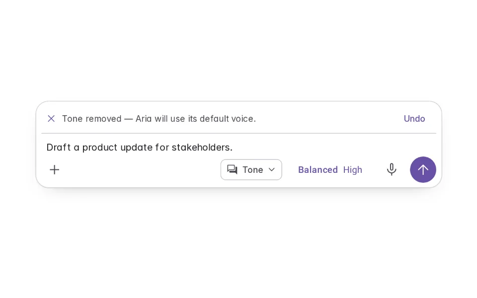

# Voice & Tone

**Initially › Prompt Scaffolds** · id `voice-tone` · API `TonePicker`

> Say how the reply should sound — Professional, Friendly, Concise, or your own words — visible in the composer, never changing what it says.

Open it: [material-pattern.html?id=voice-tone](../../../../material-pattern.html?id=voice-tone)

## Intent

Lets someone set how a reply should sound for this audience — choosing a tone, or describing one — previewed in a line, visible in the composer, and changeable or removable before they send. Tone changes wording, never facts.

## When to use

**Use when:** For writing tasks where the audience changes the voice — updates, replies, announcements. Not for analysis or factual lookups, and not as the agent’s standing personality (that is Personality).

## Where the code lives

| Part | Location |
|---|---|
| Live Preview (states, customizer, code tab) | [`material-preview.js` L3167–3375](../../../../material-preview.js#L3167-L3375) |
| Simulator | [`material-sim.js` L2106–2176](../../../../material-sim.js#L2106-L2176) |
| Docs (intent, anatomy, usage) | [`material-patterns.js` L3434–3453](../../../../material-patterns.js#L3434-L3453) |
| Category CSS block | [`material-pattern.html` PSX-START (L8184)](../../../../material-pattern.html#L8184) |
| Sidebar entry | [`material-nav.js`](../../../../material-nav.js) |

## Nucleux packages

- `@nucleux/md3-agent-composer`
- `@nucleux/md3-chip`
- `@nucleux/md3-radio`
- `@nucleux/md3-segmented-button`
- `@nucleux/md3-text-field`
- `@nucleux/tokens`

## States (6)

### 01 · Default

| | |
|---|---|
| Key | `default` |
| Trigger | No tone chosen. |
| Behaviour | A Tone control beside the model chip. Aria uses its default voice. |
| Meaning | They can say how the reply should sound. |
| Action | Open Tone, or send. |
| Next | Tone picker open |

### 02 · Tone picker open

| | |
|---|---|
| Key | `open` |
| Trigger | They opened Tone. |
| Behaviour | Tones with one line each showing how it sounds; Aria’s recommendation is marked, not selected; a field for their own description. |
| Meaning | How the reply would sound in each. |
| Action | Choose one, describe one, or close. |
| Next | Tone selected, or Custom tone |

### 03 · Tone selected _(initial)_

| | |
|---|---|
| Key | `selected` |
| Trigger | They chose Professional. |
| Behaviour | The Tone chip in the composer now reads “Professional”, with a way to change or remove it. Their text is untouched. |
| Meaning | The reply will sound professional — saying the same things. |
| Action | Send, change, or remove. |
| Next | Tone changed, or Tone removed |

### 04 · Custom tone

| | |
|---|---|
| Key | `custom` |
| Trigger | They described their own tone. |
| Behaviour | Their words become the tone chip, with a note that Aria will match it as closely as it can. |
| Meaning | Their description guides how it sounds. |
| Action | Send, edit, or remove. |
| Next | — |

### 05 · Tone changed

| | |
|---|---|
| Key | `changed` |
| Trigger | They switched to Conversational. |
| Behaviour | The chip updates; one line says the facts stay the same. |
| Meaning | Same content, different voice. |
| Action | Send, or ask for a new version. |
| Next | — |

### 06 · Tone removed

| | |
|---|---|
| Key | `removed` |
| Trigger | They removed the tone. |
| Behaviour | The chip goes; Aria uses its default voice. Undo is offered. |
| Meaning | Back to the default. |
| Action | Undo, or carry on. |
| Next | Default |

## Simulator

Choose Professional and send. Then switch to Conversational and ask for another version — the wording changes, the facts don’t. Aria’s recommendation is marked and never applied for you.

---

_Generated by `_build/catalog/make.js` — do not edit by hand; change the pattern and re-run._
