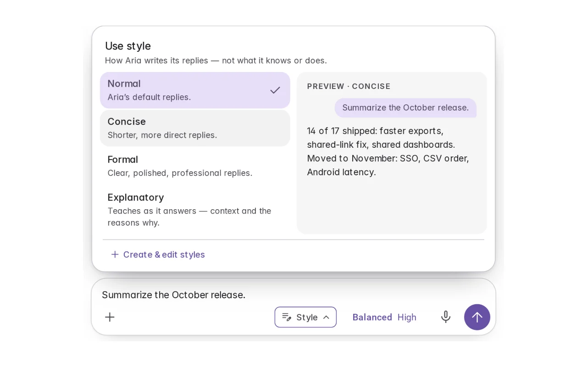
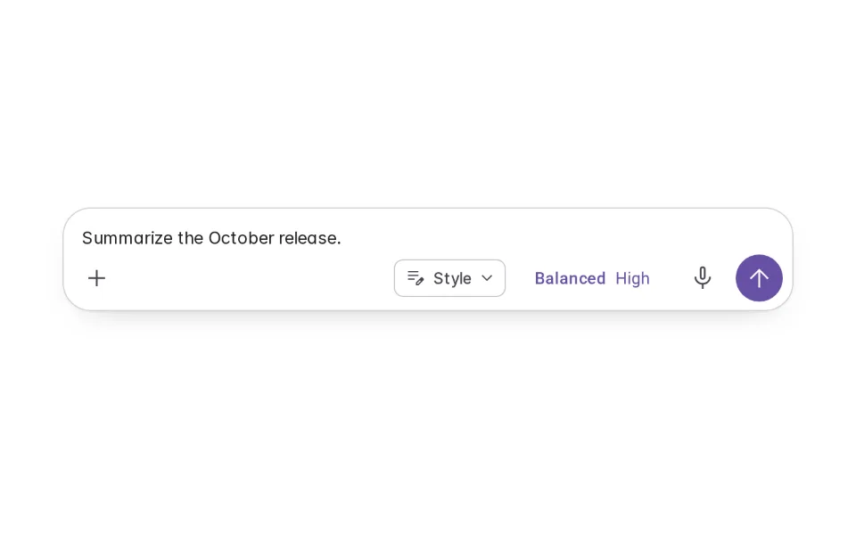
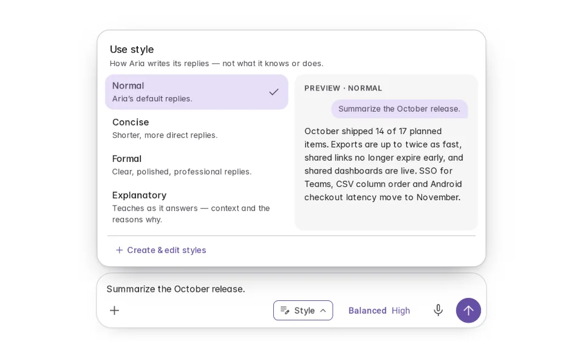
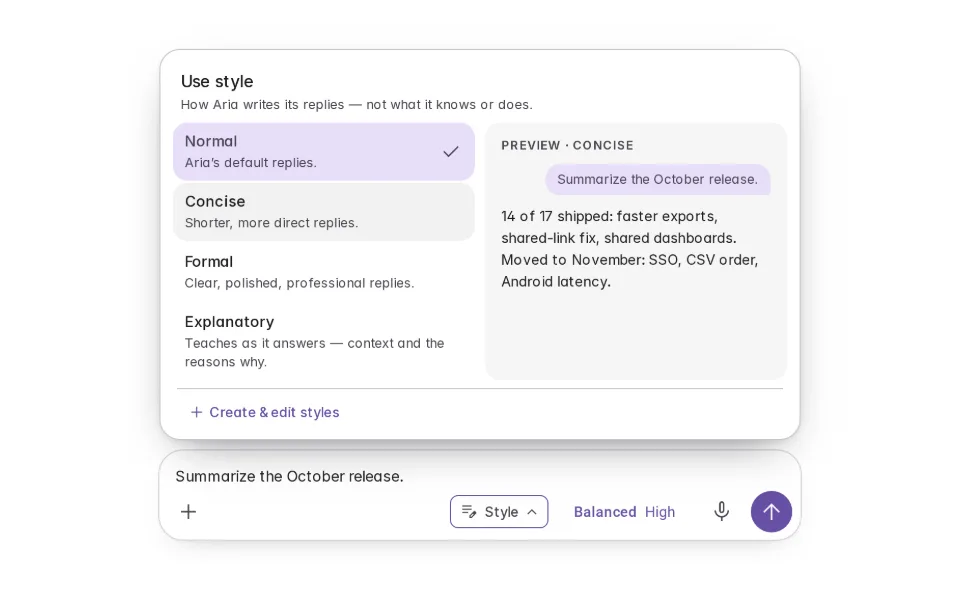
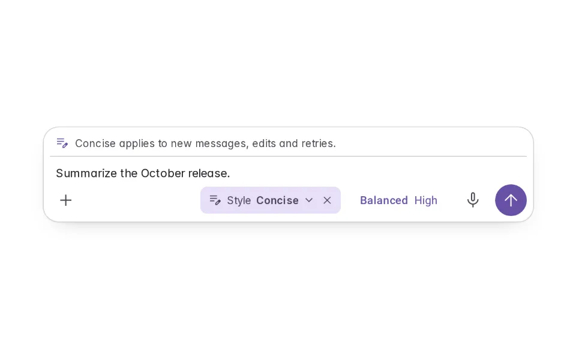
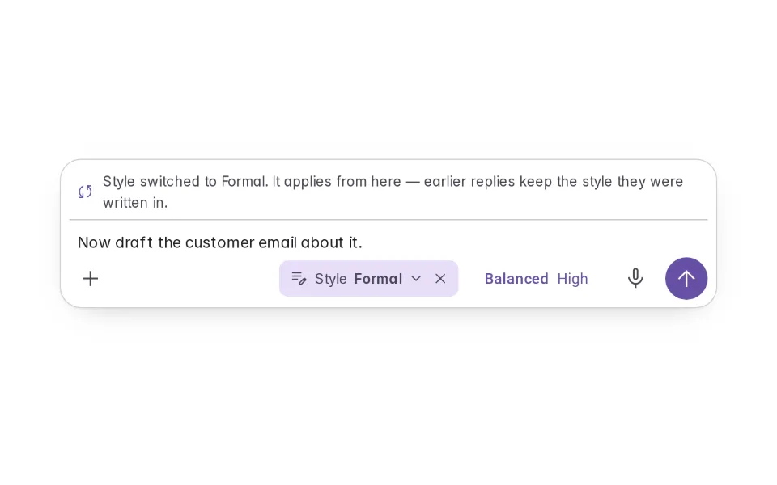
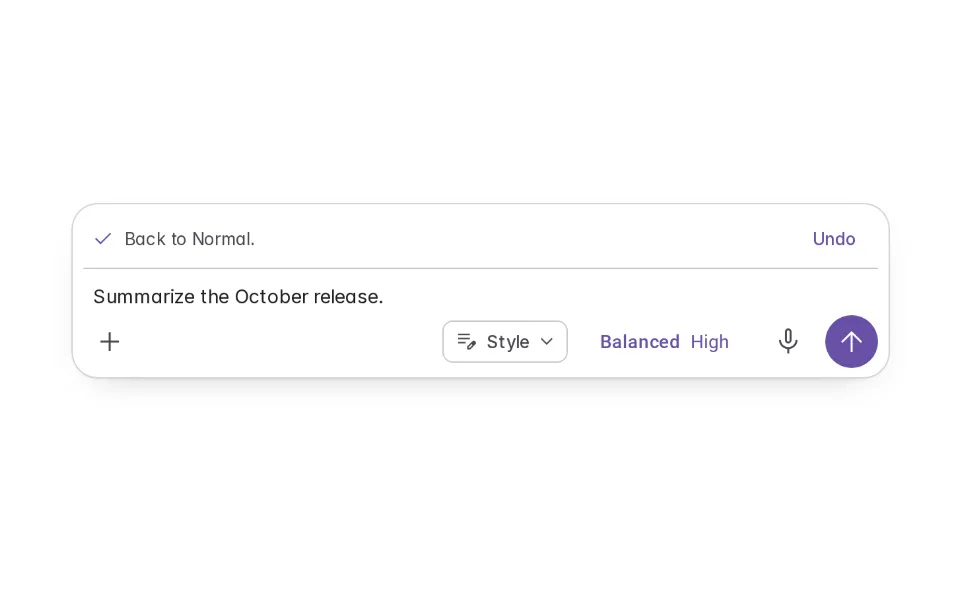
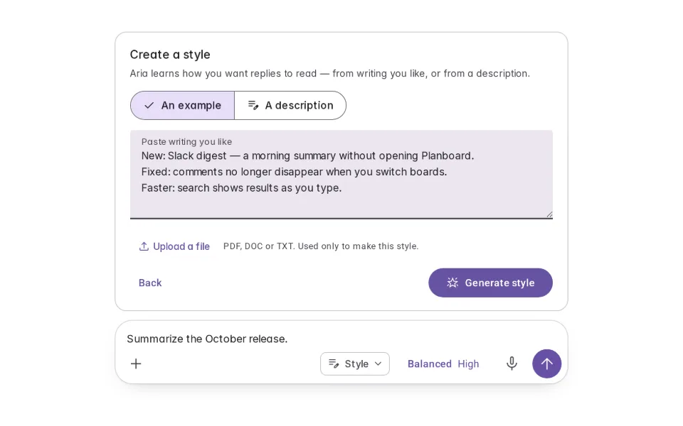
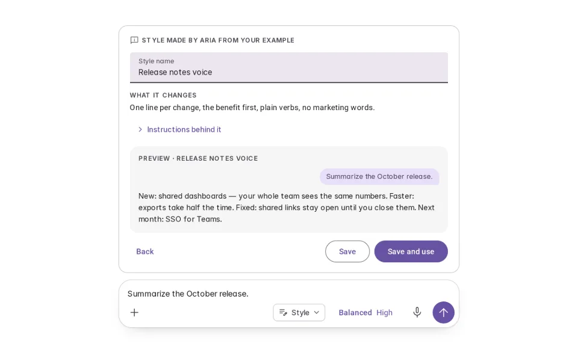

# Preset Styles

**Initially › Prompt Scaffolds** · id `preset-styles` · API `StylePicker`

> Named styles for how replies are written — Normal, Concise, Formal, Explanatory, or one made from your own writing — previewed, switchable mid-conversation.

Open it: [material-pattern.html?id=preset-styles](../../../../material-pattern.html?id=preset-styles)

## Intent

Lets someone set how the agent writes — shorter, more formal, more explanatory, or in their own house voice — without repeating it in every request, and change it at any point in a conversation.

## When to use

**Use when:** When people return to the same kind of reply — summaries, customer emails, explanations for newcomers — and want it to read a consistent way. Not for a single-request instruction, and not for what the agent knows or which model answers.

## Where the code lives

| Part | Location |
|---|---|
| Live Preview (states, customizer, code tab) | [`material-preview.js` L3385–3664](../../../../material-preview.js#L3385-L3664) |
| Simulator | [`material-sim.js` L2189–2332](../../../../material-sim.js#L2189-L2332) |
| Docs (intent, anatomy, usage) | [`material-patterns.js` L3454–3473](../../../../material-patterns.js#L3454-L3473) |
| Category CSS block | [`material-pattern.html` PSX-START (L8184)](../../../../material-pattern.html#L8184) |
| Sidebar entry | [`material-nav.js`](../../../../material-nav.js) |

## Nucleux packages

- `@nucleux/md3-agent-composer`
- `@nucleux/md3-button`
- `@nucleux/md3-chip`
- `@nucleux/md3-menu`
- `@nucleux/md3-segmented-button`
- `@nucleux/md3-text-field`
- `@nucleux/tokens`

## States (8)

### 01 · Normal

| | |
|---|---|
| Key | `none` |
| Trigger | They are writing a request. |
| Behaviour | No style chip: Aria writes the way it usually does. A Style control sits with the composer’s tools. |
| Meaning | Replies use the default style. |
| Action | Open Style, or send. |
| Next | Style menu open |

### 02 · Style menu open

| | |
|---|---|
| Key | `available` |
| Trigger | They opened Style. |
| Behaviour | “Use style”: Normal, Concise, Formal and Explanatory, each with one line on what changes, their own styles below, and Create & edit styles. The current style is checked. |
| Meaning | How Aria could write the reply. |
| Action | Point at a style to preview it, or choose one. |
| Next | Previewing a style |

### 03 · Previewing a style _(initial)_

| | |
|---|---|
| Key | `selected` |
| Trigger | They pointed at (or focused) Concise. |
| Behaviour | A sample reply in that style appears beside the list. Nothing changes until they choose it. |
| Meaning | What replies would read like. |
| Action | Choose it, or look at another. |
| Next | Style applied |

### 04 · Style applied

| | |
|---|---|
| Key | `applied` |
| Trigger | They chose Concise. |
| Behaviour | The menu closes and the Style chip in the composer reads “Concise”, with × to go back to Normal. One line says where it applies. Their request is untouched. |
| Meaning | Replies from now on will be shorter and more direct. |
| Action | Send, switch, or go back to Normal. |
| Next | Style switched, or Back to Normal |

### 05 · Style switched

| | |
|---|---|
| Key | `changed` |
| Trigger | Mid-conversation, they switched Concise to Formal. |
| Behaviour | The chip updates and one line says the new style applies from here — earlier replies keep theirs. |
| Meaning | The next reply will be formal. |
| Action | Send. |
| Next | — |

### 06 · Back to Normal

| | |
|---|---|
| Key | `removed` |
| Trigger | They pressed × on the chip (or chose Normal). |
| Behaviour | The chip goes; one line confirms Normal, with Undo. |
| Meaning | Replies go back to the default style. |
| Action | Undo, or carry on. |
| Next | Normal |

### 07 · Create a style

| | |
|---|---|
| Key | `create` |
| Trigger | They chose Create & edit styles. |
| Behaviour | A card above the composer: start from writing they like (paste or upload) or describe the style instead. Generate style is the only AI step; the example is used only to make the style. |
| Meaning | Aria can learn how they want replies to read. |
| Action | Add an example or a description, then generate. |
| Next | Style generated |

### 08 · Style generated

| | |
|---|---|
| Key | `generated` |
| Trigger | Aria made a style from their example. |
| Behaviour | A name and one line on what it changes, both editable and marked as Aria’s; the instructions behind it, on request; and a preview. Save keeps it in Your styles; Save and use applies it. |
| Meaning | Their own style — reviewed before it is used. |
| Action | Rename, adjust, preview, then save. |
| Next | Style applied |

## Simulator

Aria has answered in its Normal style. Open Style, point at a style to preview it, choose Concise and ask again. Then Create & edit styles: Aria makes a style from your own release notes. Switching never rewrites what you typed, and earlier replies keep the style they were written in.

---

_Generated by `_build/catalog/make.js` — do not edit by hand; change the pattern and re-run._
