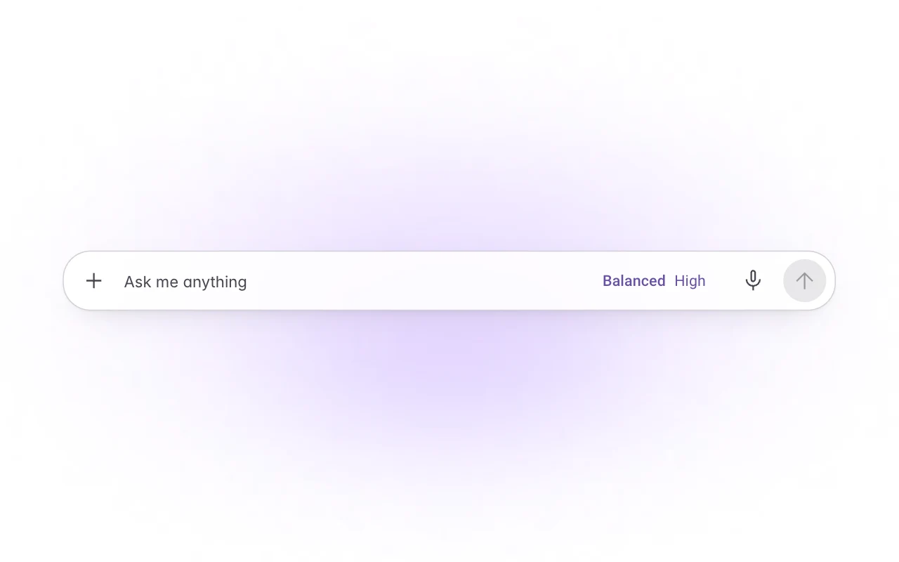
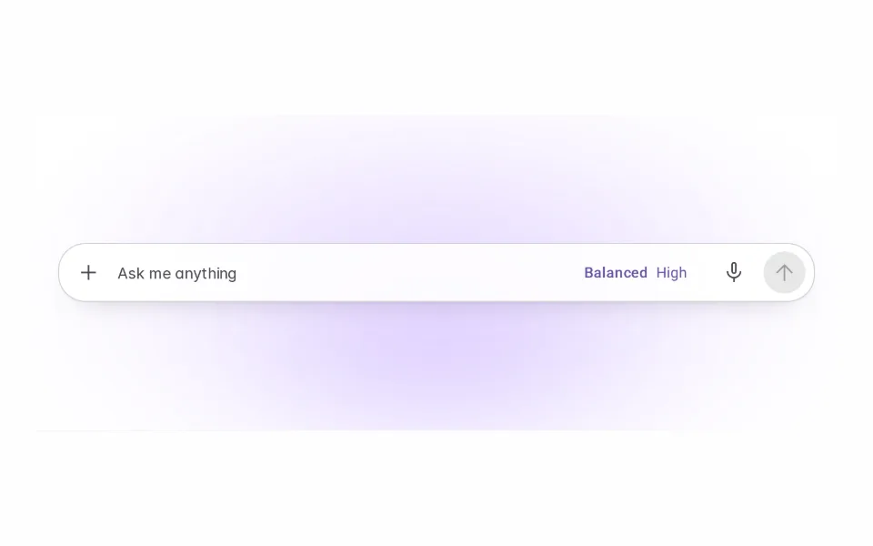
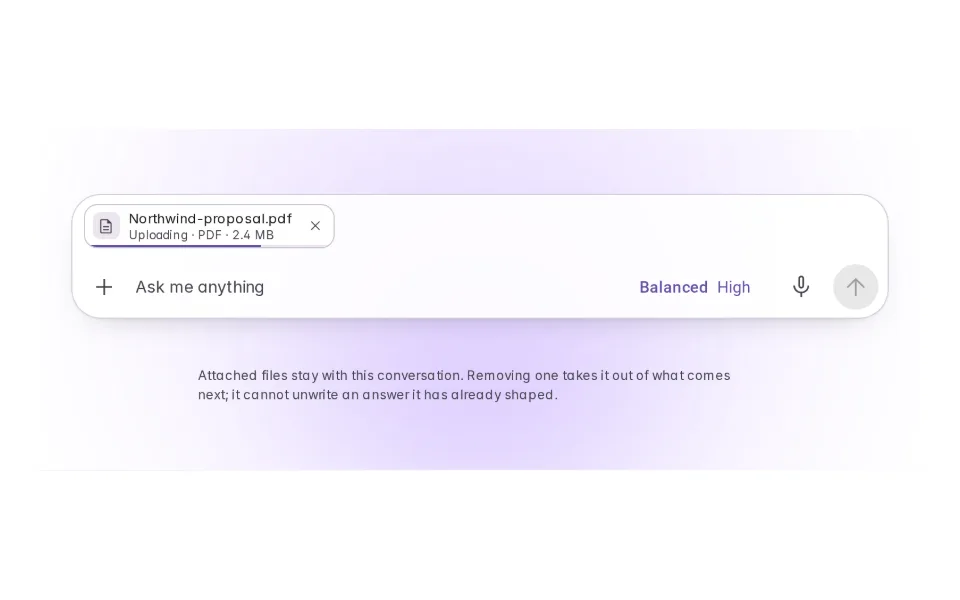
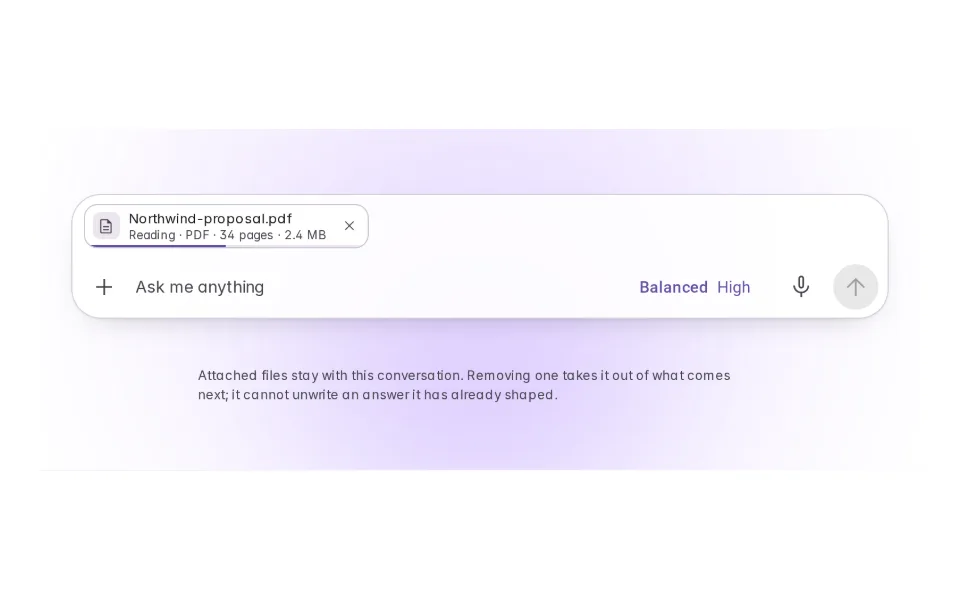
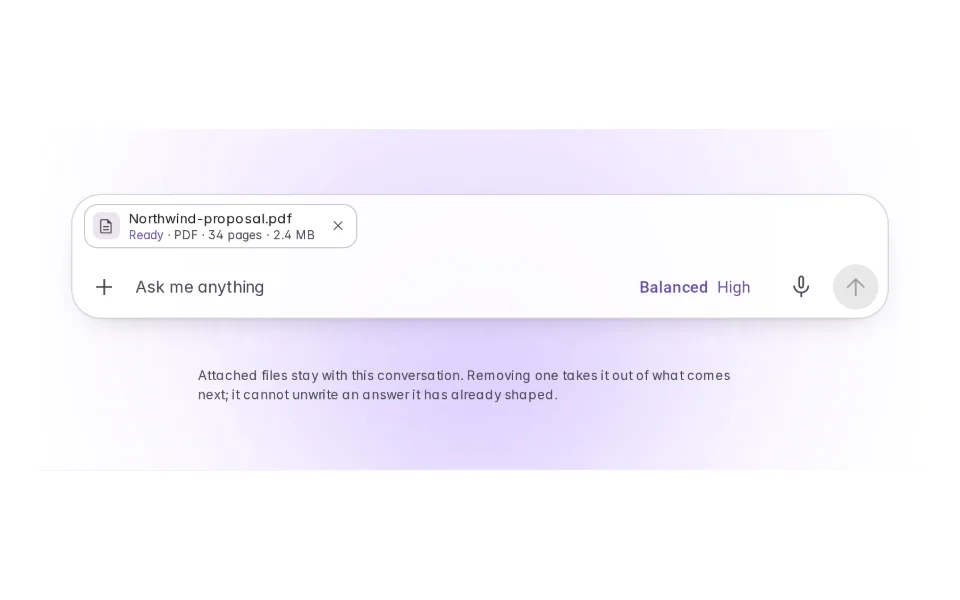
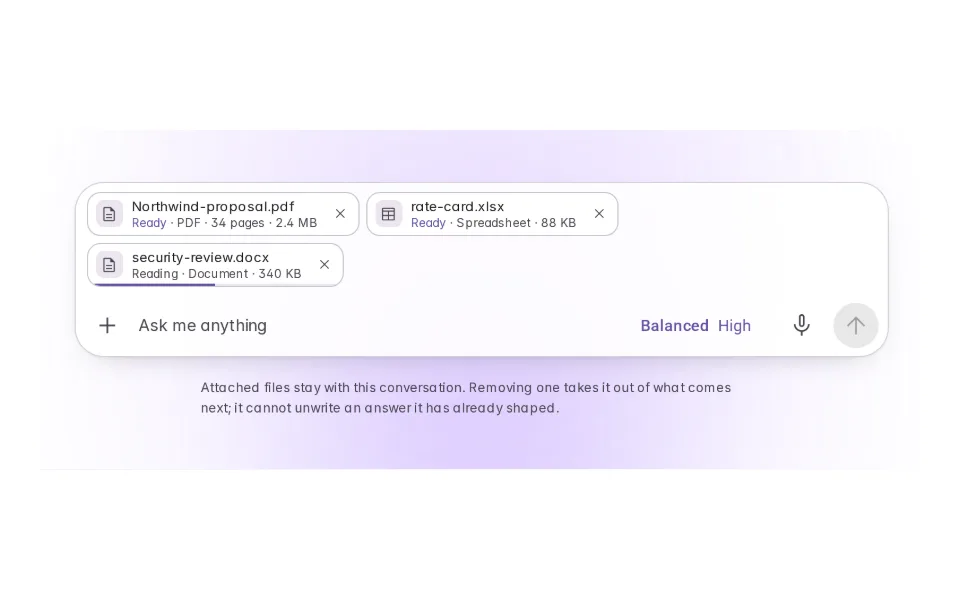
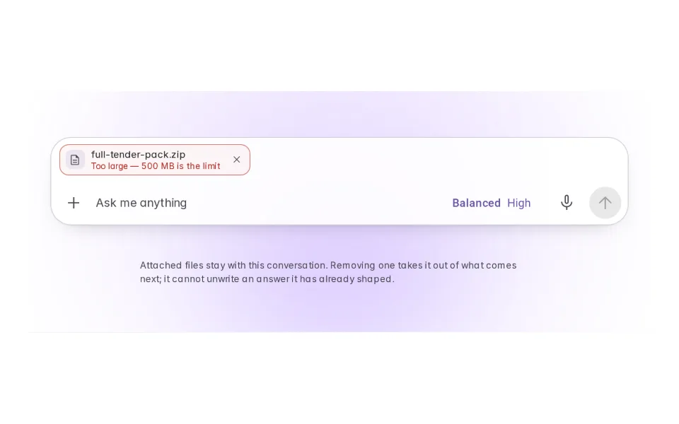
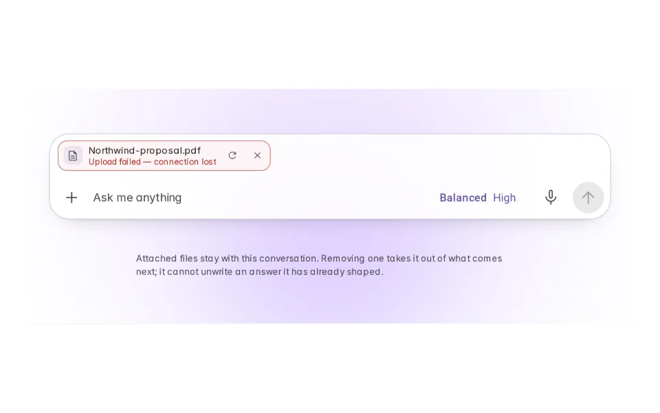
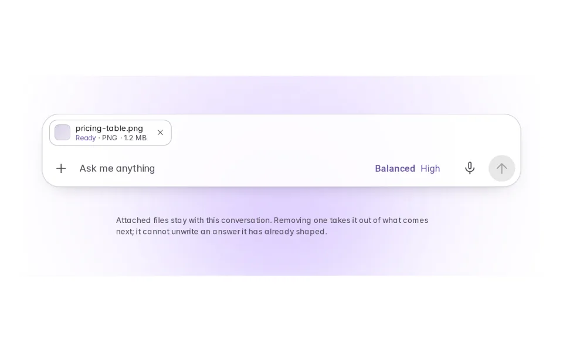

# Attachments

**Initially › Context Expansion** · id `attachments`

> Upload files, photos, docs for the AI to read.

Open it: [material-pattern.html?id=attachments](../../../../material-pattern.html?id=attachments)

## Intent

Temporary context — a file that belongs to this conversation and dies with it.

## When to use

**Use when:** Whenever the material is specific to one question — this contract, this screenshot, this export. It is the right default for anything a person would not want to keep: the cost of attaching is one press and the cost of it being wrong is nothing, because it goes away with the conversation.

## Where the code lives

| Part | Location |
|---|---|
| Live Preview (states, customizer, code tab) | [`material-preview.js` L10635–10794](../../../../material-preview.js#L10635-L10794) |
| Simulator | [`material-sim.js` L3699–3885](../../../../material-sim.js#L3699-L3885) |
| Docs (intent, anatomy, usage) | [`material-patterns.js` L2679–2800](../../../../material-patterns.js#L2679-L2800) |
| Pattern CSS (`.md-att`) | [`material-pattern.html` L4212–4325](../../../../material-pattern.html#L4212-L4325) · 32 lines |
| Sidebar entry | [`material-nav.js`](../../../../material-nav.js) |

## Nucleux packages

- `@nucleux/material`

## States (8)

### 01 · Nothing attached _(initial)_

| | |
|---|---|
| Key | `empty` |
| Trigger | The product at rest. |
| Behaviour | The ordinary composer. Attaching is one control away and it does not go anywhere else — the row appears above the input, inside the same bar. |
| Action | Attach one |

### 02 · Uploading

| | |
|---|---|
| Key | `uploading` |
| Trigger | A file is chosen. |
| Behaviour | The object joins the composer immediately, carrying a determinate bar because there is a real number to show. |
| Action | Finish the upload |

### 03 · Reading

| | |
|---|---|
| Key | `processing` |
| Trigger | The bytes have arrived. |
| Behaviour | Uploaded is not readable. The bar stops claiming a percentage it no longer has, and the word changes. |
| Action | Finish reading |

### 04 · Ready

| | |
|---|---|
| Key | `one` |
| Trigger | The agent can read it. |
| Behaviour | Name, type, and the word Ready. The composer has grown by exactly one row and nothing else has moved. |
| Action | Attach a second |

### 05 · Several

| | |
|---|---|
| Key | `several` |
| Trigger | More context is added. |
| Behaviour | They wrap within the row. Each keeps its own state, because one failing has nothing to do with the others. |
| Action | See one refused |

### 06 · Too large

| | |
|---|---|
| Key | `toobig` |
| Trigger | The file is over the limit. |
| Behaviour | Refused before a byte moves, with the limit in the message, and still listed so it can be swapped rather than hunted for. |
| Action | See an upload fail |

### 07 · Failed

| | |
|---|---|
| Key | `failed` |
| Trigger | The upload does not complete. |
| Behaviour | A retry control on the object itself, so recovering costs one press rather than finding the file again. |
| Action | See an image |

### 08 · Image

| | |
|---|---|
| Key | `image` |
| Trigger | The attachment is a picture. |
| Behaviour | A real thumbnail, because for an image it identifies the file faster than the filename does. |
| Action | Back to empty |

## Simulator

Attach a file from the + in the composer and watch the states it passes through. The one worth reading is the last: removing a file takes it out of what comes next, and cannot unwrite an answer it already shaped.

---

_Generated by `_build/catalog/make.js` — do not edit by hand; change the pattern and re-run._
