# Connect Data Source

**Initially › Context Expansion** · id `connectors` · API `ConnectDataSource`

> Sign in to GitHub, Drive, Slack or Notion for live, bounded grounding.

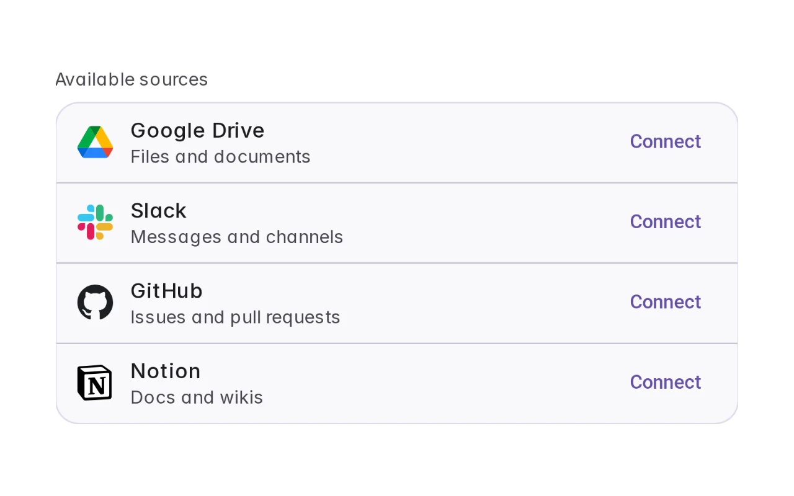

Open it: [material-pattern.html?id=connectors](../../../../material-pattern.html?id=connectors)

## Intent

An account, not a file — access that outlives the conversation and can be withdrawn.

## When to use

**Use when:** When the answer depends on a live system the person already has an account for, and the access is worth keeping — a tracker, a calendar, a drive, a code host. It is worth offering contextually the first time a request needs it, and worth surfacing in settings afterwards so that what was granted can be re-read months later.

## Where the code lives

| Part | Location |
|---|---|
| Live Preview (states, customizer, code tab) | [`material-preview.js` L10059–10621](../../../../material-preview.js#L10059-L10621) |
| Simulator | [`material-sim.js` L3926–4503](../../../../material-sim.js#L3926-L4503) |
| Docs (intent, anatomy, usage) | [`material-patterns.js` L2550–2677](../../../../material-patterns.js#L2550-L2677) |
| Pattern CSS (`.md-conn`) | [`material-pattern.html` L1792–4849](../../../../material-pattern.html#L1792-L4849) · 54 lines |
| Sidebar entry | [`material-nav.js`](../../../../material-nav.js) |
| Tests | [`conn.js`](../../../../_tests/suites/conn.js), [`connsim2.test.js`](../../../../_tests/suites/connsim2.test.js), [`modstate.js`](../../../../_tests/suites/modstate.js), [`toolbar.js`](../../../../_tests/suites/toolbar.js) |

## Nucleux packages

- `@nucleux/material`

## States (10)

### 01 · No sources connected _(initial)_

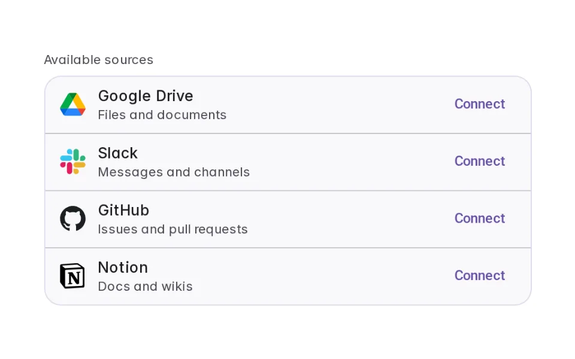

| | |
|---|---|
| Key | `zero` |
| Trigger | A fresh agent, before anything has been granted. |
| Behaviour | Names the benefit in one line and lists what can be connected as a compact list — not a gallery of logos nobody browses. |
| Action | Choose GitHub |

### 02 · Why access is needed

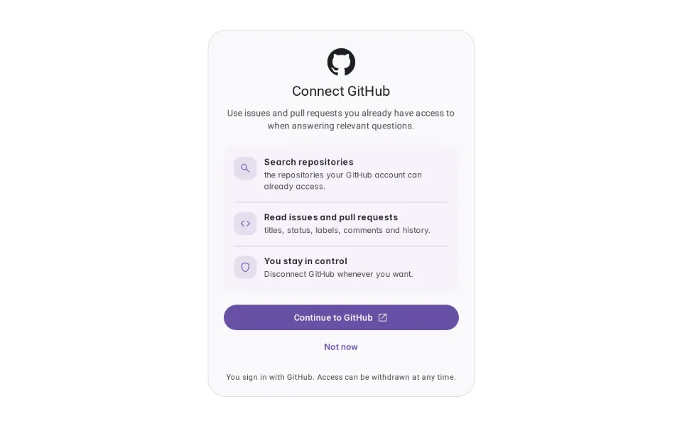

| | |
|---|---|
| Key | `access` |
| Trigger | Connect is pressed. |
| Behaviour | Says what the agent cannot reach and why, then what connecting would allow — in the product's own verbs, before any handoff, and bounded rather than absolute. |
| Action | Allow it |

### 03 · Connecting

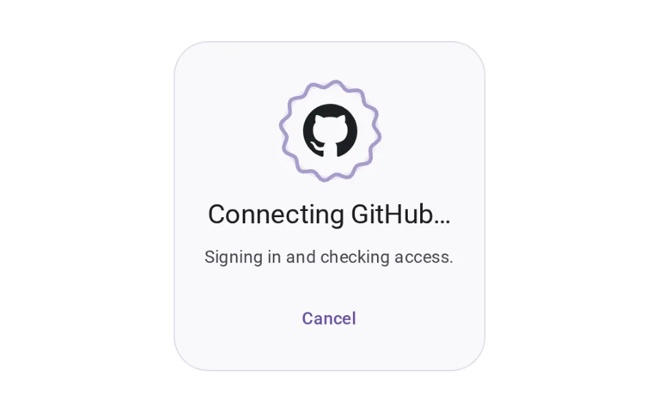

| | |
|---|---|
| Key | `connecting` |
| Trigger | Allow is pressed. |
| Behaviour | The product does not impersonate the sign-in. It waits, says it is waiting, and leaves a way out. |
| Action | See it connected |

### 04 · Connected

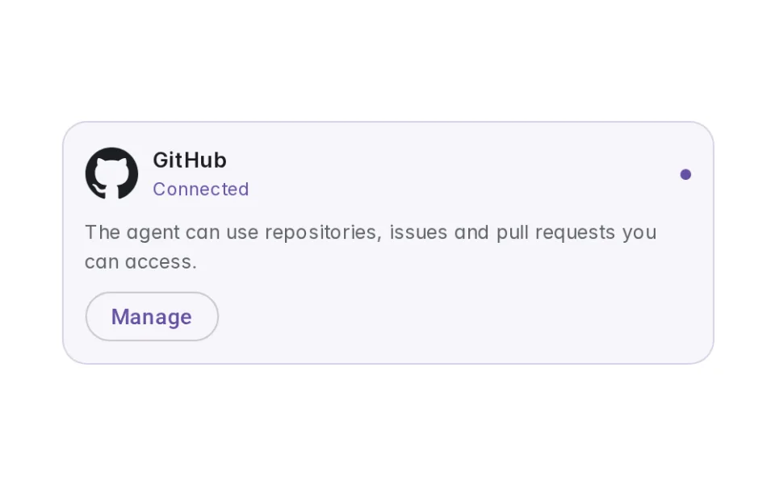

| | |
|---|---|
| Key | `connected` |
| Trigger | The service confirms. |
| Behaviour | The word and a dot, in that order, plus a plain statement of what the agent can now reach — bounded, never "all of GitHub." |
| Action | Ask something that needs it |

### 05 · Being used

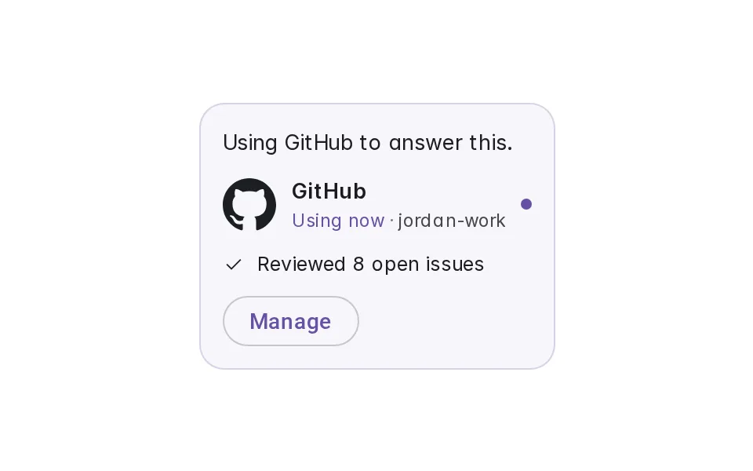

| | |
|---|---|
| Key | `active` |
| Trigger | A request the source can answer arrives. |
| Behaviour | A quiet line while the agent draws on the source, settling into a small, checkable receipt — never a progress percentage, because there is no honest one for "reading issues." |
| Action | See it settle |

### 06 · Several sources

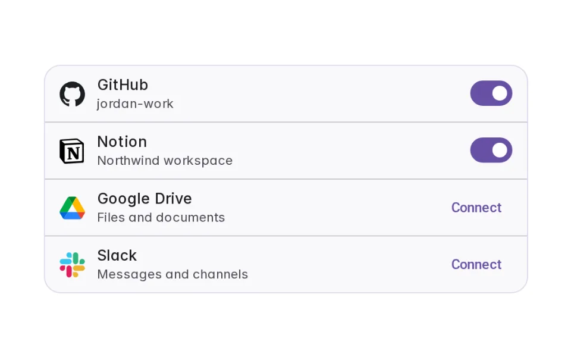

| | |
|---|---|
| Key | `multi` |
| Trigger | More than one connection exists. |
| Behaviour | One surface, grouped by the only thing that decides where a source belongs: connected sources first, each with a switch for whether the agent may draw on it right now, then what can still be added, divided by a single hairline. Neither group is captioned — a switch and a Connect say which half a row is in. The switch is availability, not the grant: off keeps the connection and the account, and ending one is a separate, confirmed decision on the connection itself. |
| Action | Connect Slack |

### 07 · Connection problem

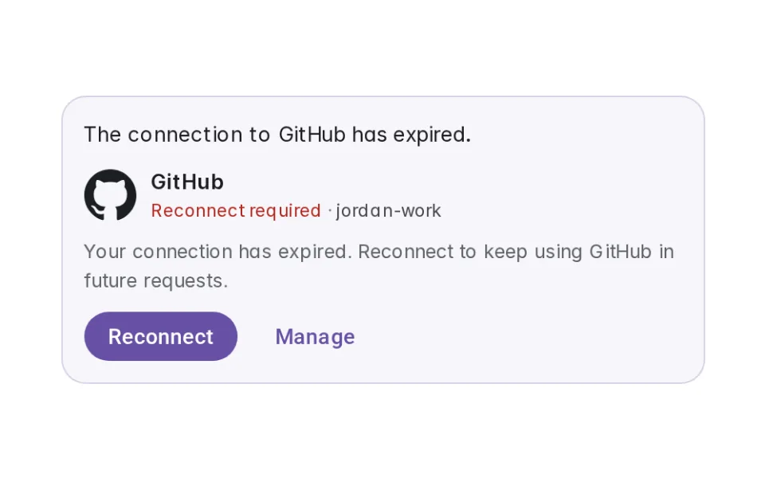

| | |
|---|---|
| Key | `problem` |
| Trigger | The handoff does not complete, or a sign-in that was working expires or is revoked upstream. |
| Behaviour | One state for both, because the product owes the same three things either way: never show it as still connected, say what happened in a sentence a person can act on, and keep the way back to one press. What it must NOT merge is the sentence. A handoff that failed changed nothing and has no account to name; a sign-in that expired was working until it wasn't, and saying "nothing was changed" to that person is simply false. Same state, same shape, one line and one verb chosen by the cause — which is what the control beside this switches between. |
| Action | Put it right |

### 08 · Manage connection

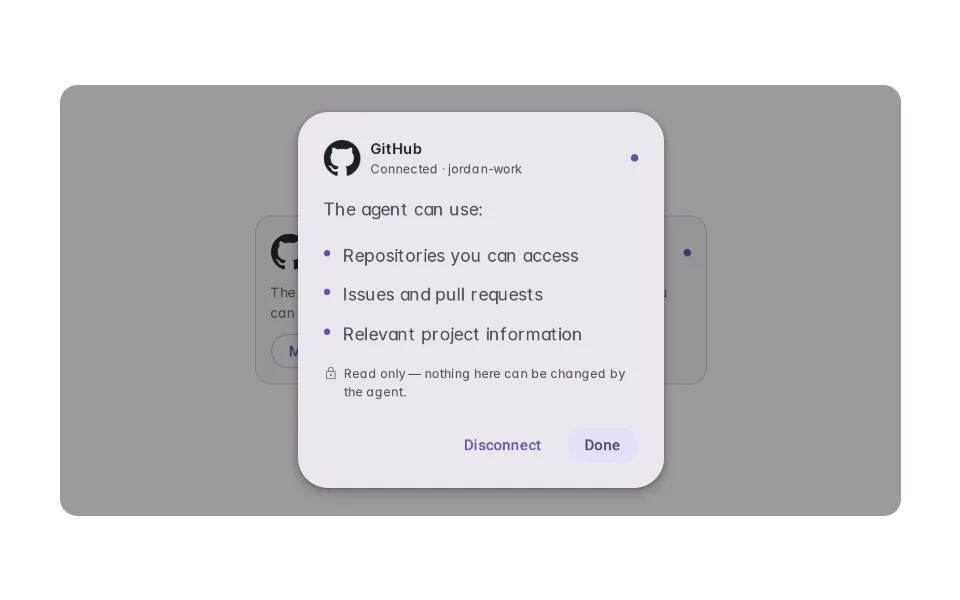

| | |
|---|---|
| Key | `manage` |
| Trigger | Manage is pressed on a live connection. |
| Behaviour | A compact surface over the connection it manages: the account, what the agent can do with it, reconnect if it needs it, and a way to end it — nothing else. |
| Action | Disconnect |

### 09 · Disconnect confirmation

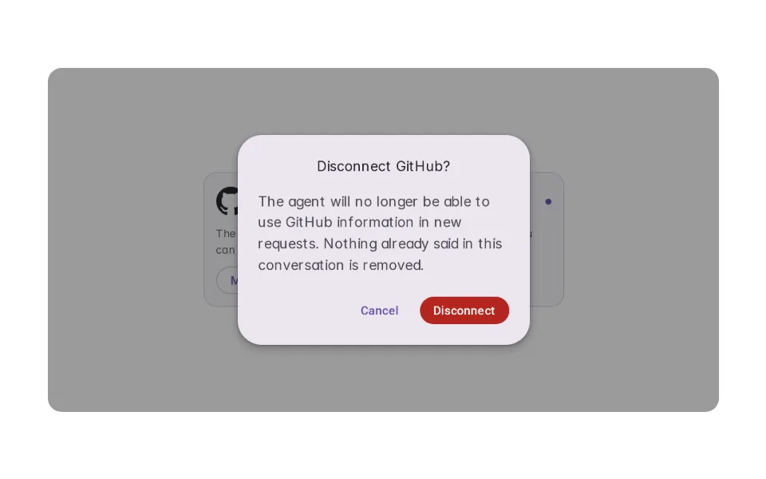

| | |
|---|---|
| Key | `confirm` |
| Trigger | Disconnect is pressed. |
| Behaviour | One press should not be enough to drop a standing grant. The sentence says what changes — new requests only — never a claim about deleting anything already said. |
| Action | Confirm disconnect |

### 10 · Disconnected

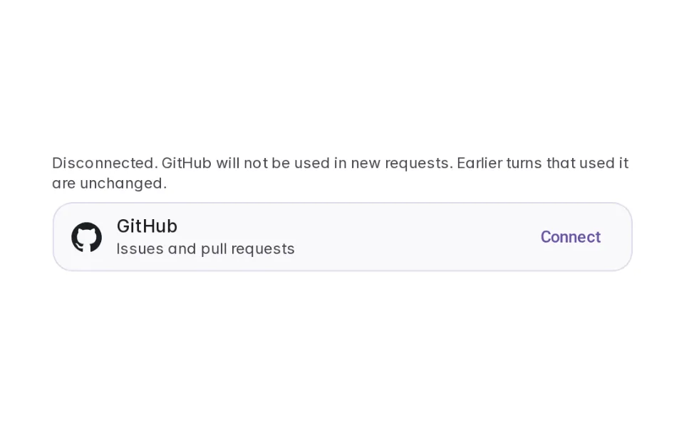

| | |
|---|---|
| Key | `disconnected` |
| Trigger | Disconnect is confirmed. |
| Behaviour | Back to the row it started as. Earlier turns that used the source are not rewritten or removed — only new requests lose access. |
| Action | Connect again |

## Simulator

Two ways in, and they meet in the same component. Open the composer's + to go looking for a source, or just send the question and let the agent run into the wall. Afterwards the + is how you add a second source, manage one, or take one away.

---

_Generated by `_build/catalog/make.js` — do not edit by hand; change the pattern and re-run._
