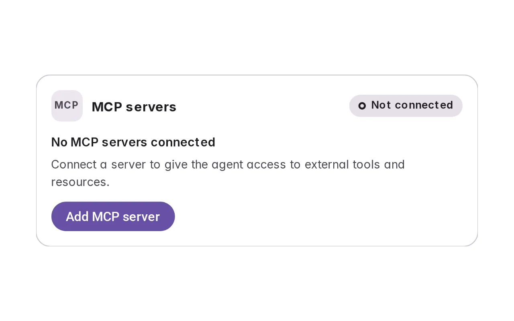
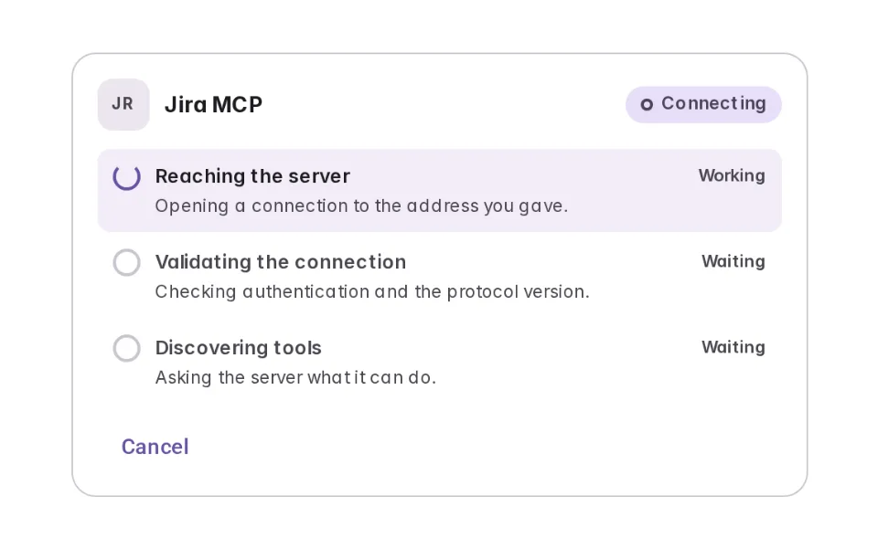
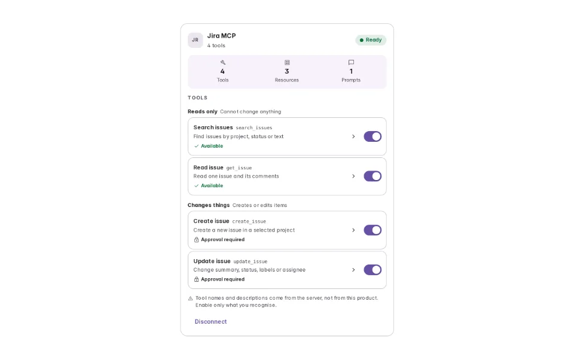
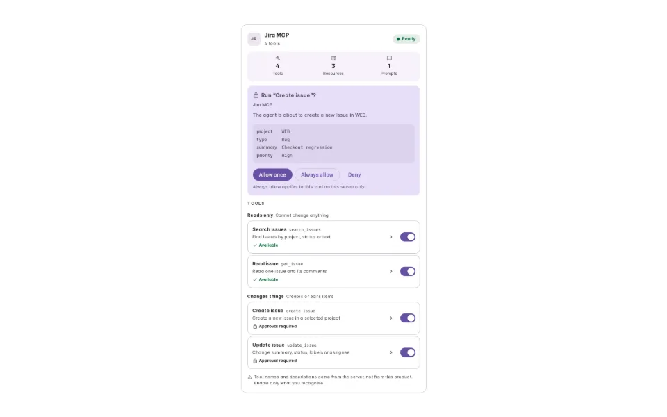
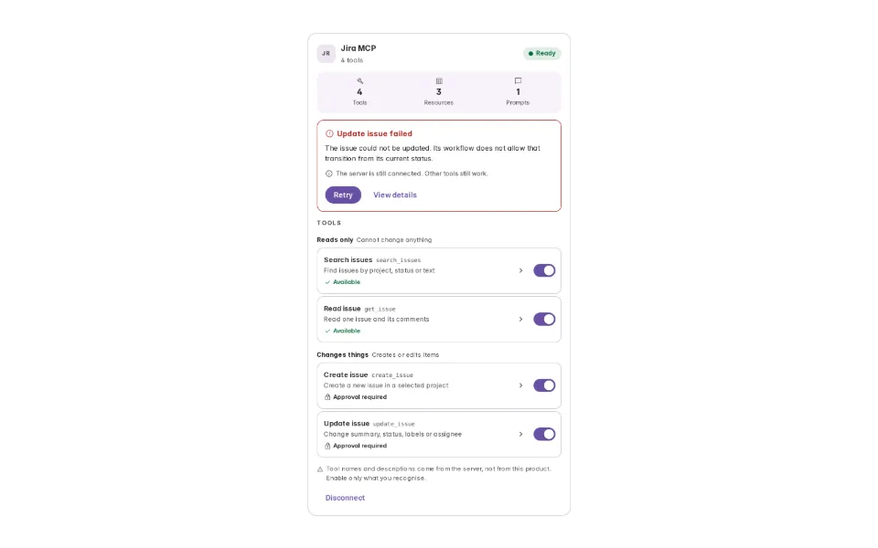

# MCP Server Connection

**Initially › Context Expansion** · id `mcp` · API `MCPServer`

> Connect a server, discover what it can do, and decide before the agent uses it.

Open it: [material-pattern.html?id=mcp](../../../../material-pattern.html?id=mcp)

## Intent

A connection whose capabilities have to be discovered, inspected and approved rather than assumed.

## When to use

**Use when:** Where an agent needs to act in a system through a standard interface rather than a bespoke integration — internal tooling, developer workflows, anything a team runs itself. It is the right pattern when the set of capabilities is genuinely not knowable in advance. It is the wrong pattern when it is: if the integration is fixed and reviewed, use a connector and spare people a capability audit they did not ask for.

## Where the code lives

| Part | Location |
|---|---|
| Live Preview (states, customizer, code tab) | [`material-preview.js` L9673–10041](../../../../material-preview.js#L9673-L10041) |
| Simulator | [`material-sim.js` L4528–4863](../../../../material-sim.js#L4528-L4863) |
| Docs (intent, anatomy, usage) | [`material-patterns.js` L2406–2548](../../../../material-patterns.js#L2406-L2548) |
| Sidebar entry | [`material-nav.js`](../../../../material-nav.js) |
| Tests | [`mcp.js`](../../../../_tests/suites/mcp.js) |

## Nucleux packages

- `@nucleux/material`

## States (5)

### 01 · Not connected _(initial)_

| | |
|---|---|
| Key | `zero` |
| Trigger | The agent needs a tool the product does not have. |
| Behaviour | One line saying what a server would give it, and one action. Add MCP server opens a name and an address on the same surface — not a settings page, because this happens in the middle of trying to get something done. |
| Action | Add a server |

### 02 · Connecting

| | |
|---|---|
| Key | `connecting` |
| Trigger | The address is submitted. |
| Behaviour | Reaching, validating, discovering — three named steps that resolve one at a time. They fail for different reasons and are fixed in different places, so a spinner cannot do this job. No percentage: nothing here knows one. |
| Action | Watch it land on Ready |

### 03 · Ready

| | |
|---|---|
| Key | `ready` |
| Trigger | Discovery returns. |
| Behaviour | Connected is not Ready. Ready is the tool count and the tool list: what the server turned out to offer, grouped by what each one can do, with the schema one press behind the row for whoever wants it. |
| Action | Inspect a tool, or let the agent use one |

### 04 · Needs approval

| | |
|---|---|
| Key | `approval` |
| Trigger | The agent calls a tool that changes something. |
| Behaviour | At call time, with the arguments visible. Allow runs it here and the result settles in place. Always allow is offered on a tool that writes and withheld on one that destroys. |
| Action | Allow it, or deny |

### 05 · Tool failed

| | |
|---|---|
| Key | `failed` |
| Trigger | One call comes back an error. |
| Behaviour | The server badge does not move. One tool broke; the other three still work, and the actions are about the call. Retry once and it escalates to the SERVER — which is a different failure with a different fix. |
| Action | Retry, and watch the failure change scope |

## Simulator

Ask for something the agent cannot do yet, and watch the connection be built for it — reached, validated, then discovered, which is the step most products skip. Then break one call, and watch the failure change scope from the tool to the connection.

---

_Generated by `_build/catalog/make.js` — do not edit by hand; change the pattern and re-run._
