# Knowledge Base

**Initially › Context Expansion** · id `knowledge-base` · API `KnowledgeBase`

> Persistent, named material the agent can draw on across a project.

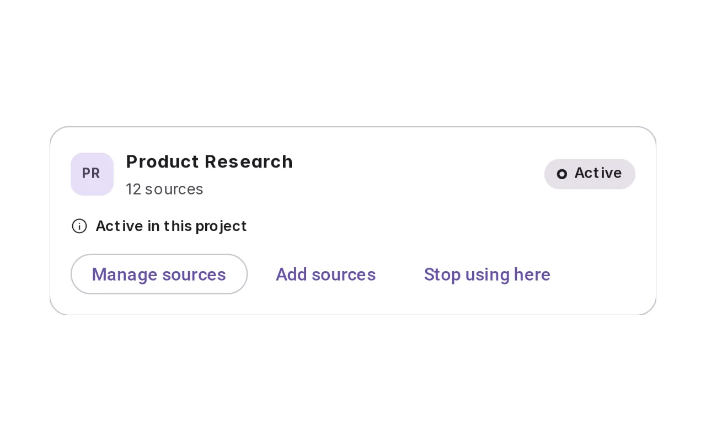

Open it: [material-pattern.html?id=knowledge-base](../../../../material-pattern.html?id=knowledge-base)

## Intent

Standing context — sources that were here before the conversation and will outlive it.

## When to use

**Use when:** Where the same material informs many conversations — a research corpus, a policy set, a product's own documentation, a team's accumulated notes. The test is lifetime. If somebody would be annoyed to re-upload it tomorrow, it wants to be a knowledge base. If they would be alarmed to find it still there tomorrow, it wants to be an attachment, and the moment a file crosses that line somebody should have agreed to it.

## Where the code lives

| Part | Location |
|---|---|
| Live Preview (states, customizer, code tab) | [`material-preview.js` L9001–9646](../../../../material-preview.js#L9001-L9646) |
| Simulator | [`material-sim.js` L4889–5352](../../../../material-sim.js#L4889-L5352) |
| Docs (intent, anatomy, usage) | [`material-patterns.js` L2260–2404](../../../../material-patterns.js#L2260-L2404) |
| Sidebar entry | [`material-nav.js`](../../../../material-nav.js) |
| Tests | [`kb12.test.js`](../../../../_tests/suites/kb12.test.js), [`kbsim3.test.js`](../../../../_tests/suites/kbsim3.test.js) |

## Nucleux packages

- `@nucleux/material`

## States (12)

### 01 · Empty

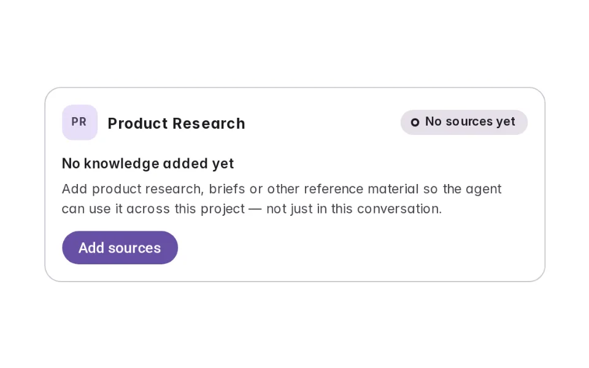

| | |
|---|---|
| Key | `empty` |
| Trigger | A project exists and nothing has been trusted to it yet. |
| Behaviour | One sentence saying what a source buys that an attachment does not — it outlives the conversation — and one action. Not an empty dashboard: there is nothing to dash. |
| Action | Add knowledge |

### 02 · Preparing

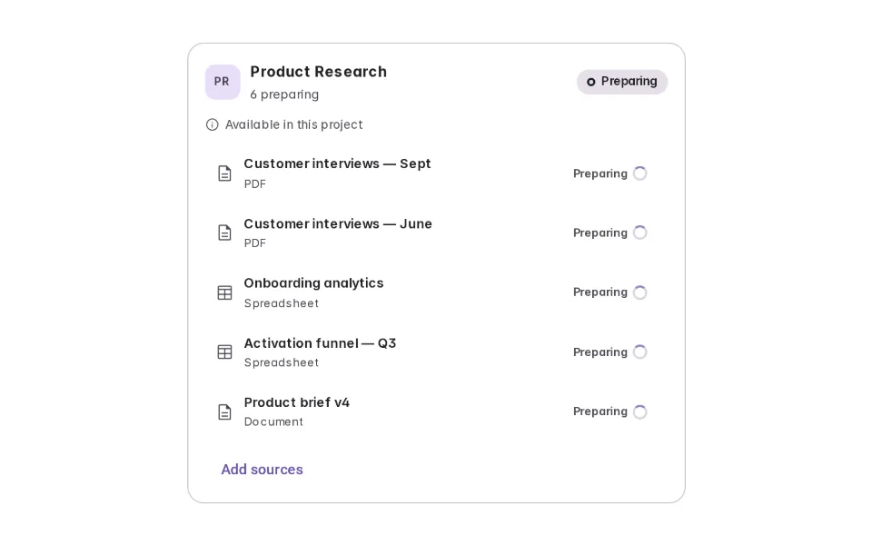

| | |
|---|---|
| Key | `preparing` |
| Trigger | Sources have been added and cannot be read yet. |
| Behaviour | The half of the lifecycle products skip. A file that has finished uploading is not a file the agent can read, and one status for both sends somebody to ask a question thirty seconds too early. One honest word, and no pipeline. |
| Action | Wait, or ask from what is already available |

### 03 · Available

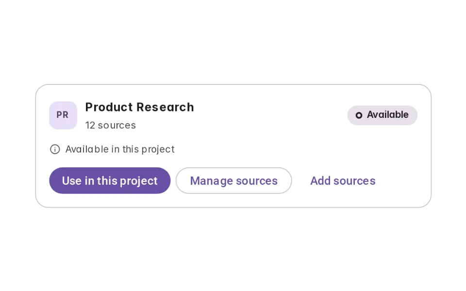

| | |
|---|---|
| Key | `available` |
| Trigger | The base is healthy and this project is not using it. |
| Behaviour | The resting state products lose. Available is a fact about the base; active is a fact about this project. A base can be available in five projects and in play in one, and only the second changes what an answer is made of. |
| Action | Use it in this project |

### 04 · Active _(initial)_

| | |
|---|---|
| Key | `active` |
| Trigger | The base is in play here. |
| Behaviour | Compact: the count, where it applies, a way into the list. Active means the agent MAY draw on it — not that it is doing so, which is the next state and a different fact. |
| Action | Open the sources, or ask a question |

### 05 · Being used

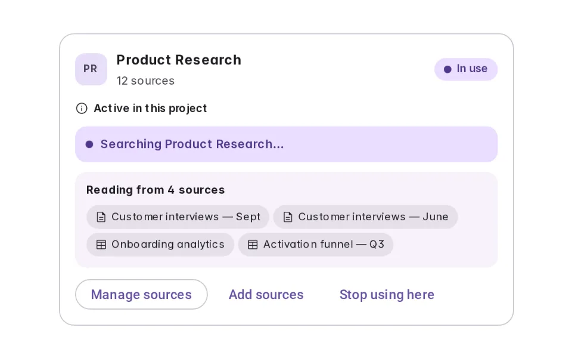

| | |
|---|---|
| Key | `using` |
| Trigger | A question arrives that this material can answer. |
| Behaviour | Searching, then reading a named number of sources, then the provenance the answer carries. Three moments of one state, because that is how it happens — and no percentage, because nothing in the client knows an honest one. |
| Action | Open any source it read |

### 06 · Multiple knowledge bases

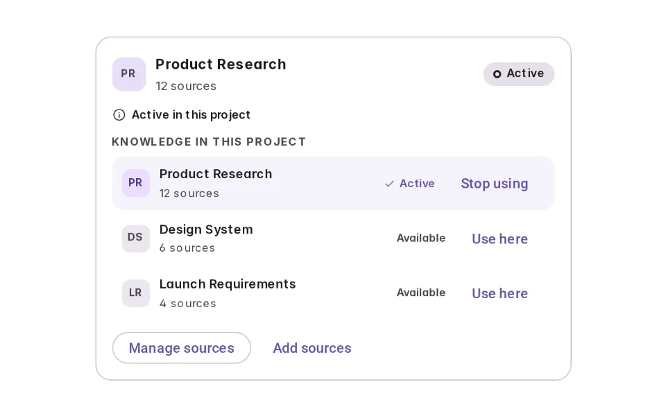

| | |
|---|---|
| Key | `multiple` |
| Trigger | The project could draw on more than one collection. |
| Behaviour | A short list saying which is in play and which merely could be, with the count on every row — because a name alone does not say whether choosing it gives the agent six documents or six hundred. A list, not a dashboard. |
| Action | Switch one on or off |

### 07 · Manage sources

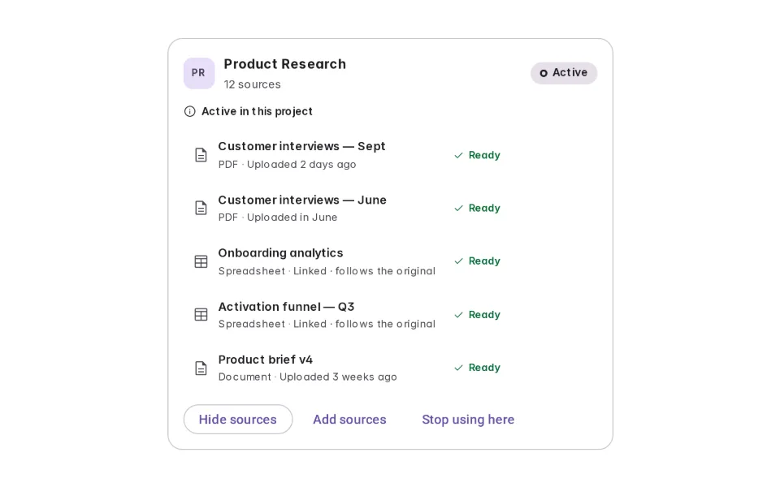

| | |
|---|---|
| Key | `manage` |
| Trigger | Somebody came to see what is actually in it. |
| Behaviour | Every source with its kind, its freshness written for that kind, its own readiness as a word, and its own action. This is the state that has to stay a knowledge base rather than becoming a file manager. |
| Action | Remove a source, or add more |

### 08 · Partially available

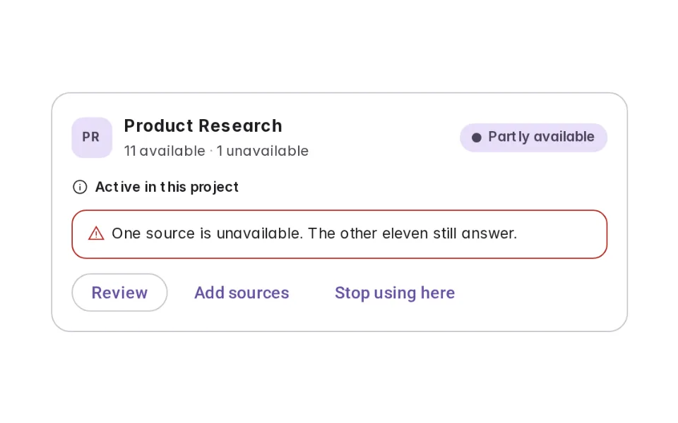

| | |
|---|---|
| Key | `partial` |
| Trigger | One source stopped working and the rest did not. |
| Behaviour | "11 available · 1 unavailable" — counted apart, because "12 sources" beside an amber badge reads as twelve broken ones. The base still answers, and Review goes straight to the row that is the reason for the word. |
| Action | Review the one that needs a person |

### 09 · Source unavailable

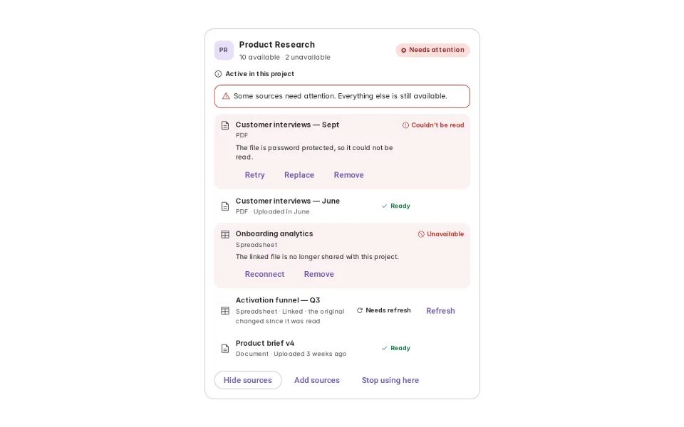

| | |
|---|---|
| Key | `unavailable` |
| Trigger | Sources cannot be read, for two different reasons. |
| Behaviour | Two kinds of stop with two different ways out: a file that would not parse offers Retry and Replace; a file you are no longer allowed to open offers Reconnect, because nothing about trying again fixes permission. |
| Action | Retry, reconnect, replace or remove |

### 10 · No relevant knowledge

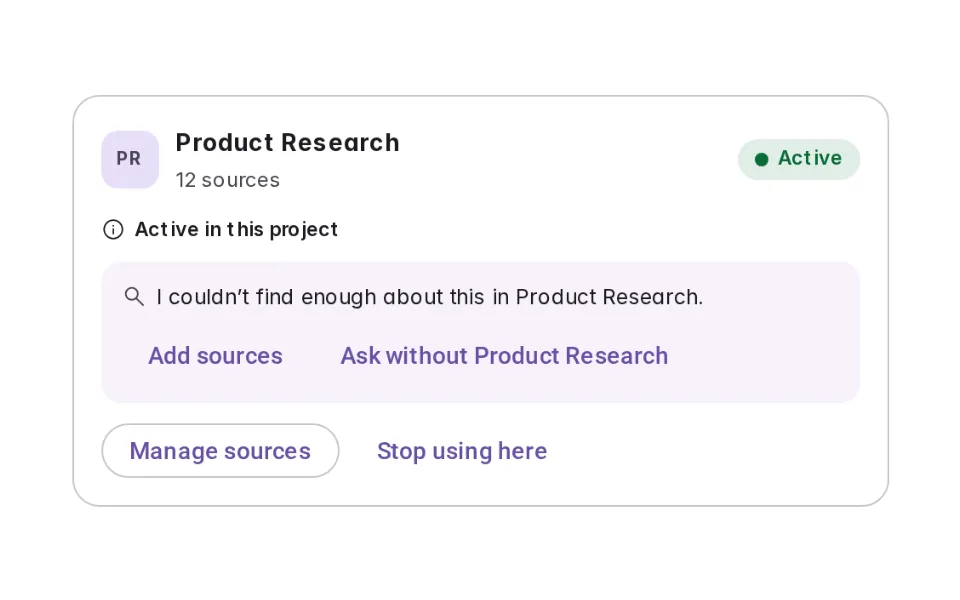

| | |
|---|---|
| Key | `none` |
| Trigger | The question falls outside the material. |
| Behaviour | It looked and found nothing, and says so. Not an error and not a broken base — the base worked. A base that always has an answer is a base that is inventing them, and this is the state that proves it is not. |
| Action | Add sources, or ask without it |

### 11 · Remove source confirmation

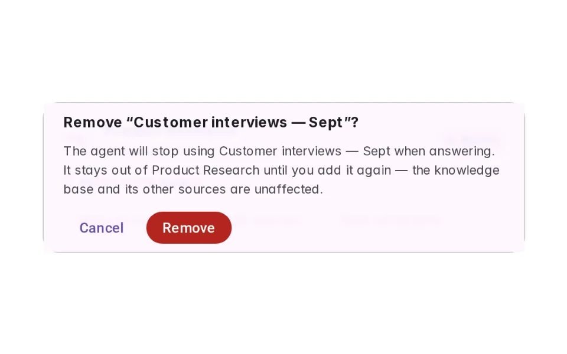

| | |
|---|---|
| Key | `confirm` |
| Trigger | Somebody pressed Remove on one source. |
| Behaviour | Names the source, says what the agent will stop doing, and says what is NOT happening — the base and its other eleven sources are untouched. Removing one source and deleting a knowledge base must never read alike. |
| Action | Remove it, or cancel |

### 12 · Inactive

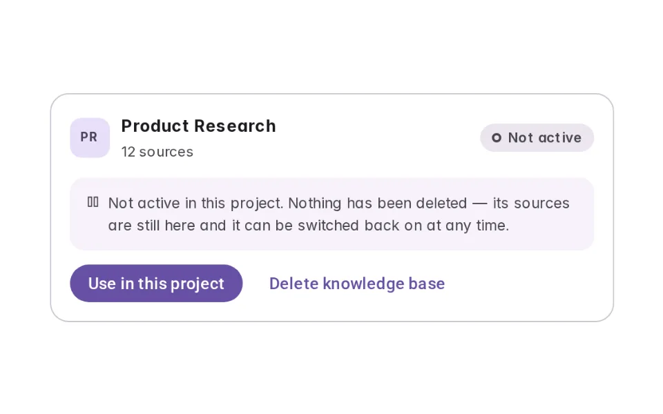

| | |
|---|---|
| Key | `inactive` |
| Trigger | The base has been switched off here. |
| Behaviour | Everything is still in it. Switching a base off, removing it from this project and destroying it are three different acts — one is a primary button, one is reversible in a press, and the third asks again before it happens. |
| Action | Use it here again, or delete it |

## Simulator

The project already has a knowledge base, and it was here before this conversation. Ask the question it was built for and watch Active become in use — then ask something it does not cover, break a source, or switch the base off, and see that all three are different things.

---

_Generated by `_build/catalog/make.js` — do not edit by hand; change the pattern and re-run._
