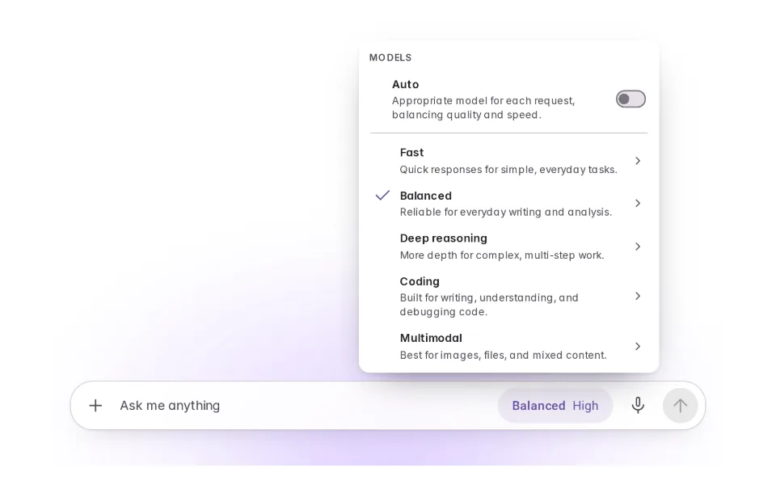
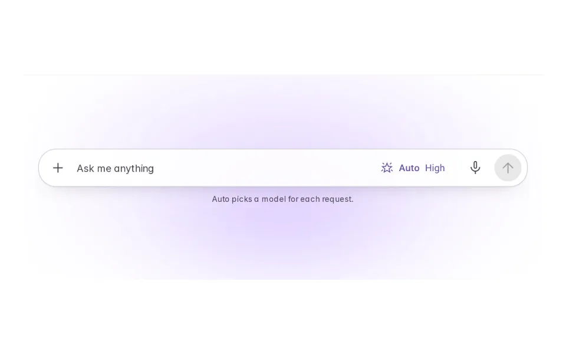
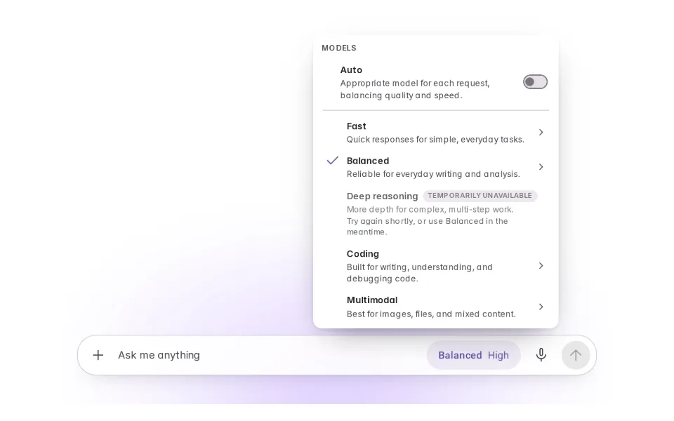
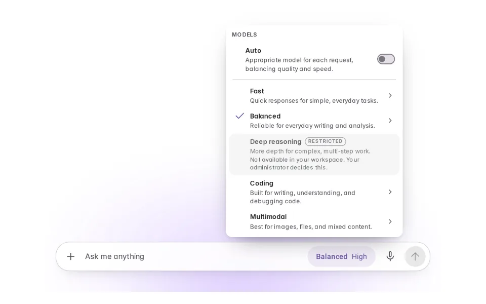
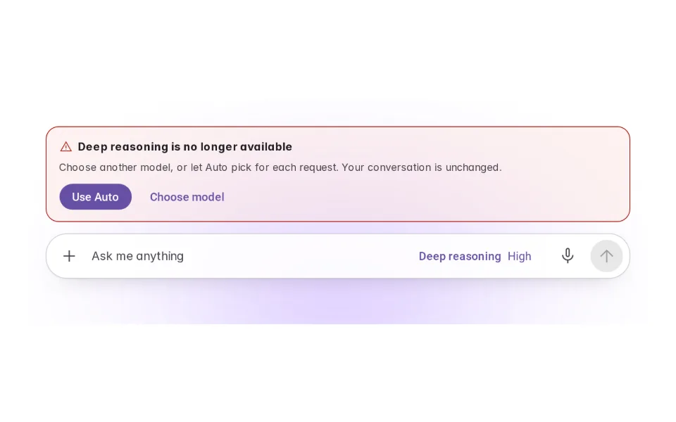

# Model Selection

**Initially › Context Expansion** · id `model-selection` · API `ModelSelector`

> Choose the capability that answers, or let the product choose per request.

Open it: [material-pattern.html?id=model-selection](../../../../material-pattern.html?id=model-selection)

## Intent

Capability as a deliberate choice — or a router that is honest about what it optimises for.

## When to use

**Use when:** Where models differ in ways a person can act on — speed, depth, what the request costs them — and where the person, not the product, owns the prompt. It belongs in professional and enterprise tools where explicit control is a requirement, and it belongs wherever somebody is choosing to wait longer for a better answer.

**Not when:** Where the product owns the prompt. If the prompt has been engineered against one model, letting people change it silently degrades a thing they cannot debug. And where routing is genuinely better than choosing, the honest move is a router that names its objective rather than a picker nobody understands. Note the cautionary history: removing a picker people have bonded to is its own failure — one major product pulled its legacy models and reversed within days.

## Where the code lives

| Part | Location |
|---|---|
| Live Preview (states, customizer, code tab) | [`material-preview.js` L8478–8942](../../../../material-preview.js#L8478-L8942) |
| Simulator | [`material-sim.js` L5374–5659](../../../../material-sim.js#L5374-L5659) |
| Docs (intent, anatomy, usage) | [`material-patterns.js` L2125–2258](../../../../material-patterns.js#L2125-L2258) |
| Pattern CSS (`.md-ml`, `.md-mle`) | [`material-pattern.html` L5980–7110](../../../../material-pattern.html#L5980-L7110) · 96 lines |
| Sidebar entry | [`material-nav.js`](../../../../material-nav.js) |
| Tests | [`ms.test.js`](../../../../_tests/suites/ms.test.js), [`mssim.test.js`](../../../../_tests/suites/mssim.test.js) |

## Nucleux packages

- `@nucleux/material`

## States (8)

### 01 · Resting _(initial)_

| | |
|---|---|
| Key | `resting` |
| Trigger | The product at rest, before anybody has chosen anything. |
| Behaviour | One small chip carrying two values: which model, and how hard to think. It is the composer's own mode slot rather than a control added beside it, and a strong default is already in it — nobody is asked to choose before their first request. |
| Action | Open it |

### 02 · Picker open

| | |
|---|---|
| Key | `open` |
| Trigger | The chip is pressed. |
| Behaviour | A list, not a catalogue. Auto sits in its own group above the models because it is a different kind of thing, every row says what it is FOR, and picking one moves the flyout on to the effort screen for that model. The prompt text is untouched throughout. |
| Action | Choose a model |

### 03 · Specific model selected

| | |
|---|---|
| Key | `selected` |
| Trigger | Somebody deliberately chose one capability. |
| Behaviour | No router mark: what runs is exactly what the chip says. This is the state Auto must never be mistaken for, because here the person has taken responsibility for the choice. |
| Action | Switch to Auto |

### 04 · Auto selected

| | |
|---|---|
| Key | `auto` |
| Trigger | The router is selected. |
| Behaviour | The switch is on, the model list has eased shut, and the chip takes a router mark. Auto says what it weighs — quality and speed — in its own line, on or off, so nobody has to switch it on to find out what it does. |
| Action | Change the model |

### 05 · Model changed

| | |
|---|---|
| Key | `changed` |
| Trigger | A different option has just been chosen. |
| Behaviour | The chip updates and one line says when it starts mattering, in the scope the host actually supports. No toast, no dialog, no success screen — and the conversation is untouched. |
| Action | See one that is down |

### 06 · Model unavailable

| | |
|---|---|
| Key | `unavailable` |
| Trigger | A model is temporarily out of service. |
| Behaviour | Listed, not selectable, and it says what to use in the meantime. Temporary, so it may come back — and no provider error text, because a status code is not a thing anybody can act on. |
| Action | See one the organisation blocks |

### 07 · Organization restricted

| | |
|---|---|
| Key | `restricted` |
| Trigger | An organisation has narrowed what may be used. |
| Behaviour | Reads differently from unavailable on purpose: somebody decided this, and no amount of waiting will change it. The recovery is a person, and it is only offered where the host genuinely has that flow. |
| Action | Lose the model you were using |

### 08 · Fallback required

| | |
|---|---|
| Key | `fallback` |
| Trigger | The model already selected can no longer be used. |
| Behaviour | The one state that interrupts, because until it is answered the chip is lying about what will happen next. Both ways out are offered — the router, or the list — and it says what is not affected, because the fear at this moment is the thread. |
| Action | Recover, either way |

## Simulator

The selector is the composer's own chip — there is no second control. Change the model and watch what the menu promises about the conversation, then let the allowance run out and see what you get instead.

---

_Generated by `_build/catalog/make.js` — do not edit by hand; change the pattern and re-run._
